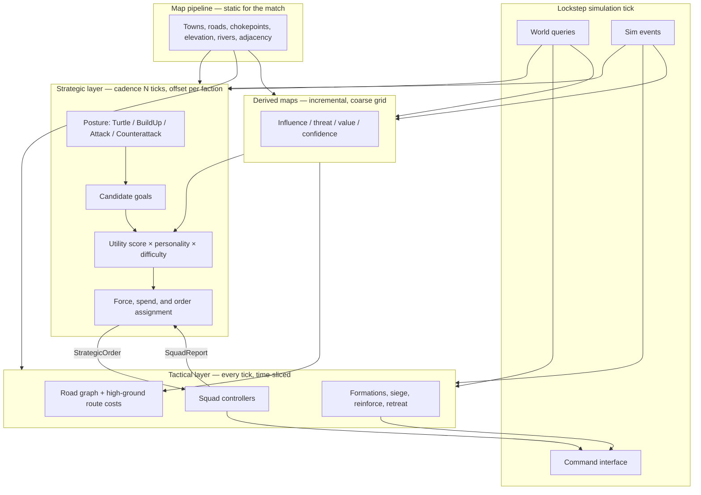

# Enemy AI Design

**Status:** Proposed  
**Audience:** Game designer, lead engineer, map pipeline engineer  
**Scope:** Single-player launch AI. Multiplayer and replays are out of scope as features, but the AI is designed so they can be added later without a rewrite.  
**Related:** Launch is PC/Steam, Unity, post-apocalyptic RTS on generated real-world maps (100×100 or 200×200 miles). Core loop: fortify held ground, then assault neighboring enemy territories.

This is the working contract for enemy AI. Numbers marked **placeholder** are starting values for the first playable; they are not balance commitments.

---

## Contents

1. [Goals and non-goals](#1-goals-and-non-goals)
2. [Architecture](#2-architecture)
3. [Reading real terrain](#3-reading-real-terrain)
4. [Determinism](#4-determinism)
5. [Difficulty](#5-difficulty)
6. [Faction personalities](#6-faction-personalities)
7. [Performance budget](#7-performance-budget)
8. [Testing and tuning](#8-testing-and-tuning)
9. [Open questions](#9-open-questions)
10. [Phased implementation plan](#10-phased-implementation-plan)

---

## 1. Goals and non-goals

Launch is single-player against AI opponents. The AI *is* the opposing side of the game. If it cannot hold towns, spend, expand, and attack in a way that reads as a faction living on the map, there is no match.

### 1.1 Launch goals

| Goal | What “good” looks like |
| --- | --- |
| Credible opponent | An AI faction claims towns, fortifies, and assaults neighbors on a cadence a player can read and counter. |
| Fair information | Default: the AI only knows what its scouts and held ground reveal. Cheating is opt-in and explicit. |
| Personality | Factions share one brain, differ by parameter profiles. A Warlord and a Settler should not play the same match. |
| Terrain literacy | The AI uses roads, chokepoints, high ground, rivers/bridges, and town value — not a Euclidean rush. |
| Deterministic sim | Same match seed + same inputs → identical AI decisions. Required for headless test, later replays, later lockstep netcode. |
| Tunable difficulty | Easy through Brutal are parameter sets, not separate AIs. |
| Budget-bound | Several AI factions on a 200×200 mile map stay inside the per-tick work budget (see §7). |

The player should be able to answer, after a loss: “they took the bridge town, cut the road, and hit me before my fortifications finished.” That is the quality bar. Opaque omniscience is a failure even if the AI wins.

### 1.2 Non-goals (launch)

- Player-vs-player, co-op, or any networked lockstep session.
- Replay file format, spectator desync UI, or checksum negotiation.
- Machine-learned policies, behavior cloning, or runtime training.
- Per-unit micro comparable to a high-level human (stutter-step, ability weaving, pixel kiting). Micro quality is a difficulty slider over squads, not units.
- Hand-authored per-map scripts, waypoints, or trigger chains. Maps come from the pipeline; the AI must generalize.
- Naval, air, or subterranean layers unless design later adds them as first-class movement graphs.
- Diplomacy, trading, or more than one relationship to the player (hostile). Neutral towns are world state, not AI actors.
- A designer-facing live tuner in the first playable. Debug overlays and JSON/ScriptableObject parameter files are enough until M5.

### 1.3 Deferred, but designed for

Replays and multiplayer need the same command stream and the same tick. That is why this doc forbids `Time.deltaTime`, dictionary iteration, physics queries, and wall-clock branching in AI decision code *now*, while launch is still offline.

---

## 2. Architecture

Two layers, one command pipe.

The **strategic layer** thinks in towns, territories, economy, and posture. It runs on a fixed cadence of simulation ticks (a few seconds of game time) and emits orders.

The **tactical layer** thinks in squads. It runs every tick (time-sliced) and turns orders into the same commands a player issues.

Neither layer moves units by writing transforms. Both go through the shared command interface (§4.3).



### 2.1 Strategic layer

**Cadence.** Default planning period is `StrategicCadenceTicks` (Normal: 40 ticks = 2.0 s at 20 Hz). Each faction’s plan tick is offset so they do not all run on the same tick:

```
planThisTick(faction) =
  (tick + factionId * FactionPlanOffsetTicks) % StrategicCadenceTicks == 0
```

`FactionPlanOffsetTicks` default is 3. Cadence stretches on Easy and tightens on Hard/Brutal (§5).

**Inputs, each plan tick.**

- Static map contract (§3.1).
- Derived maps (§3.2), last fully committed slice.
- Own economy snapshot: resources, build queues, upkeep.
- Own army snapshot: squads, strength, orders, recovery.
- Observed enemy: towns, squads, and threats inside fog-honest vision plus memory with a TTL.
- Recent `SquadReport`s since the last plan tick.

**Posture.** A faction is in exactly one posture. Posture is itself a scored choice with hysteresis so it does not chatter.

| Posture | Intent | Typical orders |
| --- | --- | --- |
| Turtle | Hold what we have. | Fortify, pull squads to threatened towns, delay expansion. |
| BuildUp | Grow economy and army. | Claim empty towns, spend on production, scout, light raids only. |
| Attack | Commit to taking a neighbor. | Primary assault + screening + cut-road raids. |
| Counterattack | Punish a push on our ground. | Intercept, retake, then re-evaluate. |

Hysteresis: a new posture must beat the current score by `PostureSwitchMarginPpt` (placeholder **150**, i.e. 15%) and stay ahead for `PostureMinHoldTicks` (placeholder **200** ticks = 10 s). Combat events (town lost, army routed) may bypass the hold timer.

**Candidate goals.** The planner does not search an open-ended action tree. It *generates* a bounded set of typed goals from the map and current state, scores them, then picks a non-conflicting subset that fits army and resource budgets.

| Goal type | Target | Generated when |
| --- | --- | --- |
| `ClaimTown` | empty / contestable town | Adjacent to held territory, or reachable via owned roads. |
| `FortifyTown` | owned town | Town value high, or threat on it above threshold. |
| `AssaultTown` | enemy town | Neighbor territory, force ratio vs estimate above personality threshold. |
| `Raid` | enemy road node or outlying town | Attack/BuildUp; cuts a supply road or delays a build. |
| `HoldChokepoint` | chokepoint id | Controls access to a valued town we own or want. |
| `ScoutRegion` | coarse-grid region | Confidence map stale; fog-honest. |
| `ExpandEconomy` | build slot / town | BuildUp or Turtle with spare income. |
| `CounterattackForce` | lost or threatened town | Posture Counterattack, or incoming threat spike. |
| `Recover` | owned rally town | Army below recovery strength after a fight. |

Hard cap: `MaxCandidateGoals` = **64** per plan tick. If generation exceeds the cap, keep the highest *heuristic pre-score* (town value × inverse distance, integer) so the utility pass stays bounded.

**Utility scoring.** Each candidate `g` gets an integer millipoint score:

```
score(g) = clamp(
    Σ_i  weight[i] * feature[i] * personalityMul[i] * difficultyMul[i]
    + postureBias[g.type, currentPosture]
    − conflictPenalty(g, alreadyPicked),
    ScoreMin, ScoreMax)
```

All terms are `int32` millipoints. Features are already in parts-per-thousand (ppt, 0–1000) or millipoints; there is no floating-point in this path.

| Feature (all ppt or millipoints) | Typical use |
| --- | --- |
| `townStrategicValue` | From pipeline, 0–1000. |
| `territoryValue` | Sum of owned/target town values in that territory. |
| `threatOnTarget` | Threat map sample at target. |
| `ownInfluenceNearTarget` | Influence map sample. |
| `forceRatioPpt` | Estimated own committed strength / estimated defenders. |
| `roadAccessPpt` | 1000 if a friendly-controlled road reaches it; less if off-graph. |
| `chokepointBonus` | Set if taking/holding it gates a high-value town. |
| `economyNeedPpt` | High when income < upkeep + planned spend. |
| `distanceCost` | Travel ticks on the road graph from nearest owned staging town. |
| `fogUncertainty` | Penalty (or scout bonus) when confidence is low. |
| `recentFailurePenalty` | Same goal type+target failed within `FailureMemoryTicks`. |

Weights live in the personality profile (§6). Difficulty scales a subset: reaction, aggression, scout weight, mistake injection (§5).

**Selection.** Greedy: sort candidates by score (stable sort, `goalId` as tie-break), then accept if:

1. Score > `MinAcceptScore` (placeholder **1000**).
2. Remaining army strength and resource budget cover `g.cost`.
3. Target is not already claimed by an accepted goal of an incompatible type (two assaults on the same town merge; assault vs fortify on the same town conflict).

Cap accepted goals at `MaxActiveOrders` = **12** per faction. Drop the rest. Idle leftover strength is assigned to `Hold` on the highest-threat owned town (implicit, not a generated candidate).

**Spending.** Economy is a goal type, not a free-form script. On a plan tick the faction has a spend envelope:

```
spendable = currentResources - ReservePpt * netIncomePerCadence / 1000
```

`ReservePpt` is a personality field. Spend priority within the envelope: (1) repairs / fortify on threatened high-value towns, (2) unit production to reach `TargetArmyStrength`, (3) expansion buildings, (4) scouts. Exact building IDs are a designer fill-in; the AI only needs a tagged catalog: `Production`, `Fortification`, `Economy`, `Intel`.

### 2.2 Tactical layer

The tactical layer owns **squads**. A squad is the smallest AI-controlled force: a stable id, a composition snapshot, a formation, an assigned `OrderId` (or idle), and a route.

Player-visible “armies” may be one or many squads. The strategic layer assigns *orders to squads*, not to individual units.

**Squad controller, every tick it is scheduled.**

1. Apply incoming order (new, updated, or cancel).
2. Refresh route if the order target, threat on the current path, or a blocked edge changed.
3. Choose formation from movement context.
4. Issue commands: move, attack-move, hold, siege stance, retreat.
5. Evaluate reinforce / retreat rules.
6. Emit a report if status, objective, or intel changed.

**Route choice.** Operational movement is A\* on the **road graph**, not the unit mesh.

Edge cost (integer):

```
cost(e) =
    e.travelCost
  + ThreatWeight * sampleThreat(e)
  + SlopeWeight * e.slopeCost
  − HighGroundWeight * e.highGroundBonus   // attacking only
  + EnemyControlPenalty * e.controlRisk
```

Weights come from personality + current order type (a raid pays more to avoid threat; an assault pays more for high ground on the approach). If the road graph cannot reach the target, fall back to a coarse-grid corridor (same 1-mile cells as influence) and rejoin the road graph at the nearest node. Last-mile movement inside a town cell is a short tactical path on a local integer grid provided by sim, not Unity NavMesh.

**Formations.**

| Context | Formation | Rule |
| --- | --- | --- |
| Road travel | Column | Width class of the edge; do not spill off-road on bridges. |
| Open approach | Line / wedge | Facing the objective; use high-ground cells if adjacent. |
| Chokepoint hold | Compact | Occupy the node and the two nearest cover cells. |
| Siege ring | Loose ring | Cover owned-road exits of the town; do not stack on one tile. |
| Retreat | Column | Fastest safe road; ignore high-ground bonus. |

Formation is a squad stance command, not per-unit steering. Unit-level spacing is the sim’s formation follower, shared with the player.

**Sieging a fortified town.** An `AssaultTown` order has three tactical phases. The squad does not skip ahead unless the town is unfortified (pipeline/sim flag `fortificationLevel == 0`).

| Phase | Entry | Behavior | Exit |
| --- | --- | --- | --- |
| Approach | Order assigned | Road route to staging node(s) outside defensive range. | Staging node reached, or aborted. |
| Invest | Force ratio ≥ `SiegeInvestRatioPpt` | Cut road edges listed on the town; hold those nodes; do not suicide into walls. | Roads cut **or** timer `MaxInvestTicks` elapsed **or** ratio fell below `SiegeAbortRatioPpt`. |
| Assault | Ratio ≥ `SiegeAssaultRatioPpt` and (roads cut or invest timed out) | Attack-move onto the town interior / designated assault cells. | Town captured, squad broken, or retreat rule fires. |

If ratio never reaches invest, the squad holds at staging and reports `WaitingOnForce`. Strategy may send another squad (reinforce) or cancel.

**Reinforcement.** A squad reports `NeedReinforce` when `strengthPpt < ReinforceBelowPpt` (placeholder **600**) while the order is still active and not retreating. Strategy, on the next plan tick (or immediately on the `SquadNeedReinforce` event if the event is processed same-tick — it must be: events are queued and consumed in id order before tactical update), assigns the nearest idle squad whose travel ticks ≤ `ReinforceMaxTravelTicks`. Tactical never steals a squad off a higher-priority order.

**Retreat.** Evaluated every scheduled tactical tick, integer prediction only:

```
predictedOutcomePpt = ownStrengthPpt * terrainDefenseMul / max(1, enemyStrengthPpt)
```

Retreat if `predictedOutcomePpt < RetreatThresholdPpt` **and** the order is not `HoldChokepoint` with `lastStand` (Turtle on a high-value town may set this). `RetreatThresholdPpt` is personality × difficulty. Destination: nearest owned town with remaining garrison capacity, via lowest-threat road path. Broken squads (`strengthPpt < BrokenPpt`, placeholder **150**) auto-retreat regardless of order, then `Recover`.

### 2.3 Orders down, reports up

Orders and reports are sim data, serialized the same way player commands are. They are not Unity events.

**`StrategicOrder`**

| Field | Type | Notes |
| --- | --- | --- |
| `orderId` | `int32` | Monotonic per faction. |
| `factionId` | `int32` | |
| `type` | `enum` | Mirrors goal type. |
| `targetKind` | `enum` | `Town`, `Territory`, `RoadNode`, `Chokepoint`, `Region`, `None`. |
| `targetId` | `int32` | Id in that space; 0 if none. |
| `stagingNodeId` | `int32` | Optional road node. |
| `squadIds` | `int32[]` | Sorted ascending. |
| `priority` | `int16` | Higher wins conflicts. |
| `resourceBudget` | `int32` | Spent via economy commands; 0 if N/A. |
| `issuedTick` | `int32` | |
| `expiresTick` | `int32` | Hard cancel if still incomplete. |
| `flags` | `uint32` | bit0 `lastStand`, bit1 `raidAvoidSiege`, … |

**`SquadReport`**

| Field | Type | Notes |
| --- | --- | --- |
| `squadId` | `int32` | |
| `orderId` | `int32` | 0 if idle. |
| `status` | `enum` | `Idle`, `Moving`, `Staging`, `Investing`, `Assaulting`, `Holding`, `Retreating`, `Broken`, `WaitingOnForce`. |
| `strengthPpt` | `int16` | 0–1000. |
| `positionCm` | `int32 x, y` | Squad centroid, centimeters. |
| `nodeId` | `int32` | Nearest road node. |
| `lastCombatTick` | `int32` | 0 if none. |
| `intelCount` | `int8` | 0–8. |
| `intel` | `IntelContact[8]` | Enemy squad/town glimpses; only what this squad currently sees. |
| `failReason` | `enum` | `None`, `PathUnreachable`, `ForceTooWeak`, `TargetLost`, `Expired`, `Cancelled`. |

**Flow.**

1. Strategy writes orders into the faction’s order table (sim state).
2. Assigned squads observe the table the next time they are scheduled (usually the same tick, after strategy, if this faction’s tactical slice runs later in the tick; otherwise next slice — see §7.2). Same-tick vs next-slice is a *fixed* schedule, not a race.
3. Tactical issues player-identical commands with `commandDelayTicks` (shared with the player, plus difficulty reaction extra).
4. Reports are appended to a per-faction ring buffer, consumed on the next plan tick and on listed events (`TownCaptured`, `SquadBroken`, `SquadNeedReinforce`).

The player never sees `StrategicOrder` / `SquadReport`. They see units move and towns change hands.

---

## 3. Reading real terrain

Maps are not handmade. The AI cannot be given designer ink. It needs a **stable, integer, match-static contract** from the map pipeline, plus **derived maps** it maintains itself.

### 3.1 Map pipeline contract (match-static)

Pipeline bakes one blob (or a small set of blobs) that the sim loads at match start. The AI reads it read-only. If a field cannot be produced yet, the pipeline still reserves the field and fills a documented default so the AI does not branch on “data missing.”

Ids are dense `int32` starting at 1. Arrays that the AI iterates are stored pre-sorted by id.

#### Towns

```
TownRecord
  id                    int32
  positionCm            int32 x, y          // world centimeters
  territoryId           int32
  nameHash              int32               // debug only; not used in decisions
  populationClass       int8                // 0..4
  strategicValue        int16               // 0..1000, pipeline-authored
  supplyCapacity        int32               // abstract supply units
  fortificationSlots    int8
  defaultFortification  int8                // 0 = open town
  roadNodeId            int32               // gate / center node on the road graph
  neighborTownIds       int32[]             // sorted; towns sharing a road or territory edge
```

`strategicValue` is the pipeline’s opinion (population, road degree, chokepoint proximity). The AI may add situational value; it does not replace this field.

#### Territories

```
TerritoryRecord
  id                    int32
  townIds               int32[]             // sorted
  neighborTerritoryIds  int32[]             // sorted, adjacency for the core loop
  areaSqM               int32               // square meters, integer
  resourceYield         int32               // placeholder economy units per cadence
  centroidCm            int32 x, y
```

Adjacency is the assault graph: you assault a neighbor, not a territory two hops away, unless a later design change says otherwise. The AI will still *raid* through a neighbor into a deeper road node if the road graph allows.

#### Road graph

```
RoadNode
  id                    int32
  positionCm            int32 x, y
  elevationCm           int32
  kind                  int8                // 0 Junction, 1 TownGate, 2 Bridge, 3 Chokepoint, 4 Way
  chokepointId          int32               // 0 if none

RoadEdge
  id                    int32
  a, b                  int32               // node ids, a < b
  lengthCm              int32
  travelCost            int32               // length × surface × slope, integer
  slopeCost             int32               // extra cost from grade
  highGroundBonus       int32               // for the endpoint with higher elevation
  widthClass            int8                // 0 trail .. 3 highway; formation width
  surface               int8                // 0 dirt, 1 paved, 2 wrecked, 3 impassable
  isBridge              bool
  controlTownId         int32               // town whose owner is treated as controlling this edge; 0 if none
```

Pathfinding uses `travelCost`, never raw meters alone. Impassable edges stay in the blob with `surface = 3` so debug tools can still draw them; the AI skips them.

#### Chokepoints

```
ChokepointRecord
  id                    int32
  roadNodeId            int32
  widthCm               int32
  defensibility         int16               // 0..1000
  gatesTerritoryIds     int32[]             // sorted; territories this point controls access to
  relatedTownId         int32               // 0 if none
```

How the pipeline detects a chokepoint is its problem (narrow road corridor, river crossing, mountain pass). The AI only consumes `defensibility` and `gatesTerritoryIds`.

#### Elevation and slope (coarse)

Same resolution as the AI grid (§3.2): **1 mile** cells, origin at map min corner, row-major, `index = y * widthCells + x`.

```
ElevationCell
  elevationCm           int32               // representative (mean or centroid sample)
  slopePpt              int16               // rise/run × 1000, 0..1000+
  class                 int8                // 0 Flat, 1 Gentle, 2 Steep, 3 Impassable
```

This is **not** a render heightmap. Unit collision and local cover stay in the sim. The AI uses this grid for influence, approach bonuses, and coarse corridors.

#### Rivers and bridges

```
RiverSegment
  id                    int32
  polylineCm            int32[]             // x,y pairs, simplified
  blocksLand            bool                // true: land path must use a bridge

BridgeRecord
  id                    int32
  roadNodeId            int32
  riverId               int32
  widthClass            int8
```

If `blocksLand` is true, tactical pathing may not cross that polyline except at a `BridgeRecord`.

#### Header

```
MapAiHeader
  schemaVersion         int32               // this doc: 1
  mapWidthCm            int32
  mapHeightCm           int32
  cellSizeCm            int32               // must be 160934 (1 mile) unless versioned
  gridWidth             int32
  gridHeight            int32
  townCount             int32
  territoryCount        int32
  roadNodeCount         int32
  roadEdgeCount         int32
  chokepointCount       int32
  riverCount            int32
  bridgeCount           int32
```

`cellSizeCm` is part of the contract so a later 800 m grid is a version bump, not a silent change.

### 3.2 AI-derived maps

Per faction, on the same coarse grid:

| Layer | Cell payload | Meaning |
| --- | --- | --- |
| Influence | `int16` | Own friendly presence, decayed. |
| Threat | `int16` | Observed hostile presence, decayed. |
| Value | `int16` | Situational prize: town value, economy, chokepoints, current goals. |
| Confidence | `int16` | Fog honesty: 1000 = currently seen, decays to 0. |

Enemy-owned cells the faction cannot see do not write into Threat as truth; they write into **memory** at last-seen strength and decay with `MemoryDecayPerCadence`. Easy decays faster than Brutal.

**Stamps (integer, saturating).**

- Friendly squad at cell: add `squad.strengthPpt * InfluenceStampMul / 1000`, then spread Chebyshev radius `InfluenceRadiusCells` (placeholder **2**) with linear falloff in ppt.
- Observed enemy squad: same into Threat.
- Owned town: add `town.strategicValue` into Value, plus `fortificationLevel * FortValueMul`.
- Pipeline chokepoint: add `defensibility` into Value if we own or contest a gated territory.

**Incremental update.** Full-grid rebuilds are forbidden on 200×200 (40,000 cells × 4 layers × N factions).

Each sim event dirties an AABB in cell space:

| Event | Dirty region |
| --- | --- |
| Squad moved to a new cell | Old cell ∪ new cell, expanded by `InfluenceRadiusCells` |
| Combat start/end | Combat cell + radius |
| Town owner / fortification change | Town cell + `TownDirtyRadius` (placeholder **3**) |
| Vision gained/lost | The vision delta cells (sim supplies the set, sorted) |

Each tick, a faction processes at most `MaxDirtyCellsPerTick` (placeholder **512**) from its dirty queue (queue is a sorted set of cell indices, drained in index order). Overflow remains queued; it is not dropped. A low-frequency **full reconcile** runs on a deterministic schedule: `tick % ReconcilePeriodTicks == factionId` with `ReconcilePeriodTicks` = **2400** (120 s at 20 Hz), rebuilding from stamps rather than from the decaying field, to bound drift.

Value map additionally refreshes on plan ticks for cells that overlap active order targets (cheap: a few dozen cells).

### 3.3 What the AI must not read from the map

- Render meshes, terrain colliders, Unity NavMesh, camera, or scene hierarchy.
- Player-only markers, unrevealed resource nodes outside fog rules, or debug gizmos.
- Floating-point GIS source data. If the pipeline still has doubles internally, it quantizes to this contract before the match starts.

---

## 4. Determinism

All AI logic runs inside the lockstep **simulation tick**. Presentation, animation, audio, and UI may not feed a single bit back into AI.

If this section conflicts with a convenience in Unity, this section wins.

### 4.1 Hard rules

| Rule | Requirement |
| --- | --- |
| Tick-only | AI runs in `SimTick(tick)`, never in `Update` / `FixedUpdate` / jobs that read presentation. |
| No wall-clock | No `DateTime`, `Stopwatch`, `Time.realtimeSinceStartup`, frame index, or “we’re running late so skip.” |
| No `Time.deltaTime` | Time is `tick` and `tick * TickDurationMs` (constant). |
| No Unity physics | No `Raycast`, `Overlap`, `NavMesh.CalculatePath`, `Rigidbody` reads. Sim provides integer queries. |
| Integer math | Decision code uses `int8`/`int16`/`int32`/`int64` only. No `float`/`double`/`Vector3` in scoring, path cost, or PRNG. |
| Seeded PRNG | Per-faction streams; never `UnityEngine.Random` or `System.Random` without an explicit sim seed. |
| Stable iteration | No `foreach` on `Dictionary` / `HashSet`. Iterate arrays, or copy keys and sort by id. |
| Time-slicing | Expensive work is sliced on a schedule that is a pure function of `tick` and `factionId` (§7.2). A slice that hits the work cap **defers** remainder; it does not “do less because the frame was heavy.” |
| Commands | AI issues orders through the **same command interface** as the player, including command delay. |
| Fog | World queries that return hidden entities must return “unknown,” not the truth, unless a difficulty flag explicitly enables a named cheat (§5). |

Fixed-point (`Q16.16`) is acceptable if the core sim standardizes on it. This doc’s default is **integer centimeters + parts-per-thousand** so that scoring stays obvious in debug dumps. Pick one match-wide; do not mix.

### 4.2 PRNG

```
matchSeed        : uint64     // from match setup
factionStream    : uint64     = hash64(matchSeed, factionId, STREAM_AI_ROOT)
strategyRng      : stream     = hash64(factionStream, STREAM_STRATEGY)
tacticalRng      : stream     = hash64(factionStream, STREAM_TACTICAL)
mistakeRng       : stream     = hash64(factionStream, STREAM_MISTAKE)
scoutRng         : stream     = hash64(factionStream, STREAM_SCOUT)
```

Use a deterministic generator with a small, portable state (recommendation: PCG32 or xoshiro128++, integer output only). `hash64` must be specified in code as a named function with a golden test.

Draws happen at defined points (goal tie-break jitter, mistake rolls, scout target among equals). Do not draw “to make the path look organic” on visual-only systems from these streams.

### 4.3 Simulation hooks the AI needs

These are the seams for the lead engineer to accept, rename, or reject. Names are proposed. All queries are **pure reads** of sim state as of the start of the current tick (plus events already applied this tick, in documented order).

#### World queries (fog-filtered unless noted)

| Hook | Returns | Fog |
| --- | --- | --- |
| `GetTown(id)` | `TownState` (owner, fortification, garrison ppt, capture progress) | Owner of a never-seen town is `Unknown` |
| `GetTerritory(id)` | Owner, contested flag | Same |
| `GetSquad(id)` | Position, strength, status, order | Own: always. Enemy: only if currently visible |
| `EnumerateOwnSquads(factionId)` | Sorted ids | Own |
| `EnumerateVisibleEnemySquads(factionId)` | Sorted ids | Visible only |
| `GetEconomy(factionId)` | Resources, income, upkeep, queues | Own only |
| `GetBuildCatalog()` | Tagged buildings (static) | Public |
| `CanIssue(command)` | `bool` + reject reason | Legality as player |
| `GetVisionDelta(factionId)` | Sorted cell indices gained/lost this tick | Own |
| `SampleElevation(cell)` | `ElevationCell` | Static, public |
| `GetRoadGraph()` | Read-only view of pipeline blob | Static, public |
| `PathOnRoads(fromNode, toNode, costWeights)` | Node list + total cost **or** unreachable | Static graph; weights may include fog-filtered threat samples |
| `EstimateTravelTicks(from, to, costWeights)` | `int32` | Same |
| `GetChokepoints()` | Read-only | Static, public |
| `GetAdjacency(territoryId)` | Neighbor ids | Static, public |
| `HashWorldSlice(factionId)` | `uint64` for tests | Own known state |

`PathOnRoads` is a sim service, not an AI-private cache of floats. Both player UI path preview and AI must be able to call it; only AI is required to at launch.

#### Commands (same types as the player)

| Command | Payload (conceptual) |
| --- | --- |
| `CmdMove` | squadId, nodeId or positionCm, formation |
| `CmdAttackMove` | squadId, targetId or cell |
| `CmdHold` | squadId, nodeId |
| `CmdSetStance` | squadId, stance (siege invest, assault, retreat, last stand) |
| `CmdProduce` | buildingId, unitType, count |
| `CmdBuild` | catalogId, townId or cell |
| `CmdFortify` | townId |
| `CmdClaimTown` | townId (if claiming is an explicit action) |
| `CmdCancel` | commandId or production slot |

Every command carries `issuedTick`, `issuer` (`Player` or `AiFactionId`), and is subject to `commandDelayTicks`. Illegal commands are rejected with a reason; the AI must handle reject (report `failReason`), not retry in a tight loop.

#### Events (consumed in `eventId` order)

| Event | Why the AI cares |
| --- | --- |
| `TownOwnerChanged` | Dirty value map; interrupt plans; Counterattack. |
| `TownFortificationChanged` | Siege phase and spend. |
| `SquadSpotted` / `SquadLostSight` | Threat + confidence. |
| `SquadBroken` / `SquadDestroyed` | Force allocation, Recover. |
| `SquadNeedReinforce` | Same-tick or next-slice reinforce (§2.2). |
| `CombatStarted` / `CombatEnded` | Dirty threat; retreat checks. |
| `CommandRejected` | Order failure path. |
| `ProductionCompleted` | Strength available. |
| `MatchEnded` | Stop scheduling work. |

Event payloads include ids and ticks only, no floats.

#### Lifecycle

| Hook | When |
| --- | --- |
| `AiMatchInit(matchSeed, mapBlob, factionIds, difficulty, personalityId)` | Once, before tick 0. |
| `AiOnTick(tick)` | Every sim tick, after world step, before command dispatch for `tick + delay`. |
| `AiMatchShutdown()` | Tests / teardown. |

`AiOnTick` must be a single deterministic call stack. No async, no threads that write sim state. Worker threads are allowed later **only** if they compute a pure function of a copied snapshot and the write-back is applied in id order on the sim thread — not needed for launch; do not start there.

---

## 5. Difficulty

Four levels. One brain. Parameter sets only.

Default **honesty:** no extra vision, no hidden resource income, no extra build speed. If Brutal (or a future difficulty) grants a material bonus, it is a named field in this table and must appear in the player-facing description.

| Parameter | Easy | Normal | Hard | Brutal |
| --- | --- | --- | --- | --- |
| `ReactionExtraTicks` | 30 (1.5 s) | 12 (0.6 s) | 4 (0.2 s) | 0 |
| `StrategicCadenceTicks` | 80 (4.0 s) | 40 (2.0 s) | 24 (1.2 s) | 16 (0.8 s) |
| `AggressionMulPpt` | 700 | 1000 | 1200 | 1400 |
| `ScoutCadenceTicks` | 160 | 80 | 48 | 32 |
| `FogCheat` | none | none | none | none |
| `MemoryDecayPerCadencePpt` | 250 | 120 | 80 | 40 |
| `EconomyBonusPpt` | 0 | 0 | 0 | **100 (explicit)** |
| `BuildSpeedBonusPpt` | 0 | 0 | 0 | 0 |
| `VisionRadiusBonusCm` | 0 | 0 | 0 | 0 |
| `MicroQuality` | 0 | 1 | 2 | 3 |
| `MistakeRatePpt` | 220 | 80 | 30 | 10 |
| `RetreatThresholdMulPpt` | 1200 | 1000 | 850 | 750 |
| `MaxActiveOrders` | 6 | 12 | 12 | 16 |
| `MaxCandidateGoals` | 32 | 64 | 64 | 64 |

All values **placeholder**.

### 5.1 What the knobs mean

**Reaction extra ticks.** Added to the shared player `commandDelayTicks` for AI-issued commands only. Easy is visibly sluggish; Brutal matches the player’s delay.

**Planning cadence.** How often posture and goals refresh. Slow cadence is a weaker opponent, not a performance cheat: Easy still uses the same time-slice budget.

**Aggression.** Multiplies `AssaultTown`, `Raid`, and Attack-posture bias. Does not grant units.

**Scouting and fog.** Higher difficulties scout more often and forget slower. They do **not** see through fog. `FogCheat` remains `none` at all four levels on purpose. A later “unfair Brutal” would set `FogCheat = RevealedThreatWithinRadius` (or similar) as a new named mode — not a silent branch.

**Economy bonus.** Brutal’s **+10% income** (`EconomyBonusPpt = 100`) is the only resource cheat at launch. It must be surfaced in the difficulty blurb. Hard is intended to win by better cadence, memory, and fewer mistakes — not by free money.

**Micro quality (0–3).** Controls how much tactical work a squad does, still at squad granularity:

| Level | Behavior |
| --- | --- |
| 0 | Attack-move, hold, retreat. No invest phase: assaults go in. Formations stay column. |
| 1 | Formations + invest/assault phases. |
| 2 | Re-routes when threat on the path rises by `RerouteThreatDelta`. Uses high-ground bonus. |
| 3 | Same as 2, plus earlier reinforce requests and tighter stagger of raid vs main assault (still integer timers). |

There is no per-unit micro layer at launch.

**Mistake rate.** Each plan tick, `mistakeRng` draws `d ∈ [0, 999]`. If `d < MistakeRatePpt`:

- With 50% (next bit): swap the top-scoring candidate with the 2nd or 3rd (if present) before selection.
- Else: delay this faction’s tactical slice by one extra scheduled slot (still deterministic: skip this slice, run a catch-up slot that is already in the schedule table — do not use wall-clock).

Retreat mistakes: if `d2 < MistakeRatePpt / 2`, Easy/Normal may ignore a single retreat check (the squad rolls again next tactical tick). Brutal almost never does.

---

## 6. Faction personalities

Personality is a **parameter profile** layered on the same core. It is not a second AI. Design will replace the three examples when faction identities exist. Until then, treat every value here as **placeholder**.

Shared fields (all ppt unless noted):

| Field | Role |
| --- | --- |
| `weightTownValue` | Scoring towns |
| `weightThreat` | Reacting to threat map |
| `weightForceRatio` | Patience before assault |
| `weightEconomy` | ExpandEconomy vs army |
| `weightChokepoint` | Hold/take gates |
| `weightDistance` | Preference for nearby goals (higher = more local) |
| `aggressionBias` | Attack posture, raids |
| `turtleBias` | Fortify, Hold, last stand |
| `raidBias` | Raid goals vs full assault |
| `scoutBias` | ScoutRegion weight |
| `ReservePpt` | Unspent resource floor |
| `SiegeInvestRatioPpt` | Min force ratio to invest |
| `SiegeAssaultRatioPpt` | Min force ratio to assault |
| `RetreatThresholdPpt` | Base retreat (before difficulty mul) |
| `PostureSwitchMarginPpt` | Hysteresis |

### 6.1 Example archetypes (placeholders)

| Field | A. Warlord | B. Settler | C. Raider |
| --- | --- | --- | --- |
| Intent | Take towns, keep pressure | Grow, wall up, expand slowly | Disrupt roads, avoid sieges |
| `weightTownValue` | 1200 | 1000 | 700 |
| `weightThreat` | 800 | 1300 | 900 |
| `weightForceRatio` | 700 | 1400 | 1000 |
| `weightEconomy` | 600 | 1400 | 500 |
| `weightChokepoint` | 1100 | 1200 | 800 |
| `weightDistance` | 800 | 1100 | 600 |
| `aggressionBias` | 1400 | 700 | 1300 |
| `turtleBias` | 600 | 1400 | 500 |
| `raidBias` | 800 | 400 | 1600 |
| `scoutBias` | 900 | 800 | 1400 |
| `ReservePpt` | 100 | 250 | 80 |
| `SiegeInvestRatioPpt` | 1100 | 1600 | 1400 |
| `SiegeAssaultRatioPpt` | 1300 | 1800 | 1600 |
| `RetreatThresholdPpt` | 350 | 500 | 450 |
| `PostureSwitchMarginPpt` | 100 | 200 | 80 |
| Default posture at match start | BuildUp → Attack | Turtle → BuildUp | BuildUp with raids |

**Warlord** should be the first playable opponent: readable attacks on the highest-value neighbor town.

**Settler** should feel late-game dangerous if the player idles: dense forts, slow border crawl.

**Raider** should make roads and bridges matter: cut supply, refuse fair sieges (`flags.raidAvoidSiege`), take a town only when it is open or already broken.

When design names real factions, keep this table’s *columns* (the schema). Replace the labels and values; do not fork the planner.

---

## 7. Performance budget

Target hardware: the Steam playable spec (TBD by engineering). Until that spec exists, budget as if **several AI factions** (placeholder **6 AI + 1 player**) on a **200×200 mile** map at **20 Hz** sim (50 ms/tick).

### 7.1 Budget

| Item | Budget |
| --- | --- |
| Sim tick wall time, all systems | 8 ms average on target CPU (headroom for render on the main thread if Unity is not fully decoupled yet) |
| **All AI factions combined** | **1.5 ms average** per tick, **2.5 ms** rare spike |
| Deterministic work cap | `AiWorkUnitsPerTick` = **50,000** (placeholder; 1 unit ≈ 1 coarse cell update or equivalent) |
| Coarse grid | 200 × 200 = **40,000** cells; 100 × 100 = 10,000 |
| Squads per AI faction | Soft cap **48**; excess merge into existing squads |
| Active orders per AI faction | `MaxActiveOrders` (difficulty) |
| Road graph | Assume ≤ **8,000** nodes / **12,000** edges on 200×200; if the pipeline exceeds this, it must LOD the graph |

The work cap is the **real** constraint. Wall-clock milliseconds are a ship gate measured in headless benches; they must not change AI behavior when the machine is slow.

### 7.2 Time-slicing schedule

A tick’s AI phase is a pure function of `tick`:

```
phase = tick % 8

0: influence/threat/confidence dirty drain — factions 0,1
1: influence/threat/confidence dirty drain — factions 2,3
2: influence/threat/confidence dirty drain — factions 4,5
3: tactical squads — factions whose id % 3 == 0
4: tactical squads — factions whose id % 3 == 1
5: tactical squads — factions whose id % 3 == 2
6: strategic plan — at most one faction (see below); leftover units go to overflow dirty drain
7: path requests / route refreshes queued by tactical (cap PathRequestsPerTick)
```

Strategic plans already fire only when `planThisTick(faction)` is true. If two factions collide on phase 6, run the lower `factionId` this tick and the next the following tick (deterministic defer). Never run two full strategic plans in one tick on 200×200.

Each subsystem stops when `workUnits` hits the cap and resumes at the next assigned slot, iterating from the **next id** (cell index, squad id, candidate index), which is stored in sim state.

**Path requests.** A\* on the road graph is the expensive unpredictable item. Cap `PathRequestsPerTick` = **8** match-wide. Squads keep their last path until the new one commits. Unreachable results are cached per `(from, to, weightKey, graphVersion)` until `graphVersion` changes (town control of edges).

### 7.3 What we will not do for speed

- Drop a faction’s plan because the frame was slow.
- Use a coarser grid on low settings (that would desync later replays / MP).
- Sample Unity profiler counters to change AI.

Quality settings may disable **debug overlays**. They may not change `AiWorkUnitsPerTick` or the schedule.

---

## 8. Testing and tuning

### 8.1 Headless AI-vs-AI

A playerless sim target (`wasteland-rts.Sim.Headless` or equivalent) loads a baked map blob, N AI factions, a seed, a tick limit, and writes:

- Per-town owner over time
- Per-faction resource and army strength
- Final score / winner
- `HashWorld` every `HashPeriodTicks` (placeholder **200**)

Use this as the daily soak: overnight 1,000 matches across seeds × difficulty × personality. Fail the soak on crash, deadlock, or hash mismatch — not on “AI played poorly.”

Poor play is a dashboard: win rate vs a baseline personality, time-to-first-town, siege success rate, idle-squad fraction. Design reads the dashboard; engineering owns the harness.

### 8.2 Determinism check

```
run A: seed S, inputs I, ticks T → hashes H[]
run B: seed S, inputs I, ticks T → hashes H[]
assert H identical
```

Inputs `I` for AI-vs-AI are empty (no player commands). Later, a recorded player command stream becomes the replay test.

**Must-fail tests (once the harness exists):**

- Iterating a `HashSet` of squad ids in hash order (guardrail: a debug build shuffles hash seeds — if anyone slipped a forbidden iterate, hashes diverge).
- Using `float` in a scoring function (CI: analzyer or a unit test that the scorer is integer-only).
- Wall-clock slice: force the thread to sleep in a test double of the host; hashes must not change.

Hash includes: town owners, resources, squad positions (cm), order tables, PRNG states, derived-map cell values. It does not include Unity transforms or debug names.

### 8.3 Debug visualizations

Editor / development build only. Overlay is presentation; it reads a **copy** of sim debug buffers filled during the tick.

| Overlay | Shows |
| --- | --- |
| Influence | Per-faction heat on the coarse grid |
| Threat | Same |
| Value | Same |
| Confidence | Fog memory |
| Goals | Current accepted orders: type, target, score, assigned squads |
| Posture | Faction label + posture + time in posture |
| Routes | Road-graph polylines for active squads |
| Dirty AABBs | This-tick influence dirty rects |
| Work | Work units spent vs cap, per phase |

Toggle per faction. Clicking a town shows the last candidate scores that involved it (ring buffer of the last plan tick). This is the primary tuning tool; do not wait for a full designer debugger.

---

## 9. Open questions

### 9.1 Game designer

1. What are the real faction identities, and which of Warlord / Settler / Raider (or mixes) should they map to?
2. What is a **town capture**? Instant flag, timed control, civilian loyalty, destruction vs occupation?
3. Does holding a majority of towns in a territory auto-claim the territory, or is territory a separate action?
4. Win / loss: last faction standing, territory percentage, timed score, or player-only story beats?
5. Economy: resource types, whether roads carry supply, and whether a cut road starves a town. The siege “invest” phase assumes cut roads *mean* something.
6. Fog of war: unit vision only, town vision radius, scouts as units vs abstract intel?
7. Neutral towns: empty at start, NPC garrison, or hazards? Can two AIs race an empty town?
8. Player-facing Brutal: is +10% income acceptable, or must Brutal stay 0% cheat and win on skill knobs only?
9. Should Easy **telegraph** attacks (longer staging, fewer raids) beyond the numbers in §5?
10. Army composition: one squad type or roles (garrison, field, raid, siege) that strategy must request by tag?

### 9.2 Lead engineer

1. Confirm sim tick rate (this doc assumes **20 Hz**) and `commandDelayTicks` shared with the player.
2. Confirm integer convention: centimeters + ppt vs a shared `Fixed` type.
3. Who owns road A\*: a sim `PathOnRoads` service (proposed) or an AI module reading a readonly graph? Preference is sim-owned so player UI can share it.
4. Command interface: is there already a player command queue to plug into, or does this doc define the first one?
5. Entity model: are squads first-class sim objects, or aggregations of units the AI must not micromanage?
6. Threading: Unity main thread vs a dedicated sim thread? AI must sit on the sim thread either way.
7. Serialization of map AI blob: custom binary, MessagePack, ScriptableObject? Needs deterministic load (no hash-set rebuild).
8. Hash function for `HashWorldSlice` and PRNG `hash64` — pick one library and golden-test it.
9. Headless target: can we run the sim without a GameObject scene in CI?
10. Budget: is 1.5 ms AI / 8 ms sim on target CPU realistic once terrain streaming exists, or should AI’s wall-clock gate wait until a vertical slice exists?

### 9.3 Map pipeline engineer

1. Can chokepoints be extracted reliably from OSM/terrain (narrow corridors, passes, river crossings), and what is the false-positive rate we should tolerate?
2. `strategicValue` 0–1000: which inputs (population, road degree, land cover, named places)? Who signs off on the formula?
3. Road graph LOD: how do we stay under ~8k nodes on 200×200 — contract residential graphs, keep highways + connectors + town gates?
4. Elevation cell: mean, median, or centroid sample? Slope: which DEM, which quantization?
5. Rivers: which features `blocksLand`? Seasonal washes? Canals?
6. Territory boundaries: administrative (counties) vs generated watershed/road partitions? Adjacency must match what the player sees painted on the map.
7. Schema versioning and golden maps: we need 2–3 frozen blobs (100×100 and 200×200) for AI soak tests that do not churn daily.
8. Are town `neighborTownIds` road-neighbors, territory-neighbors, or both? This doc wants an explicit list, not inferred at runtime, to keep iteration stable.
9. Destroyed / wrecked roads (`surface = 2/3`): are they static from the pipeline or mutatable in-match? If mutatable, `graphVersion` must bump.
10. Cell size: is 1 mile (`160934` cm) acceptable, or do you already bucket at a different native resolution?

---

## 10. Phased implementation plan

No Unity scaffolding in this PR. Milestones assume the sim and map blob exist or land in parallel. Each milestone has an **exit test** that can run headless once the harness exists; until then, exit is “code review + editor smoke.”

| Milestone | Deliverable | Exit |
| --- | --- | --- |
| **M0 — Seams** | `AiMatchInit` / `AiOnTick` stubs, command + query interfaces as no-ops, PRNG seeded, empty order/report tables. | Determinism check on empty match (hash stable over 10k ticks). |
| **M1 — Map ingest + derived maps** | Load schema v1 blob; influence/threat/value/confidence; dirty AABBs; debug grid overlay. | Overlay matches stamped squads; reconcile at T+2400 equals a from-scratch rebuild (hash). |
| **M2 — Strategy** | Posture, candidate generation, utility selection, spend envelope. Orders written, not yet executed well. | In AI-vs-AI on a small 100×100 blob, factions issue `ClaimTown` / `Fortify` / `Assault` with stable hashes. |
| **M3 — Tactical movement** | Squads follow road A\*, formations column/line, reports flow back, command delay applied. | A squad given `AssaultTown` reaches staging via roads, not crow-flies; blocked-edge repath works. |
| **M4 — Siege, reinforce, retreat** | Invest/assault phases, reinforce event, retreat/recover. | Force-ratio fixtures: under-ratio waits; under-threshold retreats; cut-road edges held during invest. |
| **M5 — Difficulty + personality** | Parameter tables as data; Easy/Normal/Hard/Brutal; three placeholder profiles. | Same seed, different difficulty → different hashes (expected) but each pair of reruns matches; Brutal income +10% visible in economy log. |
| **M6 — Harness** | Headless AI-vs-AI, hash every 200 ticks, soak script, mistake-rate rolls logged. | CI: 20 seeds × 2 personalities, 5 min matches, zero desync; forbidden-iterate canary test. |
| **M7 — Playable opponent** | Warlord profile tuned on one frozen map; debug goal overlay usable by design. | Design can play a match vs Warlord/Normal and identify *why* they lost or won from the overlay. |

**Suggested sequence with the rest of the project.** M0 can land against dummy queries. M1 wants one real (or synthetic) map blob. M2–M4 are the vertical slice of “AI takes a neighboring town.” M5–M7 are launch quality. Multiplayer/replay work should consume M0’s command stream unchanged.

**Out of milestone on purpose.** Designer faction identities, ML, naval graphs, per-unit micro, unfair fog cheats, and a live tuner.

---

## Appendix A — Default constants (placeholders)

Convenience copy of launch defaults (Normal, personality-neutral). Personality and difficulty multiply these; they are not a second source of truth.

| Name | Value | Unit |
| --- | --- | --- |
| `SimTickHz` | 20 | Hz |
| `TickDurationMs` | 50 | ms |
| `CellSizeCm` | 160934 | cm (1 mile) |
| `StrategicCadenceTicks` | 40 | ticks |
| `FactionPlanOffsetTicks` | 3 | ticks |
| `MaxCandidateGoals` | 64 | count |
| `MaxActiveOrders` | 12 | count |
| `MinAcceptScore` | 1000 | millipoints |
| `PostureSwitchMarginPpt` | 150 | ppt |
| `PostureMinHoldTicks` | 200 | ticks |
| `InfluenceRadiusCells` | 2 | cells |
| `MaxDirtyCellsPerTick` | 512 | cells |
| `ReconcilePeriodTicks` | 2400 | ticks |
| `ReinforceBelowPpt` | 600 | ppt |
| `BrokenPpt` | 150 | ppt |
| `AiWorkUnitsPerTick` | 50000 | units |
| `PathRequestsPerTick` | 8 | count |
| `HashPeriodTicks` | 200 | ticks |
| `SchemaVersion` | 1 | — |

## Appendix B — Explicit non-cheats

If a programmer is tempted to “just for now” do any of the following, that change needs a named difficulty flag and a designer sign-off:

- Query enemy squads outside vision.
- Read the player’s build queue or camera.
- Shorten build times without `BuildSpeedBonusPpt`.
- Path through impassable slope cells.
- Skip command delay.
- Run strategic planning every tick “because the CPU is idle.”

---

*End of proposed contract. Next step after acceptance: M0 interfaces in the sim repo, and a schema v1 golden map blob from the pipeline.*
