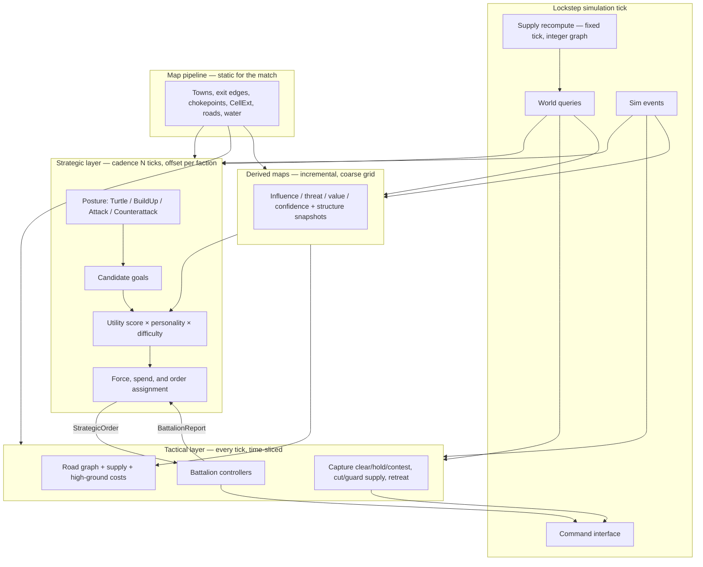

# Enemy AI Design

**Status:** Proposed  
**Audience:** Game designer, lead engineer, map pipeline engineer  
**Scope:** Single-player launch AI. Multiplayer and replays are out of scope as features, but the AI is designed so they can be added later without a rewrite.  
**Related:** Launch is PC/Steam, Unity, post-apocalyptic RTS on generated real-world maps (100×100 or 200×200 miles). Core loop: fortify held ground, then assault neighboring enemy territories.

This is the working contract for enemy AI. Numbers marked **placeholder** are starting values for the first playable; they are not balance commitments.

Designer answers in [Draft designer positions](#draft-designer-positions-pending-garand-sign-off) are **draft pending Garand’s sign-off**. Lead-engineer answers in [Lead engineer decisions](#lead-engineer-decisions) are **locked decisions**, not drafts. Map-pipeline answers in [Map pipeline decisions](#map-pipeline-decisions) are **accepted contract changes** (CI golden map approved Sep 28, 2026; soak regions still pending Garand). [Team decisions (28 Sep 2026)](#team-decisions-28-sep-2026) (neutral-town race, manpower reserve, depot pre-check, stable map ids, headless logs) are **agreed**, not drafts.

---

## Contents

1. [Goals and non-goals](#1-goals-and-non-goals)
2. [Architecture](#2-architecture)
3. [Reading real terrain](#3-reading-real-terrain)
4. [Determinism](#4-determinism)
5. [Difficulty](#5-difficulty)
6. [Faction personalities](#6-faction-personalities)
7. [Performance budget](#7-performance-budget)
8. [Testing and tuning](#8-testing-and-tuning)
9. [Open questions](#9-open-questions)
10. [Phased implementation plan](#10-phased-implementation-plan)

---

## Draft designer positions (pending Garand sign-off)

These are the Game Designer’s draft answers. They are **not final** until Garand signs off. Until then, AI behavior in this doc follows them so engineering has one spec.

| Topic | Draft position | AI consequence |
| --- | --- | --- |
| Scale | **Operational.** The balance unit is a **`Battalion`**. Players zoom from the strategic map down into fights; on-screen **sections** (6-figure groups inside a battalion) are **presentation** only. | One `Battalion` (e.g. `remnant_motor_rifles`) has pooled HP, one position/path, one command queue. That is the AI’s smallest commandable unit. Coordinated action uses **task forces** (ordered battalion ids + a goal) in **AI-owned deterministic state**. Tactical layer is route, capture-zone, and supply, not soldier spacing. `taskForceTargetSize` is the v0.3 personality field. |
| Factions | Working names: **Remnant**, **Compact**, **Clans**. Compact personality is `homestead_compact_settler`. Compact **+150‰ manpower is a faction trait**, not an AI bonus. | Personalities live in `data/balance/ai_personalities.json`; difficulty in `ai_difficulty.json`. Any personality runs at any difficulty. Do not fork the planner. |
| Capture | Every town has a **capture zone** and a **garrison**. Clear all enemy combat **battalions** from the zone, then hold it uncontested for a timer (**60 s village, 120 s town, 180 s city**). An enemy combat battalion in the zone **pauses** the timer; it does not reset. A territory belongs to whoever holds its **anchor town(s)**; some regions have several anchors and you need **all** of them. Fortified buildings **slow** capture; they do not block it. | Assault = clear then hold. Contest = park a combat battalion in the zone to pause. Score multi-anchor regions as a set. Defend and reinforce capture zones first. `minGarrisonPerTown` counts battalions and applies to **towns and cities**. |
| Supply | Cutting roads **does** starve supply. Supply traces the **road graph** from depots and HQ to battalions. A segment is cut when an enemy **holds its node** or a **bridge is destroyed**. A battalion is out of supply when it has no friendly road path back to a depot within a **short off-road** snap distance. Out-of-supply battalions stop refilling fuel and ammo. After ~**60 s** grace, fire rate and speed drop and they **cannot reinforce**. Off-road movement penalties are a separate rule. Supply is recomputed on a **fixed tick** with integer graph math. | Raid/cut enemy roads and bridges, guard own lines, do not over-extend, bake supply into routes and assault timing, value bridges and junctions. Read supply from sim hooks. |
| Fog | Vision is **per player**, from **battalions and buildings**, with **terrain LoS** from the heightmap (high ground sees further, ridges block). Recon battalions get extra range. Explored enemy structures persist as **last-seen snapshots**. **No** global reveal of own territory. | AI **never** cheats fog. Scout with recon and `HasHighGround` vs the watched cell. Memory = snapshots + confidence decay. Own empty ground is fog unless a battalion or building sees it. |
| Brutal | **+10% income is acceptable** at launch. It is the **only numeric advantage**. The rest of Brutal is better decisions. | `EconomyBonusPpt` is the single tunable resource cheat. Cadence, mistakes, memory, and operational quality are not extra money or vision. |

---

## Glossary

| Term | Meaning |
| --- | --- |
| **Battalion** (`Battalion`) | The balance unit and the AI’s smallest commandable unit. One sim entity: e.g. `remnant_motor_rifles` has pooled HP, one position/path, and one command queue. |
| **Section** | A 6-figure group drawn **inside** a battalion. Presentation only; not sim state, not commandable. Count on screen still follows HP ‰. |
| **Task force** | Ordered list of battalion ids plus a goal. Lives in **AI-owned deterministic state** (serialized, hashed, id-sorted). Other sim systems cannot read it. Orders still issue **per battalion** on the normal command queue. Size target: `taskForceTargetSize` (balance v0.3; renamed from `squadTargetSize`). |
| **Capture zone** | The town volume that must be empty of enemy combat battalions, then held, to capture. |
| **Anchor** | A town that must be held to own its territory. Some territories have several; all are required. |
| **Depot / HQ** | Supply sources. Battalions need a friendly road path to one (plus a short off-road snap). HQ range **40 mi** along roads; depot **30 mi**. Placement rules in `rules.json` `supply`. |
| **Stable map id** | Territory, bridge, and chokepoint identity stored in AI-owned state. Backed by the map’s stable-id manifest (OSM-derived permanent u64 keys). **Never** a raw road node or edge id (those follow bake order). |

---

## Lead engineer decisions

These are **decisions**, not drafts. They lock the sim seams the AI is written against. Names of hooks may still be bikeshed; the behavior must not drift.

| Topic | Decision |
| --- | --- |
| Tick | **20 Hz (50 ms)**, locked. |
| Command delay | `commandDelayTicks` is a **match-setup constant** shared by player and AI. Default **2 ticks (100 ms)** in single-player; higher in multiplayer. **Never hardcoded.** Commands are stamped `executeTick = issuedTick + commandDelayTicks`. Difficulty may add `ReactionExtraTicks` on top for Easy/Normal/Hard; that is a difficulty parameter, not a substitute for the match delay. |
| Numeric types | Sim state: **integer cm**, `int32` per axis; **`int64`** for squared distances and path costs; ratios as **int ppt**. Core has **Fixed64 (Q32.32)** for internal math only (sqrt, movement stepping, angles); results are always stored back as cm or ppt. **Nothing** in sim state, hashes, or events is Fixed. **Q16.16 in int32 is ruled out** (cannot cover a 200-mile map). |
| Road A\* | **Core sim owns it.** `PathOnRoads` and `EstimateTravelTicks` are sim services. `EstimateTravelTicks` takes a **path** and a **movement class** (`wheeled`, `tracked`, `foot`, `air`) per the designer’s movement table v0.1. `PathRequestsPerTick` = **8** match-wide. The path cache is keyed on `(start, goal, movementClass)` (sim also folds `weightKey`, `graphVersion`). `costWeights` are integer ppt. Per-class edge costs are computed at **match load**, not bake. |
| Map identity | AI-owned state that names the map stores **stable ids only** (territory, bridge, chokepoint — manifest / OSM-derived permanent u64 keys). **Never** raw road node or edge ids. Road nodes carry a **2-byte `territoryId`** that maps 1:1 to the territory’s permanent key. Path requests may pass the current node id as a sim handle; that handle is not persisted as map identity. |
| Depot placement | The AI **mirrors** the sim’s depot rules before `CmdBuild` so it never issues a build the sim will `CommandRejected`. Read `maxDepotsPerNode` and `depotMinSpacingCm` from `rules.json` `supply`. |
| Axes | Sim **x = east** (Unity +X), sim **y = north** (Unity +Z), elevation = Unity +Y. Origin is the **SW corner**. Sim stays in **absolute int cm**; rendering uses a floating origin. |
| High ground | Sim predicate **`HasHighGround`**: `attackerDm - targetDm >= 500` using the **terrain elevation-layer** cell under each battalion (whole dm). **No interpolation.** Same cell → no bonus. The AI uses **exactly** this rule. |
| Entity model | **`Battalion`** is the first-class sim entity: pooled HP, one position/path, one command queue. Orders target that entity. On-screen **sections** (6-figure groups) are presentation only. **Battalion split/merge is out of scope for v0**; if ever needed it is a separate sim command. |
| AI-owned state | Task forces and all other AI memory (strategic goals, influence caches that are not pure functions of the world, cooldowns, RNG state) live in **AI-owned deterministic state**. Serialized with save/load, folded into the periodic state hash, stored in **fixed id-sorted order** so a reload or desync check restores it exactly. Other sim systems **cannot** read it. Anything the AI can fully recompute from world state may be excluded, **only if** it is recomputed deterministically. |
| Command queue | The lead engineer’s in-progress foundation PR defines the first command queue. The AI **plugs into it**. |
| Threading | Launch: **fixed-step sim on the main thread**. A dedicated sim thread comes later. The AI stays **inside the sim tick** either way. |
| Core / headless | Core is **pure C# with no `UnityEngine`**. Headless runs via `dotnet test` or a console host in GitHub Actions. |
| Blobs | **WRMB** is the single map format (Map Pipeline Engineer’s versioned little-endian container, directory-by-tag, per-section CRCs). Layout spec: `blob-layout-v0.md` (map pipeline). Arrays sorted by id. Variable-length fields are `(offset, count)` into shared pools. **No hash-set rebuild on load.** Terrain is a **second WRMB** (elevation in whole decimetres on the 1,800×1,800 grid, plus slope‰ and land-cover); each file stores the other’s `contentHash`. |
| Hash / PRNG | **xxHash64** and **PCG32**, both in-repo with golden tests. `hash64` means xxHash64 over the listed fields. `ai_personalities.json` and `ai_difficulty.json` hashes are **match config**. AI-owned state (task forces, goals, non-pure caches, cooldowns, RNG) is **in the periodic hash**. |
| Perf targets | **1.5 ms AI** and **8 ms sim** are the accepted targets. The wall-clock **ship gate waits for a vertical slice**. The **AI work-unit cap alone** governs behavior. |
| Per-PR CI | Frozen golden **100×100** map under `data/golden/` (Git LFS + SHA-256), **2 AI** factions, **12,000 ticks** (10 game minutes), run **twice** with the same seed, identical hashes every **200** ticks, finish in **under 5 minutes**. |
| Nightly soak | Starts at about **200** matches and grows toward **1,000** once there are perf numbers. |
| Cross-check | Windows-vs-Linux hash-stream check is added **later, before multiplayer**. |
| Headless speed | Goal (not a commitment): at least **50× realtime** on 100×100 with 2 AIs. |

---

## Map pipeline decisions

Accepted field-level contract for §3. The CI golden map is **approved (Sep 28, 2026)**; soak regions are still pending Garand. **WRMB** (including section layout) is approved; see `blob-layout-v0.md`.

| Topic | Decision |
| --- | --- |
| When derived | Chokepoints, territories, `strategicValue`, and neighbour lists are computed **after** the post-apocalyptic transform. Destroyed bridges are already gone from the passable graph. |
| Chokepoints | Record in §3.1. Each stores **`bypassMaxGradePpt`** (uint16; **65535** = no bypass) and optional **`bypassSurfaceClass`** (uint8 land-cover; next golden bump). At match load the AI computes per-class **`bypassPenaltyPpt`** from `detourRatioPpt` plus the designer speed formula at that grade, using that surface’s table modifier or **field** surface if the class is absent. Rank fortify/raid/assault by that penalty, mixed by force count. **`wheeledOnly`** is an optional debug/overlay flag (wheeled penalty maxed), not a scoring input. |
| `strategicValue` | 0–1000 from per-map percentile ranks: population 40%, road connectivity 25%, chokepoint proximity 15%, high ground 10%, resources 10%, plus a `populationClass` absolute anchor. **Designer owns the weights.** Per-town components go in optional `TDBG` for the overlay. |
| Road budget | ~**8k nodes / 12k edges** on 200×200; ~**2k / 3k** on 100×100. Towns collapse to a gate plus **exit edges**. Edge geometry is a polyline. **Over-budget bake fails** (never truncates). |
| AI grid | Coarse **AI cells** from META `cellSizeCm` — **never assume a round mile**. **18** terrain cells (89 m slope‰ + land-cover + elevation in **whole decimetres**) make one 1-mile AI cell. Gorge terrain WRMB is **1,800×1,800**. `ElevationCell` plus `CellExt` on the AI grid. |
| Format | **WRMB** (approved): versioned little-endian, directory-by-tag, per-section CRCs. Spec: `blob-layout-v0.md`. Variable-length fields are `(offset, count)` into shared int32 / point / string pools. JSON/GeoJSON debug export with a **binary → JSON → binary** round-trip test. Map + terrain are **two WRMB files** that record each other’s `contentHash`. |
| Gameplay fields | `supplyCapacity`, `fortificationSlots`, `defaultFortification`, `resourceYield` are **not** in the map blob. Designer table, applied at load (keyed by `populationClass`). |
| Golden maps | CI: **Mid-Columbia Gorge** 100×100 (`golden-ci-columbia-gorge-100`), committed under `data/golden/` via **Git LFS** with SHA-256 files, **approved Sep 28, 2026**. Soak: **Illinois–Iowa** and **Central Alps** at 200×200. |
| Node territory | Each **road node** carries a 2-byte `territoryId` mapping 1:1 to the territory’s permanent key. |
| Adjacency | Until the Gorge **v1** map PR merges (river-following territory borders), the AI treats two territories as adjacent **only if a road actually connects them** (stopgap). After v1 it uses the map’s adjacency and **drops** the stopgap. |
| Chokepoint role | A chokepoint is a **border defensive post** only if it sits between **two different territories**. Interior chokepoints (same territory on both sides) are still used for routing and siege positioning, not as border posts. |
| Stable ids | Territory, bridge, and chokepoint records are keyed in the map’s **stable-id manifest** (OSM-derived permanent u64). Runtime dense ids are lookup handles, not identity. |

---

## Team decisions (28 Sep 2026)

Agreed with the whole team. These are **decisions**, not drafts. Mechanics live in the sections cited.

| Topic | Decision |
| --- | --- |
| Neutral-town race | Strategic-layer town/territory utility. For a **neutral** town, compare our arrival vs the nearest observed enemy force’s arrival, both from `EstimateTravelTicks(path, movementClass)`. We-first scores higher; they-first scores lower. Runs **only** on the strategic cadence (every **2 s** on Normal), never per tick, and only when **neither** HQ is already clearly closer. Each path is a queued request against the sim’s **8** `PathRequestsPerTick`; reuse the sim path cache `(start, goal, movementClass)`; stay in the AI’s share of that budget; if the budget is full, **defer** to the next strategic tick. §2.1. |
| Manpower reserve | **Every** AI manpower spend (production, rushes, races, reinforcements) must leave `manpower >= reserve`. `reserve` = manpower cost of the `minGarrisonPerTown` battalions every owned town still needs + `manpowerReserveSeconds` of current manpower income. `manpowerReserveSeconds` is in `ai_difficulty.json`, **60** on every difficulty including Brutal. Rushes/races size the task force only up to what passes the gate; if the affordable force is too small to take the target, **do not launch**. Sole exception: **emergency defense** when an enemy task force is inbound on an owned town. If the next tech tier is the top-scoring goal, reserve that tier’s cost and do not spend it on anything else. Balance v0.5: Compact at manpower 0 at 5:00 on Brutal, 2 by minute 5 on Normal, tier II at 9:24. §2.1, §5. |
| Headless logs | Every **10 s** (minutes **2 to 5** minimum) log manpower, current reserve, tech savings, battalion count, and **The Dalles** control. Debug only — not in the hash. §8.1. |
| Depot pre-check | Mirror the sim so depot `CmdBuild` is never `CommandRejected`: road node in an owned territory, connected to the current supply network **when the command executes**, `maxDepotsPerNode` = **1**, `depotMinSpacingCm` = **804670** (5 road-miles, along the road graph, **any** owner). Both values from `rules.json` `supply`. Ranges along roads: HQ **40 mi**, depot **30 mi**. A forward depot (e.g. The Dalles or White Salmon) is a **required prerequisite** for assaulting a town outside supply range (e.g. Hood River at 44.4 road-miles from Remnant HQ). Relay chains (e.g. Condon via an OR-206 relay) are **ordered depot steps**. §2.1, §4.3. |
| Map ids / adjacency | Persist **stable ids only** (territory, bridge, chokepoint). Never raw road node or edge ids. Road-connected adjacency stopgap until Gorge v1; then map adjacency. Border chokepoints only between two territories. §3.1, §4.1. |

---

## 1. Goals and non-goals

Launch is single-player against AI opponents. The AI *is* the opposing side of the game. If it cannot hold towns, spend, expand, and attack in a way that reads as a faction living on the map, there is no match.

### 1.1 Launch goals

| Goal | What “good” looks like |
| --- | --- |
| Credible opponent | An AI faction takes anchor towns by clearing and holding capture zones, fortifies, cuts or guards supply, and assaults neighbors on a cadence a player can read and counter. |
| Fair information | The AI only knows what its battalions and buildings see, plus last-seen snapshots of explored structures. It never cheats fog. Own territory is not auto-revealed. |
| Personality | Working names **Remnant**, **Compact**, **Clans** share one brain. Compact uses `homestead_compact_settler`; Warlord/Raider JSON profiles are stubs. Compact +150‰ manpower is a **faction trait**, not an AI bonus. |
| Terrain literacy | The AI uses roads, supply, chokepoints, bridges, high ground (`HasHighGround`: `attackerDm - targetDm >= 500`), rivers, and town/anchor value — not a Euclidean rush. |
| Deterministic sim | Same match seed + same inputs → identical AI decisions. Required for headless test, later replays, later lockstep netcode. |
| Tunable difficulty | Easy through Brutal are parameter sets, not separate AIs. Brutal’s only numeric advantage is `EconomyBonusPpt`. |
| Budget-bound | Several AI factions on a 200×200 mile map stay inside the per-tick work budget (see §7). |

The player should be able to answer, after a loss: “they cut the bridge, starved my garrison, walked into the capture zone, and held it.” That is the quality bar. Opaque omniscience is a failure even if the AI wins.

### 1.2 Non-goals (launch)

- Player-vs-player, co-op, or any networked lockstep session.
- Replay file format, spectator desync UI, or checksum negotiation.
- Machine-learned policies, behavior cloning, or runtime training.
- Company- or soldier-level micro (stutter-step, ability weaving, pixel kiting). The player may zoom into a fight; the AI still issues **operational** commands to **battalions** only. On-screen **sections** are not commandable.
- Hand-authored per-map scripts, waypoints, or trigger chains. Maps come from the pipeline; the AI must generalize.
- Naval, air, or subterranean layers unless design later adds them as first-class movement graphs.
- Diplomacy, trading, or more than one relationship to the player (hostile). Neutral towns are world state, not AI actors.
- A designer-facing live tuner in the first playable. Debug overlays and JSON/ScriptableObject parameter files are enough until M5.

### 1.3 Deferred, but designed for

Replays and multiplayer need the same command stream and the same tick. That is why this doc forbids `Time.deltaTime`, dictionary iteration, physics queries, and wall-clock branching in AI decision code *now*, while launch is still offline.

---

## 2. Architecture

Two layers, one command pipe.

The **strategic layer** thinks in towns, anchors, territories, supply, economy, and posture. It runs on a fixed cadence of simulation ticks (a few seconds of game time) and emits orders.

The **tactical layer** thinks in **battalions**. It runs every tick (time-sliced) and turns orders into the same commands a player issues.

Neither layer moves battalions by writing transforms. Both go through the shared command interface (§4.3). Zooming the camera into a fight is presentation (**sections** of 6 figures scale with HP ‰); it does not unlock a second AI.



### 2.1 Strategic layer

**Cadence.** Default planning period is `StrategicCadenceTicks` (Normal: 40 ticks = 2.0 s at 20 Hz). Each faction’s plan tick is offset so they do not all run on the same tick:

```
planThisTick(faction) =
  (tick + factionId * FactionPlanOffsetTicks) % StrategicCadenceTicks == 0
```

`FactionPlanOffsetTicks` default is 3. Cadence stretches on Easy and tightens on Hard/Brutal (§5).

**Inputs, each plan tick.**

- Static map contract (§3.1), including anchors and capture-zone radii.
- Derived maps (§3.2), last fully committed slice, plus last-seen structure snapshots.
- Own economy snapshot: resources, build queues, upkeep.
- Own army snapshot: battalions, supply state, pooled HP ‰, orders, recovery. **Task forces** are read from AI-owned state (id-sorted), then validated this tick.
- Own supply graph view: depots, HQ, held nodes, intact bridges, battalions at risk of OOS.
- Observed enemy: towns, battalions, and threats inside fog-honest vision plus memory with a TTL / snapshots.
- Recent `BattalionReport`s since the last plan tick.
- Capture-zone timers the faction can see (own zones always; enemy zones only if currently visible or last-seen as capturing).

**Posture.** A faction is in exactly one posture. Posture is itself a scored choice with hysteresis so it does not chatter.

| Posture | Intent | Typical orders |
| --- | --- | --- |
| Turtle | Hold what we have. | Fortify anchors, park garrisons in capture zones, guard supply nodes/bridges, delay expansion. |
| BuildUp | Grow economy and army. | Claim empty towns, spend on production, scout from cells with `HasHighGround` vs the watched target, light supply raids only. |
| Attack | Commit to taking a neighbor. | Assault the next anchor (clear + hold) + screening + cut-road/bridge raids. |
| Counterattack | Punish a push on our ground. | Contest our capture zones (pause their timer), retake, restore supply, then re-evaluate. |

Hysteresis: a new posture must beat the current score by `PostureSwitchMarginPpt` (placeholder **150**, i.e. 15%) and stay ahead for `PostureMinHoldTicks` (placeholder **200** ticks = 10 s). Combat events (anchor lost, capture of ours started, army routed, supply cut to HQ) may bypass the hold timer.

**Candidate goals.** The planner does not search an open-ended action tree. It *generates* a bounded set of typed goals from the map and current state, scores them, then picks a non-conflicting subset that fits army, supply, and resource budgets.

| Goal type | Target | Generated when |
| --- | --- | --- |
| `ClaimTown` | empty / contestable town | Adjacent to held territory (road-connected stopgap until Gorge v1; then map adjacency), or reachable via supplied roads. Completing an anchor set is preferred over a non-anchor. Neutral towns get a **race** term (§2.1). |
| `FortifyTown` | owned town | Town is an anchor, value high, or threat on its capture zone above threshold. |
| `AssaultTown` | enemy town | Neighbor territory; force ratio vs estimate above personality threshold; a supplied route to the capture zone exists or can be opened. If the town is outside HQ/depot range, a `PlaceDepot` chain must already be accepted (or generated as a prerequisite this pass). |
| `ContestCapture` | town whose enemy timer is ticking | Any visible (or last-seen-in-progress) enemy capture of a town we care about. Cheap: one combat battalion in the zone pauses the timer. |
| `HoldCaptureZone` | town we are capturing, or an owned zone under threat | After the zone is cleared, until the timer completes; or garrison an owned anchor. |
| `Raid` / `CutSupply` | enemy chokepoint, bridge, or town-gate **stable id** | Attack/BuildUp; holding the crossing or destroying the bridge cuts a path from their depot to a town or field force. Persist the stable id, not a raw node/edge id. |
| `GuardSupply` | own depot-path chokepoint, bridge, or town-gate **stable id** | Degree ≥ 2 junction, bridge, or the last path to an exposed battalion / anchor. Persist the stable id. |
| `HoldChokepoint` | chokepoint stable id | **Border post** only if the chokepoint sits between **two different territories**. Interior chokepoints (same territory both sides) score for routing and siege positioning, not as border posts. Score scales with mix-weighted `bypassPenaltyPpt`. |
| `ScoutRegion` | coarse-grid region or ridge cell | Confidence stale; fog-honest; prefer cells with `HasHighGround` vs the road or capture zone they watch. |
| `ExpandEconomy` | build slot / town | BuildUp or Turtle with spare income. |
| `PlaceDepot` | road node in owned territory (looked up this tick; persist territory + stable seat, not the raw node id) | Needed to extend supply toward a goal town outside HQ/depot range, or as the next step of a relay chain. Must pass the depot pre-check. |
| `ResearchTech` | next tech tier | Next tier is available. If this is the top-scoring goal, **reserve** its remaining cost (tech savings) and do not spend that reserve on anything else. |
| `CounterattackForce` | lost or threatened anchor | Posture Counterattack, or incoming capture of an owned zone. |
| `Recover` | owned rally town that is in supply | Army below recovery strength after a fight. |

Hard cap: `MaxCandidateGoals` = **64** per plan tick. If generation exceeds the cap, keep the highest *heuristic pre-score* (anchor bonus × town value × inverse distance, integer) so the utility pass stays bounded.

**Utility scoring.** Each candidate `g` gets an integer millipoint score:

```
score(g) = clamp(
    Σ_i  weight[i] * feature[i] * personalityMul[i] * difficultyMul[i]
    + postureBias[g.type, currentPosture]
    − conflictPenalty(g, alreadyPicked),
    ScoreMin, ScoreMax)
```

All terms are `int32` millipoints. Features are already in parts-per-thousand (ppt, 0–1000) or millipoints; there is no floating-point in this path.

| Feature (all ppt or millipoints) | Typical use |
| --- | --- |
| `townStrategicValue` | From pipeline, 0–1000. |
| `anchorBonus` | Extra if the town is an anchor; larger if we already hold `anchorsHeld / anchorsRequired − 1` of that territory. |
| `territoryValue` | Value of the territory **if this capture would complete its anchor set**; otherwise a fraction. Non-anchors do not flip ownership. |
| `captureProgressPpt` | Ours: finish a ticking hold. Enemy: contest a high-progress timer (pause is high value per unit). |
| `threatOnTarget` | Threat map sample at the capture zone, using the **assigned movement class**’s sim costs. |
| `ownInfluenceNearTarget` | Influence map sample. |
| `forceRatioPpt` | Estimated own committed strength / estimated defenders in the zone. |
| `defenderSupplyPpt` | Low if we have cut their road to the town — assault sooner. High if they are supplied — isolate first. |
| `ownSupplySafetyPpt` | Penalty if the assigned force would go OOS on the approach or during the hold timer. |
| `roadAccessPpt` | 1000 if a friendly-controlled, supplied road reaches it; less if off-graph. |
| `chokepointBonus` | `defensibility * mixBypassPenaltyPpt / 1000`. `mixBypassPenaltyPpt` is the count-weighted mean of per-class `bypassPenaltyPpt` over the relevant force mix (see §3.1). Not a `wheeledOnly` boolean. |
| `bridgeJunctionValue` | Extra for bridge **edges** and high-flag junctions (cut or guard). |
| `visionGroundBonus` | Cells with `HasHighGround` vs a road or zone (`attackerDm - targetDm >= 500`, terrain elevation-layer cell, no interpolation, same cell = 0). |
| `economyNeedPpt` | High when income < upkeep + planned spend. |
| `distanceCost` | From sim `EstimateTravelTicks(path, movementClass)`, not raw `travelCost`. Staging town must be in supply. Plan **per movement class**. |
| `raceAdvantagePpt` | **Neutral towns only.** `clamp((themTicks − ourTicks) * 1000 / max(1, ourTicks + themTicks), −1000, 1000)`. Positive ⇒ we arrive first. Fog-honest nearest observed enemy force. See race rules below. |
| `fogUncertainty` | Penalty (or scout bonus) when confidence is low; never treated as vision. |
| `recentFailurePenalty` | Same goal type+target failed within `FailureMemoryTicks`. |

Weights live in the personality profile (§6). Difficulty scales a subset: reaction, aggression, scout weight, mistake injection (§5).

**Neutral-town race (strategic cadence only).** For a **neutral** town, compare our arrival time vs the nearest **observed** (visible or memory) enemy force’s arrival. Both times come from `EstimateTravelTicks(path, movementClass)` — the sim service takes a **path** and a **movement class**. Towns we reach first score higher (`raceAdvantagePpt` > 0); towns the enemy clearly reaches first score lower.

Race checks run **only** on the strategic cadence (`StrategicCadenceTicks`; every **2.0 s** on Normal), **never** per tactical tick, and **only** when neither side’s HQ is already clearly closer:

```
hqUs    = EstimateTravelTicks(path ourHQ → town, movementClass)     // cache
hqThem  = EstimateTravelTicks(path theirHQ → town, movementClass)
clearlyCloser = min(hqUs, hqThem) * 2 < max(hqUs, hqThem)           // integer
```

Skip the race (leave `raceAdvantagePpt = 0`) when `clearlyCloser`, when the town is not neutral, or when no enemy force is observed.

Each path is a **queued** `PathOnRoads` request and counts against the sim’s `PathRequestsPerTick` = **8** (match-wide). Race checks **must** reuse the sim path cache keyed on `(start, goal, movementClass)` (the service also folds `weightKey` and `graphVersion`). Cache hits do not consume a request. Misses stay within the AI’s share of that budget. If the remaining budget cannot cover a miss, **defer** the check to the next strategic tick (`raceAdvantagePpt = 0` this plan tick). Do not run extra pathing on tactical slices to “catch up.”

**Selection.** Greedy: sort candidates by score (stable sort, `goalId` as tie-break), then accept if:

1. Score > `MinAcceptScore` (placeholder **1000**).
2. Remaining army strength and resource budget cover `g.cost`, **and** every manpower spend in that cost passes the **manpower reserve gate** (below). Rushes and races that fail the gate are not accepted.
3. A **supplied** route exists, or a `GuardSupply` / `CutSupply` / `PlaceDepot` order that opens it is already accepted this pass (order matters: accept supply-enabling goals, including forward depots and relay steps, before the assault that needs them).
4. Target is not already claimed by an accepted goal of an incompatible type (two assaults on the same town merge; assault vs fortify on the same town conflict; `ContestCapture` may stack with a later `AssaultTown`).

Cap accepted goals at `MaxActiveOrders` = **12** per faction. Drop the rest. Idle leftover strength is assigned to `HoldCaptureZone` on the highest-threat owned **anchor** that is in supply (implicit, not a generated candidate). Garrison that **town or city** with at least `minGarrisonPerTown` **battalions** (`minGarrisonPerTown` does not apply to villages).

For each accepted goal the AI builds a **task force**: an ordered list of battalion ids (sized toward `taskForceTargetSize`) plus the goal. Rushes and races size the list **only up to** what still passes the manpower reserve gate; if the affordable force is too small to take the target, **do not launch**. Task forces live in **AI-owned deterministic state** — serialized with save/load, folded into the periodic hash, stored in **fixed id-sorted order**. Other sim systems cannot read them. They are **validated** each strategic tick (drop dead/missing ids, re-issue if the goal is still live). Commands still go out **per battalion** on the foundation queue.

Do **not** accept an `AssaultTown` whose hold duration (capture timer, slowed by visible fortification) exceeds the time the force can stay in supply. Isolate first, `PlaceDepot` first, or cancel.

**Spending.** Economy is a goal type, not a free-form script.

**Manpower reserve gate.** Every AI manpower spend — production, rushes, races, reinforcements — must satisfy `manpowerAfter >= reserve` (integer, floor):

```
garrisonNeed = Σ_ownedTowns max(0, minGarrisonPerTown − garrisonedBattalions) * battalionManpowerCost
               // towns and cities only; villages excluded
reserve      = garrisonNeed + manpowerReserveSeconds * manpowerIncomePerSecond
manpowerAfter = manpowerNow − spendCost
```

`manpowerReserveSeconds` lives in `ai_difficulty.json` and is **60** on every difficulty including Brutal. `manpowerIncomePerSecond` is current manpower income (already includes Brutal `EconomyBonusPpt` if any), integer.

Rushes and races build the task force only up to the battalion count that still passes the gate. If that affordable force is too small to take the target, the rush is **not** launched.

**Exception:** emergency defense when an observed enemy task force is inbound on an owned town — the gate does not block that spend.

**Tech savings.** When `ResearchTech` for the next tier is the top-scoring goal, the AI reserves that tier’s remaining cost and does not spend it on anything else.

Motivation (balance **v0.5**): Compact hit manpower **0** at 5:00 on Brutal and **2** by minute 5 on Normal, with tier II slipping to **9:24**.

Non-manpower resources still use the personality envelope:

```
spendableOther = currentOtherResources - ReservePpt * netIncomePerCadence / 1000
```

`ReservePpt` is a personality field. Spend priority within both envelopes: (0) emergency defense of an inbound owned town, (1) repairs / fortify on threatened anchors and their capture zones, (2) tech savings if `ResearchTech` is top-scoring, (3) production to reach `TargetArmyStrength` (including recon if confidence is stale) that passes the manpower gate, (4) expansion buildings including `PlaceDepot`, (5) extra scouts. Building IDs and the gameplay table (`supplyCapacity`, `fortificationSlots`, `defaultFortification`, `resourceYield`) are designer fill-ins applied at load; the AI only needs a tagged catalog: `Production`, `Fortification`, `Economy`, `Intel` (recon), `Depot`.

**Depot placement pre-check.** The AI **mirrors** the sim’s depot rules before issuing `CmdBuild`. A depot the sim would `CommandRejected` is never enqueued. Checks (all integer):

1. The site is a **road node** in a **territory the AI owns** (node `territoryId` maps 1:1 to the territory’s permanent key).
2. The node is **connected to the current supply network when the command executes** (same connectivity the sim will test at `executeTick`).
3. `maxDepotsPerNode` = **1** (from `rules.json` `supply`).
4. Along-graph distance to every other depot (**any** owner) ≥ `depotMinSpacingCm` = **804670** (5 road-miles). Distance is the sum of `lengthCm` along the road graph, not Euclidean.

Read `maxDepotsPerNode` and `depotMinSpacingCm` from `rules.json` under `supply` at match init (hash those fields with match config if the file is loaded). Supply ranges are **along roads**: HQ **40 mi**, depot **30 mi**. The planner treats a forward depot (e.g. at The Dalles or White Salmon) as a **required prerequisite** for assaulting a town outside supply range — e.g. Hood River at **44.4** road-miles from Remnant’s HQ. Relay chains (e.g. Condon via an OR-206 relay) are planned as **ordered** `PlaceDepot` steps; accept them before the assault they enable.

Brutal’s `EconomyBonusPpt` is applied by the **sim economy**, not by the AI inventing extra builds.

### 2.2 Tactical layer

The tactical layer issues commands to **battalions**. A `Battalion` is one sim entity: stable id, pooled HP, one position/path, one command queue, a movement posture, a route, and a supply flag. The AI does not command **sections**. **Split/merge is out of scope for v0.** Coordinated moves use the current **task force** id list; each battalion still gets its own command.

The player may zoom into the fight; they see **sections** (6-figure groups) scaled to HP ‰. The AI does not switch layers.

**Battalion controller, every tick it is scheduled.**

1. Apply incoming order (new, updated, or cancel).
2. Refresh route if the order target, threat on the current path, a blocked/held edge, a destroyed bridge, or **supply connectivity** changed.
3. Choose movement posture from context (road column vs deployed at the zone).
4. Issue commands: move, attack-move, hold (in capture zone or on a node), destroy-bridge (if the order says so), retreat.
5. Evaluate reinforce / retreat / contest rules. **Do not request reinforce if the battalion is past supply grace** — the sim will reject it.
6. Emit a report if status, objective, supply, or intel changed.

**Route choice.** Operational movement is A\* on the **road graph**, not a unit mesh.

**High ground (sim rule, pinned).** The AI uses **exactly** this predicate — no private height, no interpolation, no bonus when both battalions sit on the same terrain cell:

```
HasHighGround(attacker, target) =
    cell(attacker) != cell(target)
    AND (elevDm[cell under attacker] - elevDm[cell under target] >= 500)
```

`elevDm` is the **terrain WRMB elevation layer** (whole decimetres) cell under each **battalion**. Applies wherever the AI evaluates high ground (route `HighGroundWeight`, approach-cell pick, fight/retreat, scout perch vs a target, `visionGroundBonus` vs a target). Query the sim; do not reimplement a different threshold.

Edge cost (integer):

```
cost(e, dir) =
    e.travelCost                         // metre-equivalents, symmetric
  + ThreatWeight * sampleThreat(e)
  + ClimbWeight * climbCm(e, dir)        // climbCmAB if a→b else climbCmBA
  − HighGroundWeight * HasHighGround(fromCell, toCell)  // 1 or 0; sim rule
  + EnemyControlPenalty * e.controlRisk  // enemy-held node or destroyed/condition-3 edge
  + SupplyBreakPenalty * e.wouldBreakSupply
  − VisionWeight * visionFromHighGround(e, dir)  // HasHighGround vs watched cell
```

`wouldBreakSupply` is 1 when occupying or traversing `e` (or a planned off-road snap) would leave the battalion with no path to a depot. Raids that *intend* to cut may pay this; assaults and holds may not. Climb terms stay `climbCmAB` / `climbCmBA` / `elevDeltaCm`. High-ground **advantage** is only `HasHighGround` above.

Weights come from personality + current order type. `PathOnRoads` / `EstimateTravelTicks` take a **movement class** (`wheeled`, `tracked`, `foot`, `air`). The sim applies designer movement table v0.1 at **match load**:

```
speed = floor(base * surfacePpt * slopePpt / 1000000)   // 0 = impassable
```

Wheeled battalions cannot go off-road above a **299‰** grade. The AI must plan routes and estimate threat **per movement class**, using those sim costs — never a private speed table. `costWeights` are integer ppt; the service returns an `int64` cost. If the road graph cannot reach the target (`offRoadDistanceCm > 0`, or no passable edge for that class), fall back to a coarse-grid corridor that **honours `CellExt.edgeBlockMask`** (no walking a `blocksLand` river, lake/sea edge, or cliff band without a bridge) and rejoin the road graph at the nearest node **within `SupplySnapCm`**. Last-mile into a capture zone is a short operational path on a local integer grid provided by sim, not Unity NavMesh. Off-road movement penalties are sim rules; the AI only chooses when a snap is worth it.

**Movement postures** (operational, not fire-team formations).

| Context | Posture | Rule |
| --- | --- | --- |
| Road travel | Column / convoy | Stay on the edge; do not leave the road on a bridge. |
| Open approach | Deployed | Face the capture zone; prefer adjacent cells with `HasHighGround` vs the zone. |
| Chokepoint / junction hold | Compact | Occupy the **node** or the chokepoint’s `roadEdgeId` (bridge span). Prefer adjacent cells with high `CellExt.coverPpt`. |
| Capture clear / hold | Zone occupy | Combat battalion **inside** the capture zone. Do not sit on the ring and hope. |
| Contest | Zone occupy | At least one combat battalion inside the enemy ticking zone — enough to pause. |
| Retreat | Column | Fastest **supplied** road toward a depot or in-supply owned town; ignore high-ground bonus. |

Posture is a battalion stance command. Spacing of **sections** on the road is **not** sim state.

**Taking a town (replaces wall-siege).** Capture is a **zone clear + uncontested hold**, not a fortification-break. Fortifications only lengthen the timer. `AssaultTown` phases:

| Phase | Entry | Behavior | Exit |
| --- | --- | --- | --- |
| Approach | Order assigned | Road route that **stays in supply** to staging; prefer cells with `HasHighGround` vs the zone and LoS into it. | Staging reached, or aborted (path/supply). |
| Isolate | Personality / force ratio / `defenderSupplyPpt` | `CutSupply`: hold or destroy the town’s **`exitEdgeIds`** (and any bridge on those edges) so the garrison goes OOS. | Defenders OOS, **or** skip if `forceRatioPpt` already ≥ `SiegeAssaultRatioPpt`, **or** `MaxIsolateTicks`. |
| Clear | Combat battalions enter the capture zone | Attack-move until **no enemy combat battalions** remain in the zone. Fortified buildings are fought through; they do not gate this phase. | Zone clear, or retreat. |
| Hold | Zone clear of enemy combat | Stay inside the zone. Timer runs (`CaptureTicksVillage/Town/City`, then slowed by visible fortification). | Town captured; **or** an enemy combat battalion enters (timer **pauses**, phase stays Hold); **or** retreat. |

If ratio never supports Clear, the battalion holds at staging and reports `WaitingOnForce`. Strategy may send another battalion in the same task force, cut supply first, or cancel.

**Contesting an enemy capture.** `ContestCapture` is deliberately cheap: **any** friendly combat battalion inside the zone pauses their timer. The battalion does not need to win the fight to be useful. If it can also Clear, it upgrades in place to a retake (`HoldCaptureZone` after Clear). Priority: contest **anchors** whose timer is furthest along.

**Defense and reinforcement around capture zones.**

- Highest priority: owned capture zones whose enemy timer is ticking (contest now).
- Next: owned **anchors** with threat in or on the road to the zone.
- Next: the last remaining friendly path (node/bridge) that supplies those zones.
- Then other towns.

A battalion reports `NeedReinforce` when `strengthPpt` (pooled HP ‰) `< ReinforceBelowPpt` (placeholder **600**) while the order is still active, not retreating, and **`supplyState != OutOfSupplyPastGrace`**. Strategy assigns the nearest idle in-supply battalion whose travel ticks ≤ `ReinforceMaxTravelTicks` **without** going OOS. Tactical never steals a battalion off a higher-priority capture-zone order.

**Retreat.** Evaluated every scheduled tactical tick. Integer only.

```
predictedOutcomePpt = ownStrengthPpt * terrainDefenseMul / max(1, enemyStrengthPpt)  // overlay / intel
```

`retreatThresholdPpt` compares against the **task force’s total HP ‰**, not against `predictedOutcomePpt` and not against a single battalion. Dead battalions in the task force count as **0**:

```
tfHpPpt = (Σ strengthPpt_i) / n_assigned    // floor; destroyed members contribute 0
```

Retreat if `tfHpPpt < retreatThresholdPpt` **and** the order is not `HoldCaptureZone`/`HoldChokepoint` with `lastStand` (Turtle on an anchor may set this). Also retreat toward a depot if `supplyState == OutOfSupply` and remaining grace < `SupplyRetreatGraceTicks` (placeholder **400**) unless `lastStand`. `retreatThresholdPpt` is personality × difficulty (`RetreatThresholdMulPpt`). Destination: nearest owned in-supply **town or city** with garrison capacity (`minGarrisonPerTown` counts **battalions** and applies to towns and cities), via lowest-threat **supplied** road. Broken battalions (`strengthPpt < BrokenPpt`, placeholder **150**) auto-retreat regardless of order, then `Recover`. High-ground in `terrainDefenseMul` is `HasHighGround` only.

### 2.3 Orders down, reports up

Orders and reports are sim data, serialized the same way player commands are. They are not Unity events.

**`StrategicOrder`**

| Field | Type | Notes |
| --- | --- | --- |
| `orderId` | `int32` | Monotonic per faction. |
| `factionId` | `int32` | |
| `type` | `enum` | Mirrors goal type. |
| `targetKind` | `enum` | `Town`, `Territory`, `RoadNode`, `Chokepoint`, `Bridge`, `Region`, `None`. |
| `targetId` | `int32` | Id in that space; 0 if none. |
| `stagingNodeId` | `int32` | Optional road node. |
| `battalionIds` | `int32[]` | Sorted ascending. The **task force** (same ids + goal) is persisted in AI-owned state, not only this field. |
| `priority` | `int16` | Higher wins conflicts. Capture-zone contest > field raid. |
| `resourceBudget` | `int32` | Spent via economy commands; 0 if N/A. |
| `issuedTick` | `int32` | |
| `expiresTick` | `int32` | Hard cancel if still incomplete. Must exceed the capture timer for `HoldCaptureZone`. |
| `flags` | `uint32` | bit0 `lastStand`, bit1 `raidAvoidSiege` (Raider: cut/contest, skip long holds), bit2 `destroyBridge` |

**`BattalionReport`**

| Field | Type | Notes |
| --- | --- | --- |
| `battalionId` | `int32` | |
| `orderId` | `int32` | 0 if idle. |
| `status` | `enum` | `Idle`, `Moving`, `Staging`, `Isolating`, `Clearing`, `Holding`, `Contesting`, `GuardingSupply`, `Retreating`, `Broken`, `WaitingOnForce`. |
| `strengthPpt` | `int16` | Pooled HP ‰, 0–1000. On-screen **section** count scales with this. |
| `supplyState` | `enum` | `InSupply`, `OutOfSupply`, `OutOfSupplyPastGrace`. |
| `positionCm` | `int32 x, y` | Battalion position, centimeters. |
| `nodeId` | `int32` | Nearest road node. |
| `inCaptureZoneTownId` | `int32` | 0 if none. |
| `lastCombatTick` | `int32` | 0 if none. |
| `intelCount` | `int8` | 0–8. |
| `intel` | `IntelContact[8]` | Currently visible contacts **plus** snapshot refs this force can see. |
| `failReason` | `enum` | `None`, `PathUnreachable`, `ForceTooWeak`, `TargetLost`, `OutOfSupply`, `Expired`, `Cancelled`. |

**Flow.**

1. Strategy writes orders into the faction’s order table (sim state).
2. Assigned battalions observe the table the next time they are scheduled (usually the same tick, after strategy, if this faction’s tactical slice runs later in the tick; otherwise next slice — see §7.2). Same-tick vs next-slice is a *fixed* schedule, not a race.
3. Tactical issues player-identical commands into the **same command queue**, **one command per battalion**. Each command is stamped `executeTick = issuedTick + commandDelayTicks` (match-setup constant; default 2 in SP). Difficulty may add `ReactionExtraTicks` to that delay for Easy/Normal/Hard. Capture happens because the battalion occupies the zone, not because the AI issues a special “claim” command. `CanIssue` is advisory; a command can still reject at `executeTick` (`CommandRejected`).
4. Reports are appended to a per-faction ring buffer, consumed on the next plan tick and on listed events (`CaptureStarted`, `CapturePaused`, `TownOwnerChanged`, `BattalionBroken`, `NeedReinforce`, `SupplyStateChanged`, `BridgeDestroyed`).

The player never sees `StrategicOrder` / `BattalionReport`. They see battalions (**sections** scaled to HP ‰) move, timers pause, and towns change hands.

---

## 3. Reading real terrain

Maps are not handmade. The AI cannot be given designer ink. It needs a **stable, integer, match-static contract** from the map pipeline, plus **derived maps** it maintains itself.

### 3.1 Map pipeline contract (match-static)

Pipeline bakes **two WRMB files** at match start (map + terrain). Format: **WRMB**, the Map Pipeline Engineer’s versioned little-endian container with directory-by-tag section lookup and per-section CRCs. Layout: map pipeline spec **`blob-layout-v0.md`**. Records are fixed-size with explicit zero padding. Variable-length arrays are `{uint32 offset, uint32 count}` into shared pools (`I32P` int32 ids, `PTSP` int32 x/y points, `STRP` UTF-8). Arrays and pool spans are pre-sorted by id. Load memory-maps or copies arrays; **no hash-set rebuild**. No floats in the file. `bool` is `uint8` 0/1. Each WRMB stores the other’s `contentHash` in META.

Debug next to every blob (game never loads these): `<map>.debug.json` and `<map>.geojson`. CI **round-trip**: binary → JSON → binary must be byte-identical.

A **frozen golden 100×100** map + terrain WRMB pair is required for per-PR CI (§8). Over-budget road graphs **fail the bake**; they are never truncated.

Ids are dense `int32` starting at 1 **as runtime lookup handles**. Territory, bridge, and chokepoint **identity** is the map’s **stable-id manifest** (OSM-derived permanent u64 keys). AI-owned state stores those stable ids, **never** raw road node or edge ids (those follow bake order and can change). Chokepoints, territories, `strategicValue`, and neighbour lists are computed **after** the post-apocalyptic transform.

Gameplay values **not** in this blob: `supplyCapacity`, `fortificationSlots`, `defaultFortification`, `resourceYield`. A designer table keyed by `populationClass` is applied at load into the runtime records the AI reads. `fortificationLevel` is sim state.

#### Towns

```
TownRecord                                 // fixed size; lists via (offset,count) → I32P
  id                    int32
  positionCm            int32 x, y
  territoryId           int32
  population            int32              // GeoNames / GHSL rule
  populationClass       int8               // 0 <1k, 1 1k–10k, 2 10k–50k, 3 50k–250k, 4 >250k
                                           // (thresholds designer-confirm)
  isAnchor              uint8              // designer overlay at load if not baked
  captureZoneRadiusCm   int32              // designer table at load if not baked
  captureTicks          int32              // designer table at load (60/120/180 s)
  strategicValue        int16              // 0..1000, formula below
  roadNodeId            int32              // town gate; 0 if off-graph
  offRoadDistanceCm     int32              // >0 ⇒ no synthetic connector; use corridor fallback
  neighborTownIds       (off,count)        // road-neighbours only (no other town gate on the path)
  territoryNeighborTownIds (off,count)     // optional; towns in adjacent territories
  exitEdgeIds           (off,count)        // boundary-crossing edges after town-interior collapse
  nameStrOffset/Len     uint32, uint32     // STRP; UI/debug only
  sourceFlags           uint8
```

`strategicValue` (pipeline implements; **designer owns weights** in `strategic_value_weights.v1.json`, hash in the header):

```
P, R, C, H, X  = per-map percentile ranks in ppt (0..1000)
                 population 40%, road connectivity 25%, chokepoint proximity 15%,
                 high ground 10%, resources 10%
base           = (400*P + 250*R + 150*C + 100*H + 100*X) / 1000
abs            = populationClass * 250
strategicValue = clamp( (850*base + 150*abs) / 1000, 0, 1000 )
```

Percentile rank: sort by `(rawValue, townId)`; tied towns share the first index of the tie group. Optional `TDBG` section stores the five component ppt values per town for the §8.3 overlay. The AI may add situational value (anchor-set completion, supply); it does not replace this field.

#### Territories

Generated as a travel-cost partition on the 1-mile grid (not admin boundaries). Canonical painted boundary = `CellExt.territoryId`. Map-file adjacency = shared cell edge. **AI frontline / adjacency (stopgap until Gorge v1):** treat two territories as adjacent **only if a road actually connects them**. After the Gorge v1 map PR merges (river-following territory borders), use the map’s adjacency directly and **drop** this stopgap.

```
TerritoryRecord
  id                    int32
  seatTownId            int32              // seed town
  townIds               (off,count)
  anchorTownIds         (off,count)        // ALL must be held to own the territory (designer overlay)
  neighborTerritoryIds  (off,count)        // sorted
  areaCells             int32              // 1-mile cell count (NOT areaSqM — that overflows int32)
  areaHa                int32              // optional hectares
  centroidCm            int32 x, y
```

`resourceYield` is **not** here; designer table at load. Ownership is **anchor-complete**. Assault graph = AI adjacency (road-connected stopgap until Gorge v1; then map `neighborTerritoryIds`). Raids may still follow the road graph through a neighbor.

#### Road graph

Budget: **~8k nodes / 12k edges** on 200×200; **~2k / 3k** on 100×100. Town interiors collapse to one `TownGate` plus `exitEdgeIds`. Over budget → bake **fails**.

```
RoadNode
  id                    int32              // runtime handle; do **not** persist in AI-owned state
  positionCm            int32 x, y
  elevationCm           int32
  flags                 uint8              // bitmask: TownGate, BridgeEnd, Chokepoint, Way, TerritoryBorder
                                           // (categories overlap; not an exclusive enum)
  chokepointId          int32              // 0 if none; stable chokepoint identity is the manifest key
  territoryId           uint16             // 2-byte; maps 1:1 to the territory’s permanent key; 0 if none
  degree                int8               // incident simplified edges
  _padNode              uint8

RoadEdge
  id                    int32
  a, b                  int32              // node ids, a < b — runtime handles, not AI-owned identity
  lengthCm              int32
  travelCost            int32              // metre-equivalents, symmetric base
                                           // (paved, intact, flat = 1 per metre). Sim converts to ticks.
  climbCmAB             int32              // climb a→b
  climbCmBA             int32
  elevDeltaCm           int32              // signed (b − a)
  widthClass            int8               // 0 trail .. 3 highway
  surface               int8               // pre-war material: 0 dirt, 1 gravel, 2 paved
  condition             int8               // post-apocalyptic: 0 intact, 1 damaged, 2 wrecked, 3 destroyed
  flags                 uint8              // bit: bridge, tunnel, destructible, repairable, ford, isBridge
  bridgeId              int32              // 0 if none; details in BridgeRecord
  territoryId           int32              // edge belongs to exactly one territory (split at borders)
  controlTownId         int32              // lowest-cost town in that territory within 15 mi; else 0
  geometry              (off,count)        // PTSP polyline; overlay/render only, not A*
```

A\* uses per-**movement-class** costs from the sim (match load, designer table v0.1), plus climb from `climbCm*` / `elevDeltaCm`. High-ground **advantage** on a route is **`HasHighGround` only** (`attackerDm - targetDm >= 500`, terrain elevation-layer cell, no interpolation, same cell = 0). `distanceCost` scoring uses `EstimateTravelTicks(..., movementClass)`, not raw `travelCost`. Destroyed edges stay in the blob with `condition = 3` for debug; they are skipped for pathing. In-match demolition/repair is sim-owned and bumps `graphVersion` (designer+lead still decide whether that exists).

A node is **held** (supply cut) at runtime when an enemy combat battalion occupies it.

#### Chokepoints

Computed on the **post-transform** passable graph. The map stores **`bypassMaxGradePpt`** (`uint16`): the gentlest worst-case grade of any off-road route around the chokepoint, or **65535** if there is no bypass. **Do not store `wheeledOnly` in the map file.** Rank chokepoints by **bypass cost**, not a boolean.

**Match-load penalty (per movement class, integer, deterministic, floor rounding).** Optional **`bypassSurfaceClass`** (`uint8`) is the dominant land-cover class along the best bypass (same remapping as `CellExt.landCover`). It is plain terrain data — no balance numbers — and arrives in the **next golden bump**. `bypassPenaltyPpt` uses that class’s **surface modifier from the designer’s table**. If the field is absent (older golden, or `0`), fall back to the table’s **field** surface for that movement class. The tactical map’s **pass symbols** (art side) use the same inputs and fallback and **must match** the AI.

`base`, `fieldSurfacePpt`, `roadSurfacePpt`, `roadSlopePpt`, `classMaxGradePpt`, and per-land-cover `surfacePpt` come from movement table v0.1 (`wheeledMaxGradePpt` currently **299‰**, tracked **599‰**, foot **999‰**).

```
if bypassSurfaceClass != 0:                                 // present in this golden
    bypassSurfacePpt = designerSurfacePpt[class, bypassSurfaceClass]
else:
    bypassSurfacePpt = fieldSurfacePpt                      // older golden / absent

if bypassMaxGradePpt == 65535 or bypassMaxGradePpt > classMaxGradePpt:
    bypassSpeed = 0
else:
    bypassSpeed = floor(base * bypassSurfacePpt * bypassMaxGradePpt / 1000000)

if bypassSpeed == 0:
    bypassPenaltyPpt[class] = 1000          // no bypass: max
else:
    roadSpeed = floor(base * roadSurfacePpt * roadSlopePpt / 1000000)
    if roadSpeed == 0:
        bypassPenaltyPpt[class] = 1000
    else:
        relBypassPpt = bypassSpeed * 1000 / roadSpeed          // ppt of road speed
        bypassPenaltyPpt[class] = 1000 - relBypassPpt * 1000 / detourRatioPpt
        bypassPenaltyPpt[class] = clamp(bypassPenaltyPpt[class], 0, 1000)
```

`wheeledOnly = (bypassPenaltyPpt[wheeled] == 1000)` is an **optional debug/overlay** flag only. It is **not** a scoring input.

**Strategic mix.** Fortify / `HoldChokepoint` / `Raid` / `CutSupply` / `AssaultTown` scores that involve a chokepoint scale with

```
mixBypassPenaltyPpt = (Σ_c n_c * bypassPenaltyPpt[c]) / (Σ_c n_c)   // floor; 0 if n=0
```

`n_c` is the **battalion** count of movement class `c` in the **relevant** mix: enemy mix when we fortify, hold, or raid/cut; friendly assigned mix when we assault through or around the choke. Weight by battalion count.

A chokepoint is a **border defensive post** only if `sideATerritoryId` and `sideBTerritoryId` are **different and both non-zero**. Interior chokepoints (same territory, or a zero side) are still used for routing and siege positioning; they do **not** generate a border `HoldChokepoint`.

A designer change to `wheeledMaxGradePpt` (including lowering it to **199‰** after playtests) must take effect from the table at match load with **no code or map rebuild**.

**Gorge examples** (`golden-ci-columbia-gorge-100`):

| Site | `bypassMaxGradePpt` | Wheeled (limit 299‰) | Foot (limit 999‰) |
| --- | --- | --- | --- |
| Satus bypass | 227 | Under the limit; trucks bypass at roughly **140‰** of road speed. Strong choke vs wheeled. | Weak. |
| Bennett bypass | 263 | Same pattern (~140‰ of road speed). Strong vs wheeled. | Weak. |
| Four main Columbia bridges | 65535 | No bypass. Max penalty. | Max penalty (every class). |

If the wheeled limit drops to 199‰, Satus (227) and Bennett (263) become impassable for wheeled (`bypassSpeed = 0`, penalty 1000) with no bake change.

```
ChokepointRecord                           // fixed size; arrays via (offset,count) → I32P
  id                    int32
  kind                  int8               // 0 Bridge, 1 Pass, 2 Causeway, 3 Dam, 4 Gap, 5 Tunnel, 6 Junction
  flags                 uint8              // bit0 inferredBridge, bit1 onlyCrossing,
                                           // bit2 destroyedByTransform, bit3 roadless
  widthClass            int8               // 0..3, same scale as RoadEdge
  bypassSurfaceClass    uint8              // dominant land-cover on best bypass;
                                           // 0 = absent (older golden → field surface).
                                           // Next golden bump. Not a balance number.
  positionCm            int32 x, y
  elevationCm           int32
  roadNodeId            int32              // primary node (0 only if flags.roadless)
  roadEdgeId            int32              // bridge/tunnel/causeway edge; 0 for node-type chokes
  widthCm               int32
  defensibility         int16              // 0..1000
  detourRatioPpt        int16              // 1000..10000 (10000 = disconnects)
  bypassMaxGradePpt     uint16             // gentlest worst-case off-road bypass; 65535 = none
  _pad2                 uint16
  approachReliefCmA     int32              // relief toward sideA
  approachReliefCmB     int32
  sideATerritoryId      int32              // the two territories it connects (A < B); 0 if interior
  sideBTerritoryId      int32              // border **defensive post** only if A and B are different and both ≠ 0
                                           // interior (A == B, or either 0): routing and siege positioning only
  gatesTerritoryIds     (off,count)        // sorted; access it controls (can be >2)
  relatedTownId         int32              // nearest town by road cost within 5 km; 0 if none
  riverId               int32              // Bridge/Tunnel/Causeway; else 0
  alsoNodeIds           (off,count)        // merged nearby nodes, sorted
```

#### Elevation, cells, CellExt

Terrain (89 m slope‰ + land-cover + elevation in **whole decimetres**) lives in a **separate WRMB**. On the Gorge that grid is **1,800×1,800**. **18** terrain cells make one 1-mile **AI** cell. The AI reads **`cellSizeCm` from META** and **never assumes** a round mile (do not hardcode 160934). Map extent is `gridWidth × cellSizeCm`. Index = `xCm / cellSizeCm` (integer division), row-major `y * gridWidth + x`. Each WRMB records the other’s `contentHash`.

AI-grid `elevationCm` = **median** of the terrain samples in the cell; `slopePpt` from those samples; `class` from sub-cell fractions (not the mean).

```
ElevationCell                              // packed ~7–8 B
  elevationCm           int32
  slopePpt              int16
  class                 int8               // 0 Flat, 1 Gentle, 2 Steep, 3 Impassable
  ridgeHint             uint8              // LoS / vision perch hint

CellExt                                    // CELX, parallel array
  territoryId           int32              // canonical painted boundary
  steepFractionPpt      int16
  waterFractionPpt      int16
  coverPpt              int16              // forest + built-up (chokepoint hold cover)
  landCover             int8               // dominant WorldCover remapped
  edgeBlockMask         uint8              // bit0 N,1 E,2 S,3 W: blocked by blocksLand river
                                           // without a bridge, lake/sea edge, or cliff band
```

This is **not** the render heightmap. True LoS stays in the sim. Corridor fallback **must** honour `edgeBlockMask`. Later 800 m grid = schema version bump.

#### Rivers, bridges, water

Bridges are **edges**, not nodes.

```
RiverSegment
  id                    int32
  kind                  int8               // river / canal / stream
  widthCm               int32
  flags                 uint8              // intermittent, …
  blocksLand            uint8              // true: land path must use a bridge
  polylineCm            (off,count)        // PTSP

BridgeRecord
  id                    int32
  roadEdgeId            int32
  nodeAId, nodeBId      int32              // abutments (BridgeEnd flags)
  riverId               int32
  lengthCm              int32
  widthClass            int8
  deckElevationCm       int32              // higher abutment
  condition             int8               // same scale as RoadEdge.condition
  flags                 uint8              // inferred, tunnel, dam-crossing

WaterBody                                  // lakes / reservoirs / sea — corridor must not path through
  id                    int32
  kind                  int8               // lake / reservoir / sea
  blocksLand            uint8
  ringCm                (off,count)        // PTSP
```

`blocksLand` (placeholder): non-intermittent `waterway=river` = true; wide canals = true; streams/ditches/seasonal washes = false. Lakes/sea use `WaterBody` plus `CellExt.edgeBlockMask`. Tactical pathing may not cross a `blocksLand` river except at an **intact** bridge edge (`condition != 3`).

#### Header (META)

```
MapAiHeader
  magic                 "WRMB"
  formatVersion         uint16
  schemaVersion         uint16             // this doc: 1
  pipelineVersion       // semver + git sha
  contentHash           uint8[32]          // SHA-256 of this file
  companionHash         uint8[32]          // SHA-256 of the other WRMB (map ↔ terrain)
  mapWidthCm, mapHeightCm  int32           // = gridWidth/Height × cellSizeCm (from META)
  cellSizeCm            int32              // AI grid; read this, never assume a round mile
  gridWidth, gridHeight int32
  projection            // TM centre lat/lon micro-degrees + type
                                           // origin SW; sim x east = Unity +X;
                                           // sim y north = Unity +Z; elevation = Unity +Y
                                           // sim: absolute int cm; render: floating origin
  verticalDatum         // EGM2008 (Copernicus) or NAVD88 (3DEP)
  transformSeed         uint64
  transformVersion
  lodLadderLevel        int32
  weightsTableHash, gameplayTableHash
  source manifest       // per-source id, version/snapshot, hash
  attribution block     // ODbL, Copernicus, CC BY — travels with the map
  counts                // towns, territories, nodes, edges, chokepoints,
                        // rivers, bridges, water bodies, cells
```

Section directory (locked; `blob-layout-v0.md`): `META`, `TOWN`, `TERR`, `RNOD`, `REDG`, `CHOK`, `RIVR`, `BRDG`, `WATR`, `CELL`, `CELX`, `I32P`, `PTSP`, `STRP`, optional `TDBG`. Terrain WRMB holds the 89 m slope‰ + land-cover + elevation-in-dm grid (Gorge: 1,800×1,800).

#### Golden maps

| Id | Size | Role | Region |
| --- | --- | --- | --- |
| `golden-ci-columbia-gorge-100` | 100×100 | **Per-PR CI** | Mid-Columbia Gorge, Hood River to The Dalles (~45.62°N, 121.10°W). **Approved Sep 28, 2026.** |
| `golden-soak-illinois-iowa-200` | 200×200 | Soak | Mississippi / Quad Cities grid |
| `golden-soak-central-alps-200` | 200×200 | Soak | Tyrol / South Tyrol / Trentino |

CI map: inputs frozen; map WRMB + terrain WRMB + manifest + SHA-256 files under **`data/golden/`** via **Git LFS**. CI verifies checksums before the determinism run. Regenerate only on explicit `schemaVersion` / `formatVersion` bump.

### 3.2 AI-derived maps

Per faction, on the same coarse grid. Decaying influence / threat / confidence and last-seen battalion memory are **not** pure functions of the world: they live in **AI-owned deterministic state** (save/load + periodic hash, id-sorted). Layers that can be fully rebuilt from world + snapshots this tick may be omitted from that blob **only if** the rebuild is deterministic.

| Layer | Cell payload | Meaning |
| --- | --- | --- |
| Influence | `int16` | Own friendly presence, decayed. |
| Threat | `int16` | Observed hostile presence, decayed. |
| Value | `int16` | Situational prize: anchors, capture progress, economy, bridges/junctions, current goals. |
| Confidence | `int16` | Fog honesty: 1000 = currently seen by own battalions/buildings, decays to 0. Own territory is **not** auto-1000. |

**Structure snapshots** (side table, not a grid): every enemy building/town this faction has **ever** seen keeps a last-seen record until match end (or a designer-set TTL, default: persist). Fields: `id`, `kind`, `lastOwner`, `lastFortLevel`, `lastCaptureProgressPpt`, `lastSeenTick`. Confidence for the *cell* still decays; the snapshot remains queryable so the AI can plan against a town it explored even when fogged. Snapshots are **not** live truth — owner and garrison may have changed.

Enemy battalions the faction cannot see do not write into Threat as truth; they write into **battalion memory** at last-seen strength (pooled HP ‰) and decay with `MemoryDecayPerCadence`. Easy decays faster than Brutal. Structures do not use that decay to vanish. When scoring approach or raid threat, sample with the **battalion’s movement class** via sim `EstimateTravelTicks` / `PathOnRoads` — do not treat all classes as equally fast.

**Stamps (integer, saturating).**

- Friendly battalion at cell: add `strengthPpt * InfluenceStampMul / 1000`, then spread Chebyshev radius `InfluenceRadiusCells` (placeholder **2**) with linear falloff in ppt.
- Observed enemy battalion: same into Threat.
- Owned or snapshotted town: add `town.strategicValue` into Value, plus `anchorBonus`, plus `fortificationLevel * FortValueMul` (from snapshot if fogged).
- Capture zone currently ticking (visible): add `captureProgressPpt` into Value for both the attacker’s finish-hold and the defender’s contest.
- Bridges and high-degree junctions: add `bridgeJunctionValue` into Value if they sit on a known supply path (own: guard; enemy: cut).
- Pipeline chokepoint: add `defensibility * mixBypassPenaltyPpt / 1000` if we own or contest a gated territory (`gatesTerritoryIds` / `sideA/BTerritoryId`) or supply path. Until a mix is known, use the mean of per-class `bypassPenaltyPpt`. Do not stamp from `wheeledOnly`.
- Ridge / high-elevation cells with `HasHighGround` vs a fogged road (`ridgeHint` may still hint LoS): scout value, not threat.

**Incremental update.** Full-grid rebuilds are forbidden on 200×200 (40,000 cells × 4 layers × N factions).

Each sim event dirties an AABB in cell space:

| Event | Dirty region |
| --- | --- |
| Battalion moved to a new cell | Old cell ∪ new cell, expanded by `InfluenceRadiusCells` |
| Combat start/end | Combat cell + radius |
| Town owner / fortification / capture progress change | Town cell + `TownDirtyRadius` (placeholder **3**) |
| Bridge destroyed / repaired, node held/released | Node cell + adjacent edge cells |
| Supply recompute changed a battalion’s `supplyState` | That battalion’s cell + path cells if a cut appeared |
| Vision gained/lost | The vision delta cells (sim supplies the set, sorted) |

Each tick, a faction processes at most `MaxDirtyCellsPerTick` (placeholder **512**) from its dirty queue (queue is a sorted set of cell indices, drained in index order). Overflow remains queued; it is not dropped. A low-frequency **full reconcile** runs on a deterministic schedule: `tick % ReconcilePeriodTicks == factionId` with `ReconcilePeriodTicks` = **2400** (120 s at 20 Hz), rebuilding from stamps rather than from the decaying field, to bound drift.

Value map additionally refreshes on plan ticks for cells that overlap active order targets (cheap: a few dozen cells).

### 3.3 What the AI must not read from the map

- Render meshes, terrain colliders, Unity NavMesh, camera, or scene hierarchy.
- Player-only markers, unrevealed resource nodes outside fog rules, or debug gizmos.
- Heightmap LoS via Unity raycasts. Vision is a sim query; the coarse elevation grid and `CellExt` are **hints** for scout placement and corridor blocks.
- Live enemy structure/battalion state that has never been seen this match, including in owned-but-unseen territory.
- Floating-point GIS source data, raw OSM extracts, or the JSON/GeoJSON debug export. The game loads only the WRMB pair (map + terrain) plus the map’s **stable-id manifest**. AI-owned state may store those manifest keys (OSM-derived permanent u64), not raw GIS ids and not bake-order node/edge ids.

---

## 4. Determinism

All AI logic runs inside the lockstep **simulation tick**. Presentation, animation, audio, and UI may not feed a single bit back into AI.

The core sim is **pure C# with no `UnityEngine`**. Launch runs a **fixed-step sim on the main thread**; a dedicated sim thread comes later. The AI stays inside `AiOnTick` either way. If this section conflicts with a convenience in Unity, this section wins.

### 4.1 Hard rules

| Rule | Requirement |
| --- | --- |
| Tick | **20 Hz (50 ms)**, locked. Time is `tick` and `tick * 50 ms`. No `Time.deltaTime`. |
| Tick-only | AI runs in `AiOnTick(tick)`, never in `Update` / `FixedUpdate` / jobs that read presentation. |
| No wall-clock | No `DateTime`, `Stopwatch`, `Time.realtimeSinceStartup`, frame index, or “we’re running late so skip.” |
| No Unity | Core has no `UnityEngine`. No `Raycast`, `Overlap`, `NavMesh.CalculatePath`, `Rigidbody` reads. Sim provides integer queries, including vision/LoS. |
| Numeric types | Positions: **integer cm**, `int32` per axis (**x east** = Unity +X, **y north** = Unity +Z, elevation = Unity +Y; origin SW). Squared distances and path costs: **`int64`**. Ratios: **int ppt**. Sim stays in absolute int cm; rendering uses a floating origin. AI decision code uses those integers only — no `float`/`double`/`Vector3` in scoring, path cost, supply, or PRNG. |
| Fixed64 | Core **Fixed64 (Q32.32)** is for **internal math only** (sqrt, movement stepping, angles). Results are always stored back as cm or ppt. **Nothing** in sim state, hashes, or events is Fixed. **Q16.16 in int32 is ruled out** (cannot cover a 200-mile map). |
| Ids only | Across ticks the AI keeps **ids only**, never references to sim objects. Re-query by id each tick. Map references in AI-owned state are **stable ids** (territory, bridge, chokepoint — manifest / OSM-derived permanent u64 keys), **never** raw road node or edge ids. Path/depot commands may pass the current node handle looked up this tick. Task forces, goals, caches, cooldowns, RNG are still ids and integers, serialized and hashed in fixed id-sorted order. |
| Seeded PRNG | **PCG32**, in-repo with golden tests. Per-faction streams derived with **xxHash64**. Never `UnityEngine.Random`. |
| Stable iteration | No `foreach` on `Dictionary` / `HashSet`. Iterate arrays, or copy keys and sort by id. Blobs load with arrays already sorted; **no hash-set rebuild on load**. |
| Time-slicing | Expensive work is sliced on a schedule that is a pure function of `tick` and `factionId` (§7.2). A slice that hits the **work-unit cap** **defers** remainder; it does not “do less because the frame was heavy.” Wall-clock must not change behavior. |
| Commands | AI plugs into the **foundation command queue**. Same types as the player. `executeTick = issuedTick + commandDelayTicks`. `commandDelayTicks` is a **match-setup constant** (default **2** in SP, higher in MP) and **must never be hardcoded**. |
| Fog | World queries that return hidden entities must return “unknown” or a **snapshot**, never live truth. `FogCheat` stays `none` at all difficulties. |
| Supply | AI reads sim supply state. It may estimate cuts from the **visible** graph but must not recompute a private float supply model. |

Supply itself is a **sim** system: fixed-tick integer BFS/Dijkstra on the road graph from depots/HQ, snap ≤ `SupplySnapCm` off-road. The AI is a consumer.

### 4.2 PRNG

```
matchSeed        : uint64     // from match setup
factionStream    : uint64     = hash64(matchSeed, factionId, STREAM_AI_ROOT)
strategyRng      : PCG32      = seed from hash64(factionStream, STREAM_STRATEGY)
tacticalRng      : PCG32      = seed from hash64(factionStream, STREAM_TACTICAL)
mistakeRng       : PCG32      = seed from hash64(factionStream, STREAM_MISTAKE)
scoutRng         : PCG32      = seed from hash64(factionStream, STREAM_SCOUT)
```

`hash64` means **xxHash64** over the listed fields. PCG32 and xxHash64 live in the repo with golden tests.

Draws happen at defined points (goal tie-break jitter, mistake rolls, scout target among equals). Do not draw “to make the path look organic” on visual-only systems from these streams.

### 4.3 Simulation hooks the AI needs

Hook **behavior is decided** ([Lead engineer decisions](#lead-engineer-decisions)). Names may still be bikeshed. All queries are **pure reads** of sim state as of the start of the current tick (plus events already applied this tick, in documented order). The AI stores **ids**, not object references, across ticks.

The foundation PR owns the command queue. The AI enqueues onto it; it does not invent a second pipe.

#### World queries (fog-filtered unless noted)

| Hook | Returns | Fog |
| --- | --- | --- |
| `GetTown(id)` | `TownState` (owner, fortification, garrison ppt, capture progress ticks, paused flag, isAnchor, zone radius) | Never-seen: `Unknown` + empty. Explored: last-seen snapshot fields if not currently visible |
| `GetTerritory(id)` | Owner if all anchors known-held; else `Unknown`/`Contested` | Based on visible/snapshot anchors only |
| `GetCaptureZone(townId)` | Occupying combat faction ids, timer ticks, paused, slow mul | Own: always. Enemy: only if zone currently seen |
| `GetUnit(id)` | **Not a sim entity.** **Sections** have no command id. | — |
| `GetBattalion(id)` | Position, pooled HP ‰, type, status, order, supply | Own: always. Enemy: only if currently visible |
| `EnumerateOwnBattalions(factionId)` | Sorted battalion ids | Own |
| `EnumerateVisibleEnemyBattalions(factionId)` | Sorted battalion ids | Visible only |
| `EnumerateVisibleEnemyUnits(factionId)` | **Do not use.** **Sections** are presentation. Composition = battalion type + `strengthPpt` | — |
| `GetEconomy(factionId)` | Resources, income (already includes `EconomyBonusPpt` if Brutal), upkeep, queues | Own only |
| `GetBuildCatalog()` | Tagged buildings (static) | Public |
| `CanIssue(command)` | `bool` + reject reason | **Advisory only.** Authoritative validation is at `executeTick` and can still reject (`CommandRejected`) |
| `GetVisionDelta(factionId)` | Sorted cell indices gained/lost this tick | Own |
| `EnumerateVisibleCells` / building vision | Current vision set | Own; **not** all owned territory |
| `SampleElevation(cell)` | `ElevationCell` (AI-grid hint) | Static, public |
| `TerrainElevDm(battalionId or cell)` | Terrain-layer elevation, **whole decimetres**, cell under the battalion, **no interpolation** | Static, public |
| `HasHighGround(attacker, target)` | `bool`: `cell` differs AND `attackerDm - targetDm >= 500`. **Sim rule;** AI must not substitute | Public |
| `GetCellExt(cell)` | `CellExt` (territoryId, fractions, `edgeBlockMask`) | Static, public |
| `GetWaterBodies()` | Read-only | Static, public |
| `GetRoadGraph()` | Read-only view of pipeline blob | Static, public |
| `GetGraphVersion()` | `int32` (destroyed/repaired bridges, `condition` changes) | Public |
| `PathOnRoads(fromNode, toNode, movementClass, costWeights)` | Node list + `int64` total cost **or** unreachable | Sim-owned A\*. `movementClass`: `wheeled` / `tracked` / `foot` / `air`. `costWeights` are **integer ppt**. Per-class costs at **match load**. Threat/held-node samples must be fog-filtered. Counts against `PathRequestsPerTick` = **8** unless served from cache |
| `EstimateTravelTicks(path, movementClass)` | `int32` ticks | Takes a **path** and a **movement class**. Speed = `floor(base * surfacePpt * slopePpt / 1_000_000)`; 0 = impassable. Wheeled off-road blocked above **299‰**. A from/to convenience form may look up or queue `PathOnRoads` (same cap and cache) then estimate |
| `GetChokepoints()` | Read-only | Static, public |
| `GetAdjacency(territoryId)` | Neighbor ids | Static, public. **Until Gorge v1**, the AI intersects this with **road-connected** territories (stopgap) |
| `GetAnchors(territoryId)` | Sorted anchor town ids | Static, public |
| `GetStableId(kind, runtimeId)` | Permanent u64 from the map manifest | Public |
| `HashWorldSlice(factionId)` | `uint64` (**xxHash64**) | Own known state |

`PathOnRoads` and `EstimateTravelTicks` are **core sim services**. `EstimateTravelTicks` takes a **path** and a **movement class**. The sim owns road A\*, the `PathRequestsPerTick` = **8** cap, and the path cache keyed on `(start, goal, movementClass)` (also `weightKey`, `graphVersion`). Player UI path preview may call the same service; the AI must. Race checks (§2.1) reuse this cache and defer when the remaining budget cannot cover a miss. `costWeights` are integer ppt. Path costs in the result are `int64`. The AI plans and estimates threat **per movement class**.

#### Supply queries (sim-owned, integer, fog-filtered)

Supply is recomputed by the sim on a fixed tick (placeholder: every **10** ticks). AI must not run a second algorithm.

| Hook | Returns | Fog |
| --- | --- | --- |
| `GetSupplyState(battalionId)` | `InSupply` / `OutOfSupply` + `graceTicksRemaining` | Own: always. Enemy: only if that battalion is visible |
| `GetDepots(factionId)` | Sorted depot/HQ ids (stable building/town keys; current node is a lookup) | Own: always. Enemy: only explored snapshots |
| `GetSupplyRules()` | `maxDepotsPerNode`, `depotMinSpacingCm`, HQ/depot range along roads from `rules.json` `supply` | Public |
| `RoadDistanceCm(fromNode, toNode)` | `int32` sum of `lengthCm` along the road graph, or unreachable | Public; used for `depotMinSpacingCm` |
| `HasSupplyPath(fromNode, factionId)` | `bool` + next hop | Own graph with **known** cuts (enemy-held nodes we see, destroyed bridges) |
| `GetNodeHolder(nodeId)` | Faction id or 0 | If the node is visible; else Unknown |
| `IsBridgeDestroyed(bridgeId)` | `bool` | Destroyed bridges are world facts (or snapshot if that is how sim treats wreckage — prefer public) |
| `EstimateEnemySupply(townId)` | `Unknown` / `LikelySupplied` / `LikelyCut` | From visible held nodes and destroyed bridges only |

#### Commands (same types as the player)

| Command | Payload (conceptual) |
| --- | --- |
| `CmdMove` | **battalionId**, nodeId or positionCm, posture |
| `CmdAttackMove` | **battalionId**, targetId or cell (into a capture zone to Clear) |
| `CmdHold` | **battalionId**, nodeId or town capture zone (Hold / Contest) |
| `CmdSetStance` | **battalionId**, stance (column, deployed, last stand, destroy-bridge intent) |
| Battalion split/merge | **Out of scope for v0.** If ever needed, a **separate sim command**. |
| `CmdDestroyBridge` | bridgeId (if the player can; reject if not destroyable) |
| `CmdProduce` | buildingId, battalionType, count |
| `CmdBuild` | catalogId, townId or cell; **depot:** current road-node handle (looked up this tick; must pass the depot pre-check) |
| `CmdFortify` | townId (slows future capture; does not block) |
| `CmdCancel` | commandId or production slot |

There is **no** `CmdClaimTown`. Capture is a sim process driven by combat occupancy of the zone. Commands take a **battalion** id (`battalionId`). **Sections** are not movers.

Every command carries `issuedTick`, `executeTick` (`issuedTick + commandDelayTicks`, plus AI `ReactionExtraTicks` when difficulty says so), `issuerId` (`Player` or `AiFactionId`), and a **sequence** number. They enter the **same queue** as player commands. Dispatch order is `(executeTick, issuerId, sequence)`.

`CanIssue` is **advisory**. Authoritative validation happens at `executeTick` and can still reject. The AI **must** handle `CommandRejected` (report `failReason`), not retry in a tight loop, and not assume `CanIssue == true` means the command will land. Reinforce commands against `OutOfSupplyPastGrace` battalions must reject at execute. Depot `CmdBuild` is **pre-checked** against the sim rules in §2.1 so the AI does not enqueue placements the sim will reject.

#### Events (consumed in `eventId` order)

| Event | Why the AI cares |
| --- | --- |
| `TownOwnerChanged` | Dirty value map; interrupt plans; Counterattack; re-score remaining anchors. |
| `CaptureStarted` / `CapturePaused` / `CaptureResumed` | Contest vs finish-hold; defense priority. |
| `TownFortificationChanged` | Capture slow mul and spend. |
| `BattalionSpotted` / `BattalionLostSight` | Threat + confidence. Lost sight of a **structure** writes/keeps a snapshot. |
| `BattalionBroken` / `BattalionDestroyed` | Force allocation, Recover. |
| `NeedReinforce` | Same-tick or next-slice reinforce (§2.2); ignored if OOS past grace. |
| `CombatStarted` / `CombatEnded` | Dirty threat; retreat checks. |
| `NodeHolderChanged` | Supply cut/restore; route refresh. |
| `BridgeDestroyed` / `BridgeRepaired` | `graphVersion`; supply; raid follow-up. |
| `SupplyStateChanged` | Abort over-extended assaults; retreat toward depot; stop reinforce. |
| `CommandRejected` | Order failure path. |
| `ProductionCompleted` | Strength available. |
| `MatchEnded` | Stop scheduling work. |

Event payloads include ids and ticks only — **cm and ppt, never Fixed**.

#### Lifecycle

| Hook | When |
| --- | --- |
| `AiMatchInit(matchSeed, mapBlob, factionIds, difficulty, personalityId, personalityJsonHash, difficultyJsonHash)` | Once, before tick 0. Personality and difficulty file hashes are **match config**. Read `rules.json` `supply` (`maxDepotsPerNode`, `depotMinSpacingCm`, HQ/depot ranges) here. |
| `AiOnTick(tick)` | Every sim tick, **after the world step** (including supply recompute if this is a supply tick) and **before dispatch**. AI commands enqueue on the same queue as the player. |
| `AiMatchShutdown()` | Tests / teardown. |

`AiOnTick` is a single deterministic call stack on the sim thread (main thread at launch). No async. No retained references to sim objects after return — **ids only**. A dedicated sim thread later does not change this: the AI still runs inside the tick, after world step, before dispatch.

---

## 5. Difficulty

Four levels. One brain. Parameter sets only. Difficulty lives in **`data/balance/ai_difficulty.json`**: strict JSON, `schemaVersion` 1. Its content hash is part of **match config**. Any personality can run at any difficulty — do not bake difficulty into the personality file.

**Honesty.** The AI never cheats fog at any level: no extra vision, no reveal of own territory, no live reads of unseen enemies. No extra build speed. The **only numeric advantage** in this table is `EconomyBonusPpt` (Brutal +10% income). Compact’s **+150‰ manpower is a faction trait**, not an AI bonus, and is not in this table. Everything else is slower/faster **decisions** and more/fewer **mistakes**.

`EconomyBonusPpt` is the single tunable resource-cheat parameter. Changing Brutal’s money means changing that one field (and the player-facing blurb). Do not add silent multipliers on health, damage, or vision.

| Parameter | Easy | Normal | Hard | Brutal |
| --- | --- | --- | --- | --- |
| `ReactionExtraTicks` | 30 (1.5 s) | 12 (0.6 s) | 4 (0.2 s) | 0 |
| `StrategicCadenceTicks` | 80 (4.0 s) | 40 (2.0 s) | 24 (1.2 s) | 16 (0.8 s) |
| `AggressionMulPpt` | 700 | 1000 | 1200 | 1400 |
| `ScoutCadenceTicks` | 160 | 80 | 48 | 32 |
| `FogCheat` | none | none | none | none |
| `MemoryDecayPerCadencePpt` | 250 | 120 | 80 | 40 |
| `EconomyBonusPpt` | 0 | 0 | 0 | **100** |
| `BuildSpeedBonusPpt` | 0 | 0 | 0 | 0 |
| `VisionRadiusBonusCm` | 0 | 0 | 0 | 0 |
| `MicroQuality` | 0 | 1 | 2 | 3 |
| `MistakeRatePpt` | 220 | 80 | 30 | 10 |
| `RetreatThresholdMulPpt` | 1200 | 1000 | 850 | 750 |
| `MaxActiveOrders` | 6 | 12 | 12 | 16 |
| `MaxCandidateGoals` | 32 | 64 | 64 | 64 |
| `manpowerReserveSeconds` | **60** | **60** | **60** | **60** |

All values except the meaning of Brutal `EconomyBonusPpt` = 100 are **placeholder**. The +10% itself is a **draft designer position pending Garand sign-off**.

### 5.1 What the knobs mean

**Reaction extra ticks.** Added **on top of** the match-setup `commandDelayTicks` (default 2 in SP; never hardcoded) for AI-issued commands only: `executeTick = issuedTick + commandDelayTicks + ReactionExtraTicks`. Easy is visibly sluggish; Brutal’s extra is 0, so it matches the player delay.

**Planning cadence.** How often posture and goals refresh. Slow cadence is a weaker opponent, not a performance cheat: Easy still uses the same time-slice budget.

**Aggression.** Multiplies `AssaultTown`, `Raid`/`CutSupply`, and Attack-posture bias. Does not grant battalions.

**Scouting and fog.** Higher difficulties scout more often (recon to cells with `HasHighGround` vs the watched target) and forget **battalion** contacts slower. Structure snapshots still persist at all levels. They do **not** see through fog. `FogCheat` is `none` at all four levels and is not a planned Brutal unlock.

**Economy bonus.** Brutal’s **+10% income** (`EconomyBonusPpt = 100`) is the only numeric cheat at launch. Surface it in the difficulty blurb. Hard wins by better cadence, supply play, capture contest, memory, and fewer mistakes. `manpowerReserveSeconds` is **60** at every difficulty including Brutal — it is a spend discipline, not a cheat.

**Manpower reserve.** See §2.1. The same 60-second income floor plus unmet `minGarrisonPerTown` cost applies on Easy through Brutal. Compact bleeding to manpower 0 by 5:00 on Brutal (balance v0.5) is the reason this is not a personality field.

**Micro quality (0–3).** Operational quality of battalion play, not soldier micro:

| Level | Behavior |
| --- | --- |
| 0 | Attack-move into the zone and hold. No isolate phase. Column only. Weak contest (may forget to pause timers). |
| 1 | Isolate if defenders look supplied; clear then hold; contest with at least one combat battalion. |
| 2 | Re-routes when threat or a supply cut appears on the path. Uses `HasHighGround` for approach **and** scout vision. Guards own last supply node. |
| 3 | Same as 2, plus earlier reinforce into ticking zones, stagger cut-road raids vs the main hold, and refuse assaults that would go OOS before `captureTicks`. |

**Mistake rate.** Each plan tick, `mistakeRng` draws `d ∈ [0, 999]`. If `d < MistakeRatePpt`:

- With 50% (next bit): swap the top-scoring candidate with the 2nd or 3rd (if present) before selection.
- Else: delay this faction’s tactical slice by one extra scheduled slot (still deterministic: skip this slice, run a catch-up slot that is already in the schedule table — do not use wall-clock).

Retreat mistakes: if `d2 < MistakeRatePpt / 2`, Easy/Normal may ignore a single retreat check (the battalion rolls again next tactical tick). Brutal almost never does.

---

## 6. Faction personalities

Personality is a **parameter profile** layered on the same core. It is not a second AI. Difficulty is a **separate** file so any personality runs at any difficulty.

**Source of truth:** `data/balance/ai_personalities.json` (designer’s file, **strict JSON**, `schemaVersion` **1**). Difficulty: `data/balance/ai_difficulty.json` (same strict rules). **Both files’ hashes are match config** (passed into `AiMatchInit`; they are not rebuilt per tick). Do not fork the planner.

**Draft (pending Garand sign-off):** working names **Remnant**, **Compact**, **Clans**. Compact uses **`homestead_compact_settler`**. **Warlord and Raider profiles in that file are stubs.** Compact’s **+150‰ manpower is a faction trait**, not an AI personality or difficulty bonus — do not put it in these JSON files as an AI cheat.

Shared fields (all ppt unless noted; names as in the JSON):

| Field | Role |
| --- | --- |
| `weightTownValue` | Scoring towns |
| `weightAnchorSet` | Completing a territory’s anchors vs picking a random town |
| `weightThreat` | Reacting to threat map |
| `weightForceRatio` | Patience before entering a capture zone |
| `weightEconomy` | ExpandEconomy vs army |
| `weightChokepoint` | Hold/take gates; scales with mix-weighted `bypassPenaltyPpt` |
| `weightSupplyCut` | Raiding nodes/bridges vs frontal assault |
| `weightSupplyGuard` | Protecting own depot paths |
| `weightDistance` | Preference for nearby goals (higher = more local) |
| `weightRace` | Neutral-town race term (`raceAdvantagePpt`); 0 if the check was skipped or deferred |
| `weightVisionGround` | Scout/overwatch on cells with `HasHighGround` vs the watched road/zone |
| `aggressionBias` | Attack posture, raids |
| `turtleBias` | Fortify, HoldCaptureZone, last stand |
| `raidBias` | CutSupply / contest vs long holds |
| `scoutBias` | ScoutRegion weight |
| `ReservePpt` | Unspent **non-manpower** resource floor |
| `manpowerReserveSeconds` | Difficulty field (not personality): **60** on every difficulty; see §2.1, §5 |
| `SiegeInvestRatioPpt` | Min force ratio to Isolate (cut supply) |
| `SiegeAssaultRatioPpt` | Min force ratio to Clear the zone |
| `RetreatThresholdPpt` | Compared to the **task force’s total HP ‰** (dead battalions count as 0), before difficulty mul |
| `PostureSwitchMarginPpt` | Hysteresis |
| `minGarrisonPerTown` | Minimum **battalion** count on a held **town or city** |
| `taskForceTargetSize` | Desired battalions per task force (balance v0.3; renamed from `squadTargetSize`) |

### 6.1 Archetypes (stubs in JSON)

The table below is the stub/placeholder layout. Live values come from `ai_personalities.json`. Compact’s playable profile is `homestead_compact_settler` (Settler column). Warlord and Raider rows are **stubs** until filled in that file.

| Field | A. Warlord | B. Settler | C. Raider |
| --- | --- | --- | --- |
| Intent | Take anchors, keep pressure | Grow, fortify anchors, expand slowly | Cut roads/bridges, pause timers, avoid long holds |
| `weightTownValue` | 1200 | 1000 | 700 |
| `weightAnchorSet` | 1400 | 1300 | 800 |
| `weightThreat` | 800 | 1300 | 900 |
| `weightForceRatio` | 700 | 1400 | 1000 |
| `weightEconomy` | 600 | 1400 | 500 |
| `weightChokepoint` | 1100 | 1200 | 800 |
| `weightSupplyCut` | 1000 | 700 | 1600 |
| `weightSupplyGuard` | 900 | 1400 | 700 |
| `weightDistance` | 800 | 1100 | 600 |
| `weightRace` | 900 | 1100 | 700 |
| `weightVisionGround` | 900 | 800 | 1300 |
| `aggressionBias` | 1400 | 700 | 1300 |
| `turtleBias` | 600 | 1400 | 500 |
| `raidBias` | 800 | 400 | 1600 |
| `scoutBias` | 900 | 800 | 1400 |
| `ReservePpt` | 100 | 250 | 80 |
| `SiegeInvestRatioPpt` | 1100 | 1600 | 1400 |
| `SiegeAssaultRatioPpt` | 1300 | 1800 | 1600 |
| `RetreatThresholdPpt` | 350 | 500 | 450 |
| `PostureSwitchMarginPpt` | 100 | 200 | 80 |
| Default posture at match start | BuildUp → Attack | Turtle → BuildUp | BuildUp with raids |

**Warlord** should be the first playable opponent: readable assaults on the next neighbor **anchor** (clear the zone, hold the timer).

**Settler** should feel late-game dangerous if the player idles: dense forts (slower capture), garrisons in zones, supply lines guarded.

**Raider** should make roads and bridges matter: hold nodes or destroy bridges, contest (pause) rather than win fair holds (`flags.raidAvoidSiege`), take a town when it is open, OOS, or already ticking.

When design names remaining factions, add a mapping table `FactionId → personalityId` in data (Compact already maps to `homestead_compact_settler`). Keep these columns; do not fork the planner.

---

## 7. Performance budget

Tick is **20 Hz**. Targets below are **accepted**. The wall-clock **ship gate waits for a vertical slice**. Until then, **`AiWorkUnitsPerTick` alone governs AI behavior** — a slow machine must not change decisions.

Budget as if **several AI factions** (placeholder **6 AI + 1 player**) on a **200×200 mile** map. Headless speed **goal** (not a commitment): **≥ 50× realtime** on the golden 100×100 with 2 AIs.

### 7.1 Budget

| Item | Budget |
| --- | --- |
| Sim tick, all systems | **8 ms** average on target CPU (accepted target) |
| **All AI factions combined** | **1.5 ms** average per tick (accepted target) |
| Deterministic work cap | `AiWorkUnitsPerTick` = **50,000** (placeholder magnitude; this cap, not wall-clock, changes what the AI does when over budget — it defers) |
| Coarse grid | 200 × 200 = **40,000** cells; 100 × 100 = 10,000 |
| Battalions per AI faction | Soft cap **48**. **No** v0 split/merge to absorb excess. |
| Active orders per AI faction | `MaxActiveOrders` (difficulty) |
| Road graph | **≤ 8,000 nodes / 12,000 edges** on 200×200; **≤ 2,000 / 3,000** on 100×100. Over-budget bake **fails**. |
| Path requests | `PathRequestsPerTick` = **8**, enforced **inside the sim `PathOnRoads` service** |

Supply BFS is **sim** cost, not AI cost, but it must stay integer and fixed-tick so AI reads are cheap.

### 7.2 Time-slicing schedule

A tick’s AI phase is a pure function of `tick`:

```
phase = tick % 8

0: influence/threat/confidence dirty drain — factions 0,1
1: influence/threat/confidence dirty drain — factions 2,3
2: influence/threat/confidence dirty drain — factions 4,5
3: tactical battalions — factions whose id % 3 == 0
4: tactical battalions — factions whose id % 3 == 1
5: tactical battalions — factions whose id % 3 == 2
6: strategic plan — at most one faction (see below); leftover units go to overflow dirty drain
7: path requests / route refreshes queued by tactical (cap PathRequestsPerTick in the sim service)
```

Strategic plans already fire only when `planThisTick(faction)` is true. If two factions collide on phase 6, run the lower `factionId` this tick and the next the following tick (deterministic defer). Never run two full strategic plans in one tick on 200×200.

Each subsystem stops when `workUnits` hits the cap and resumes at the next assigned slot, iterating from the **next id** (cell index, battalion id, candidate index), which is stored in sim state as ids.

**Path requests.** A\* is sim-owned. The AI calls `PathOnRoads` with a **movement class**; `EstimateTravelTicks` takes the resulting **path** and that class. The service applies `PathRequestsPerTick` = **8** match-wide and caches at `(start, goal, movementClass)` (also `weightKey`, `graphVersion`). Cache hits are free. Neutral-town race checks (§2.1) run only on the strategic cadence, reuse this cache, stay in the AI’s share of the 8, and **defer** to the next strategic tick if a miss would exceed the remaining budget. Battalions keep their last path until the new one commits. `graphVersion` bumps on held nodes, destroyed bridges, and town control of edges. `costWeights` are integer ppt; path cost is `int64`. Per-class costs are computed at match load.

### 7.3 What we will not do for speed

- Drop a faction’s plan because the frame was slow.
- Use a coarser grid on low settings (that would desync later replays / MP).
- Sample Unity profiler counters to change AI.
- Let wall-clock measurements change `AiWorkUnitsPerTick` or the schedule.

Quality settings may disable **debug overlays**. They may not change `AiWorkUnitsPerTick` or the schedule.

---

## 8. Testing and tuning

The core is pure C# (`no UnityEngine`). Headless runs via **`dotnet test`** or a **console host** in GitHub Actions.

### 8.1 Headless AI-vs-AI

A playerless sim host loads a baked map + terrain WRMB pair, N AI factions, a seed, a tick limit, and writes:

- Per-town owner and capture progress over time
- Per-territory owner (anchor-complete)
- Per-faction resource, army strength, and in-supply fraction
- **Every 10 s** (`HeadlessLogPeriodTicks` = **200**), from minute **2** through minute **5** **minimum** (ticks 2400–6000 at 20 Hz; continue after minute 5 is allowed): manpower, current manpower reserve, tech savings, battalion count, and **The Dalles** control. Debug/dashboard only — **not** in `HashWorld`.
- Final score / winner
- `HashWorld` (**xxHash64**) every `HashPeriodTicks` (**200**)

**Per-PR CI (locked):** frozen golden **`golden-ci-columbia-gorge-100`** (Mid-Columbia Gorge, 100×100 miles, Hood River to The Dalles — **approved Sep 28, 2026**), **2 AI** factions, **12,000 ticks**, run **twice** with the same seed, assert identical hashes every 200 ticks, finish in **under 5 minutes**. Map WRMB + terrain WRMB + manifest + SHA-256 files live under **`data/golden/`** (Git LFS). CI verifies the checksums before the run.

**Nightly soak:** start at about **200** matches; grow toward **1,000** once there are perf numbers. Soak maps: **`golden-soak-illinois-iowa-200`** and **`golden-soak-central-alps-200`**. Fail the soak on crash, deadlock, or hash mismatch — not on “AI played poorly.”

**Later, before multiplayer:** Windows-vs-Linux hash-stream cross-check.

**Headless speed goal (not a commitment):** ≥ **50× realtime** on 100×100 with 2 AIs.

Poor play is a dashboard: win rate vs a baseline personality, time-to-first-anchor, capture-hold success, contest-pause rate, OOS-assault rate, idle-battalion fraction. Design reads the dashboard; engineering owns the harness.

### 8.2 Determinism check

```
run A: seed S, inputs I, ticks T → hashes H[]   // xxHash64 every 200 ticks
run B: seed S, inputs I, ticks T → hashes H[]
assert H identical
```

Inputs `I` for AI-vs-AI are empty (no player commands). Later, a recorded player command stream becomes the replay test. Hashes cover sim state only: **cm and ppt, never Fixed**.

**Must-fail tests (once the harness exists):**

- Iterating a `HashSet` of battalion ids in hash order (guardrail: a debug build shuffles hash seeds — if anyone slipped a forbidden iterate, hashes diverge).
- Using `float` or storing Fixed64 in scoring / events / hash inputs.
- Wall-clock slice: force the thread to sleep in a test double of the host; hashes must not change.

Hash includes: town owners, capture ticks, resources, battalion positions (cm), pooled HP ‰, supply states, order tables, **AI-owned state** (task forces, strategic goals, non-pure influence caches, cooldowns, AI RNG) in **fixed id-sorted order**, PRNG states, derived-map cell values that are not a pure rebuild, structure snapshots, and **match-config hashes** of `ai_personalities.json` and `ai_difficulty.json`. It does **not** include Unity transforms, debug names, Fixed64 scratch, or presentation **section** counts. Other sim systems do not read AI-owned state. Anything the AI can fully recompute from world state may be excluded from the hash **only if** it is recomputed deterministically on load.

### 8.3 Debug visualizations

Editor / development build only. Overlay is presentation; it reads a **copy** of sim debug buffers filled during the tick.

| Overlay | Shows |
| --- | --- |
| Influence | Per-faction heat on the coarse grid |
| Threat | Same |
| Value | Same (anchors, bridges, ticking zones) |
| Confidence | Fog memory; **not** owned-territory fill |
| Snapshots | Last-seen enemy structures |
| Supply | In-supply vs OOS battalions; cut nodes; destroyed bridges |
| Capture | Zone occupancy, timer, paused |
| Goals | Current accepted orders: type, target, score, assigned battalions |
| Town value | `strategicValue` plus `TDBG` components (P/R/C/H/X) when present |
| Posture | Faction label + posture + time in posture |
| Routes | Road-graph polylines for active battalions |
| Dirty AABBs | This-tick influence dirty rects |
| Work | Work units spent vs cap, per phase |
| Chokepoints | Per-class `bypassPenaltyPpt`; optional `wheeledOnly` (wheeled penalty maxed). Overlay only; not a scoring input. |

Toggle per faction. Clicking a town shows the last candidate scores that involved it (ring buffer of the last plan tick). This is the primary tuning tool; do not wait for a full designer debugger.

---

## 9. Open questions

### 9.1 Game designer

Answered items (scale / `Battalion` entity, Compact personality file, capture/anchors, supply, fog, Brutal +10%) are recorded as [draft positions pending Garand sign-off](#draft-designer-positions-pending-garand-sign-off) and removed here.

Still open:

1. Win / loss: last faction standing, territory percentage, timed score, or player-only story beats?
2. Neutral towns: empty at start, NPC garrison, or hazards? Whose timer if two sides occupy the zone? (**Race scoring** for neutral towns is decided: §2.1, team 28 Sep 2026.)
3. Should Easy **telegraph** attacks (longer staging, fewer raids) beyond the numbers in §5?
4. Army composition: one battalion type or roles (garrison, field, raid, recon, siege-engineer / bridge) that strategy must request by tag?
5. Sign-off on `strategicValue` weights (percentile mix + land-cover “resources”) and `populationClass` thresholds.
6. Fill the gameplay table (`supplyCapacity`, `fortificationSlots`, `defaultFortification`, `resourceYield`) keyed by `populationClass`.
7. Territory counts / generated travel-cost partitions vs any designer overlay for anchors.
8. In-match demolish/repair of roads and bridges (`graphVersion`), or initial state only?
9. **Garand:** approve soak golden regions (Illinois–Iowa and Central Alps).
10. Map remaining names **Remnant / Clans** onto personality ids (Compact is `homestead_compact_settler`). Warlord/Raider JSON profiles are stubs.

### 9.2 Lead engineer

All previous items are **decided**, including WRMB as the single map format (`blob-layout-v0.md`). See [Lead engineer decisions](#lead-engineer-decisions).

### 9.3 Map pipeline engineer

Answered items (chokepoints including `bypassMaxGradePpt` and match-load `bypassPenaltyPpt`; `wheeledOnly` overlay-only, `strategicValue` formula, road LOD budget, AI cells + `cellSizeCm` from META, terrain WRMB split with elevation in dm, rivers/lakes, territories, neighbour lists, `areaCells`, bridges-as-edges, surface/condition split, golden maps under `data/golden/`, **WRMB section layout**, **RoadNode `territoryId`**, **stable-id manifest**) are recorded as [Map pipeline decisions](#map-pipeline-decisions). Layout spec: **`blob-layout-v0.md`**.

Remaining: Gorge **v1** river-following territory borders (map PR). Until that merges, the AI uses the **road-connected adjacency stopgap**. After v1 it uses map adjacency and drops the stopgap. Soak golden regions stay under §9.1 (Garand).

---

## 10. Phased implementation plan

No Unity scaffolding in this PR. Milestones assume the sim and map blob exist or land in parallel. Each milestone has an **exit test** that can run headless once the harness exists; until then, exit is “code review + editor smoke.”

| Milestone | Deliverable | Exit |
| --- | --- | --- |
| **M0 — Seams** | Plug into the foundation command queue. `AiMatchInit` / `AiOnTick` stubs, PCG32 + xxHash64, empty battalion order tables, AI-owned state (id-sorted, hashed, save/load), personality/difficulty JSON hashes in match config. | Determinism check on empty match (hash stable over 10k ticks). |
| **M1 — Map ingest + derived maps** | Load WRMB pair (map + terrain, mutual `contentHash`) per `blob-layout-v0.md`; `cellSizeCm` from META; `CellExt` / `WaterBody`; influence maps; `TDBG` overlay; stable-id manifest; road-connected adjacency stopgap. | Overlay matches stamped battalions; corridor fallback respects `edgeBlockMask`; binary→JSON→binary round-trip; companion hashes match; reconcile hash; AI state stores no raw node/edge ids. |
| **M2 — Strategy** | Posture, candidate generation (including Contest/HoldCapture/CutSupply/GuardSupply/`PlaceDepot`/`ResearchTech`), utility selection (neutral-town race on cadence), manpower reserve gate, spend envelope, anchor-set scoring. | In AI-vs-AI on the golden 100×100 blob, factions issue `HoldCaptureZone` / `Fortify` / `AssaultTown` / `CutSupply` / `PlaceDepot` with stable hashes; Compact does not hit manpower 0 by 5:00 from skipping the gate. |
| **M3 — Tactical movement** | Battalions call sim `PathOnRoads` (movement class, ppt weights, `int64` cost); `EstimateTravelTicks(path, movementClass)`; column vs deployed; reports flow back; `executeTick = issuedTick + commandDelayTicks`. | A battalion given `AssaultTown` reaches staging via **supplied** roads, not crow-flies; held-node / destroyed-bridge repath works; wheeled refuses >299‰ off-road; race checks never run off the strategic cadence. |
| **M4 — Capture, supply, reinforce, retreat** | Clear/hold/contest phases; isolate by cutting nodes/bridges; contest pauses timers; OOS blocks reinforce after grace; depot pre-check; forward-depot / relay prerequisites. | Fixtures: zone-clear starts timer; enemy combat battalion pauses it; multi-anchor territory flips only when all anchors held; OOS past grace cannot reinforce; depot `CmdBuild` that violates `maxDepotsPerNode` / `depotMinSpacingCm` / ownership / connectivity is never issued. |
| **M5 — Difficulty + personality** | Load `ai_personalities.json` + `ai_difficulty.json` (`schemaVersion` 1); hashes in match config; Compact `homestead_compact_settler`; Warlord/Raider stubs; `EconomyBonusPpt` as the sole AI numeric cheat (Compact manpower is a faction trait). | Same seed, different difficulty → different hashes (expected) but each pair of reruns matches; swapping personality at fixed difficulty is valid; Brutal income +10% visible in economy log; vision queries never return fogged live enemies. |
| **M6 — Harness** | `dotnet test` / console host. Per-PR: golden 100×100, 2 AI, 12,000 ticks × 2, hash every 200 ticks. Headless log every 10 s (minutes 2–5 min.) of manpower, reserve, tech savings, battalion count, The Dalles control. Nightly soak from ~200 matches. | CI finishes in under 5 minutes; identical hash streams; forbidden-iterate canary; 10 s logs present and **not** in the hash. |
| **M7 — Playable opponent** | Warlord profile tuned on one frozen map; debug goal / supply / capture overlay usable by design. | Design can play a match vs Warlord/Normal and identify *why* they lost or won from the overlay. |

**Suggested sequence with the rest of the project.** M0 can land against dummy queries. M1 wants one real (or synthetic) map blob. M2–M4 are the vertical slice of “AI cuts supply, takes a neighboring **anchor**, and contests the player’s timer.” M5–M7 are launch quality. Multiplayer/replay work should consume M0’s command stream unchanged.

**Out of milestone on purpose.** Remaining FactionId → personalityId mapping (Remnant / Clans), **battalion split/merge**, ML, naval graphs, soldier micro, fog cheats, and a live tuner.

---

## Appendix A — Default constants

Locked values from lead-engineer decisions are marked **locked**. The rest are placeholders (Normal, personality-neutral). Personality and difficulty multiply the placeholders; they are not a second source of truth.

| Name | Value | Unit |
| --- | --- | --- |
| `SimTickHz` | 20 | Hz (**locked**) |
| `TickDurationMs` | 50 | ms (**locked**) |
| `commandDelayTicks` | 2 in SP; higher in MP | ticks (**locked as match-setup**; never hardcoded) |
| `CellSizeCm` | from META | cm (never assume a round mile; 18 terrain cells = 1 AI cell) |
| `wheeledMaxGradePpt` | 299 | ppt (designer movement table v0.1; off-road. Playtests may set 199; no code/map change) |
| `trackedMaxGradePpt` | 599 | ppt |
| `footMaxGradePpt` | 999 | ppt |
| `StrategicCadenceTicks` | 40 | ticks |
| `FactionPlanOffsetTicks` | 3 | ticks |
| `MaxCandidateGoals` | 64 | count |
| `MaxActiveOrders` | 12 | count |
| `MinAcceptScore` | 1000 | millipoints |
| `PostureSwitchMarginPpt` | 150 | ppt |
| `PostureMinHoldTicks` | 200 | ticks |
| `InfluenceRadiusCells` | 2 | cells |
| `MaxDirtyCellsPerTick` | 512 | cells |
| `ReconcilePeriodTicks` | 2400 | ticks |
| `ReinforceBelowPpt` | 600 | ppt (pooled HP ‰) |
| `BrokenPpt` | 150 | ppt (pooled HP ‰) |
| `minGarrisonPerTown` | from personality JSON | battalion count (towns and cities) |
| `taskForceTargetSize` | from personality JSON | battalions (v0.3) |
| `manpowerReserveSeconds` | 60 | seconds (all difficulties, including Brutal) |
| `maxDepotsPerNode` | 1 | count (`rules.json` `supply`) |
| `depotMinSpacingCm` | 804670 | cm (5 road-miles along graph, any owner) |
| `hqSupplyRangeMi` | 40 | road-miles along graph |
| `depotSupplyRangeMi` | 30 | road-miles along graph |
| `HeadlessLogPeriodTicks` | 200 | ticks (10 s at 20 Hz) |
| `HeadlessLogFromTick` | 2400 | ticks (minute 2; through minute 5 minimum) |
| `CaptureTicksVillage` | 1200 | ticks (60 s) |
| `CaptureTicksTown` | 2400 | ticks (120 s) |
| `CaptureTicksCity` | 3600 | ticks (180 s) |
| `SupplyRecomputeTicks` | 10 | ticks |
| `SupplyGraceTicks` | 1200 | ticks (60 s) |
| `SupplySnapCm` | 50000 | cm (placeholder short off-road) |
| `SupplyRetreatGraceTicks` | 400 | ticks |
| `AiWorkUnitsPerTick` | 50000 | units (governs behavior; 1.5 ms is the wall-clock *target*) |
| `PathRequestsPerTick` | 8 | count (enforced in sim path service) |
| `HashPeriodTicks` | 200 | ticks (**locked** for CI) |
| `CiMatchTicks` | 12000 | ticks (**locked** per-PR: 10 game minutes) |
| `EconomyBonusPpt` (Brutal) | 100 | ppt (+10%) |
| `SchemaVersion` | 1 | — |

## Appendix B — Explicit non-cheats

If a programmer is tempted to “just for now” do any of the following, that change needs a named difficulty flag and a **Garand** sign-off. Draft design already forbids fog cheats and extra numeric bonuses besides `EconomyBonusPpt`:

- Query enemy battalions or live town state outside vision (snapshots of **explored structures** are allowed).
- Treat owned territory as visible without battalion/building LoS.
- Read the player’s build queue or camera.
- Shorten build times without `BuildSpeedBonusPpt` (keep 0).
- Add health/damage/vision bonuses on Brutal instead of raising `EconomyBonusPpt`.
- Treat Compact’s +150‰ manpower as an AI bonus (it is a **faction trait**).
- Path through impassable slope cells or blocking rivers without a bridge.
- Skip `commandDelayTicks` or hardcode it instead of reading match setup.
- Command a **section**, or invent nested unit ids. Command the **battalion** (`battalionId`).
- Invent a private high-ground test. Use the sim’s `HasHighGround` (`attackerDm - targetDm >= 500`, terrain-layer cell, no interpolation, same cell = 0).
- Store raw road node or edge ids in AI-owned state. Store **stable** territory / bridge / chokepoint ids.
- Run a neutral-town race check off the strategic cadence, skip the path cache, or exceed `PathRequestsPerTick`.
- Issue a depot `CmdBuild` the sim would `CommandRejected` (ownership, connectivity at execute, `maxDepotsPerNode`, `depotMinSpacingCm`).
- Spend manpower so that `manpowerAfter < reserve`, except emergency defense of an inbound owned town.
- Drop task forces or other AI memory from save/load or the periodic hash (or store them in non-id-sorted order). Other sim systems must not read AI-owned state.
- Omit a cache from AI-owned state without a deterministic recompute from world state.
- Run strategic planning every tick “because the CPU is idle.”
- Recompute supply with floats or a private graph that ignores fogged node holders.
- Store Fixed64 or object references in AI state, events, or hashes.

---

*End of proposed contract. Designer positions are draft pending Garand sign-off. Lead-engineer seams, map-pipeline field contract, and team decisions of 28 Sep 2026 (neutral-town race, manpower reserve, depot pre-check, stable map ids, headless logs) above are **decisions** (WRMB approved; CI golden map approved Sep 28, 2026; soak regions still pending Garand; Gorge v1 adjacency still pending the map PR). Next step: M0 against the foundation command queue, and `golden-ci-columbia-gorge-100` under `data/golden/`.*
