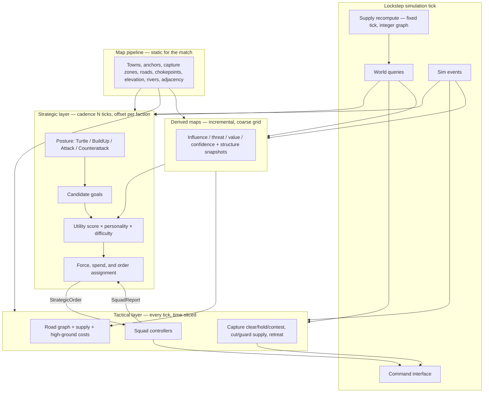

# Enemy AI Design

**Status:** Proposed  
**Audience:** Game designer, lead engineer, map pipeline engineer  
**Scope:** Single-player launch AI. Multiplayer and replays are out of scope as features, but the AI is designed so they can be added later without a rewrite.  
**Related:** Launch is PC/Steam, Unity, post-apocalyptic RTS on generated real-world maps (100×100 or 200×200 miles). Core loop: fortify held ground, then assault neighboring enemy territories.

This is the working contract for enemy AI. Numbers marked **placeholder** are starting values for the first playable; they are not balance commitments.

Designer answers in [Draft designer positions](#draft-designer-positions-pending-garand-sign-off) are **draft pending Garand’s sign-off**. Lead-engineer answers in [Lead engineer decisions](#lead-engineer-decisions) are **locked decisions**, not drafts.

---

## Contents

1. [Goals and non-goals](#1-goals-and-non-goals)
2. [Architecture](#2-architecture)
3. [Reading real terrain](#3-reading-real-terrain)
4. [Determinism](#4-determinism)
5. [Difficulty](#5-difficulty)
6. [Faction personalities](#6-faction-personalities)
7. [Performance budget](#7-performance-budget)
8. [Testing and tuning](#8-testing-and-tuning)
9. [Open questions](#9-open-questions)
10. [Phased implementation plan](#10-phased-implementation-plan)

---

## Draft designer positions (pending Garand sign-off)

These are the Game Designer’s draft answers. They are **not final** until Garand signs off. Until then, AI behavior in this doc follows them so engineering has one spec.

| Topic | Draft position | AI consequence |
| --- | --- | --- |
| Scale | **Operational.** Each unit is a battalion or convoy. Players zoom from the strategic map down into fights. | AI commands **squads** (first-class sim entities that group battalions/convoys). It never commands individual units. Tactical layer is route, capture-zone, and supply behavior, not soldier spacing. |
| Factions | **Not defined yet** (they depend on the apocalypse premise). | Keep Warlord / Settler / Raider as **parameter archetypes**. Each real faction will map onto one of them. Do not fork the planner. |
| Capture | Every town has a **capture zone** and a **garrison**. Clear all enemy combat units from the zone, then hold it uncontested for a timer (**60 s village, 120 s town, 180 s city**). An enemy combat unit in the zone **pauses** the timer; it does not reset. A territory belongs to whoever holds its **anchor town(s)**; some regions have several anchors and you need **all** of them. Fortified buildings **slow** capture; they do not block it. | Assault = clear then hold. Contest = park combat units in the zone to pause. Score multi-anchor regions as a set. Defend and reinforce capture zones first. |
| Supply | Cutting roads **does** starve supply. Supply traces the **road graph** from depots and HQ to units. A segment is cut when an enemy **holds its node** or a **bridge is destroyed**. A unit is out of supply when it has no friendly road path back to a depot within a **short off-road** snap distance. Out-of-supply units stop refilling fuel and ammo. After ~**60 s** grace, fire rate and speed drop and they **cannot reinforce**. Off-road movement penalties are a separate rule. Supply is recomputed on a **fixed tick** with integer graph math. | Raid/cut enemy roads and bridges, guard own lines, do not over-extend, bake supply into routes and assault timing, value bridges and junctions. Read supply from sim hooks. |
| Fog | Vision is **per player**, from **units and buildings**, with **terrain LoS** from the heightmap (high ground sees further, ridges block). Recon units get extra range. Explored enemy structures persist as **last-seen snapshots**. **No** global reveal of own territory. | AI **never** cheats fog. Scout with recon and high ground. Memory = snapshots + confidence decay. Own empty ground is fog unless a unit or building sees it. |
| Brutal | **+10% income is acceptable** at launch. It is the **only numeric advantage**. The rest of Brutal is better decisions. | `EconomyBonusPpt` is the single tunable resource cheat. Cadence, mistakes, memory, and operational quality are not extra money or vision. |

---

## Glossary

| Term | Meaning |
| --- | --- |
| **Unit** | A battalion or convoy. Lives inside a squad. The AI never issues commands to unit ids. |
| **Squad** | First-class sim entity with a stable id and its own order table. Operational grouping of units (not a 10-person fire team). Orders target squads. The sim moves, forms, and picks targets inside the squad. Player **form / split / merge** are also commands. |
| **Capture zone** | The town volume that must be empty of enemy combat units, then held, to capture. |
| **Anchor** | A town that must be held to own its territory. Some territories have several; all are required. |
| **Depot / HQ** | Supply sources. Units need a friendly road path to one (plus a short off-road snap). |

---

## Lead engineer decisions

These are **decisions**, not drafts. They lock the sim seams the AI is written against. Names of hooks may still be bikeshed; the behavior must not drift.

| Topic | Decision |
| --- | --- |
| Tick | **20 Hz (50 ms)**, locked. |
| Command delay | `commandDelayTicks` is a **match-setup constant** shared by player and AI. Default **2 ticks (100 ms)** in single-player; higher in multiplayer. **Never hardcoded.** Commands are stamped `executeTick = issuedTick + commandDelayTicks`. Difficulty may add `ReactionExtraTicks` on top for Easy/Normal/Hard; that is a difficulty parameter, not a substitute for the match delay. |
| Numeric types | Sim state: **integer cm**, `int32` per axis; **`int64`** for squared distances and path costs; ratios as **int ppt**. Core has **Fixed64 (Q32.32)** for internal math only (sqrt, movement stepping, angles); results are always stored back as cm or ppt. **Nothing** in sim state, hashes, or events is Fixed. **Q16.16 in int32 is ruled out** (cannot cover a 200-mile map). |
| Road A\* | **Core sim owns it.** `PathOnRoads` and `EstimateTravelTicks` are sim services. `PathRequestsPerTick` and the unreachable cache keyed on `(from, to, weightKey, graphVersion)` live in that service. `costWeights` are integer ppt. |
| Entity model | **Squads are first-class** sim entities. Orders target squads. Sim handles unit movement, formation, and target selection within a squad. AI never commands individual units. |
| Command queue | The lead engineer’s in-progress foundation PR defines the first command queue. The AI **plugs into it**. |
| Threading | Launch: **fixed-step sim on the main thread**. A dedicated sim thread comes later. The AI stays **inside the sim tick** either way. |
| Core / headless | Core is **pure C# with no `UnityEngine`**. Headless runs via `dotnet test` or a console host in GitHub Actions. |
| Blobs | Map and AI blobs: **custom versioned little-endian binary**. Arrays sorted by id. **No hash-set rebuild on load.** |
| Hash / PRNG | **xxHash64** and **PCG32**, both in-repo with golden tests. `hash64` means xxHash64 over the listed fields. |
| Perf targets | **1.5 ms AI** and **8 ms sim** are the accepted targets. The wall-clock **ship gate waits for a vertical slice**. The **AI work-unit cap alone** governs behavior. |
| Per-PR CI | Frozen golden **100×100** map, **2 AI** factions, **12,000 ticks** (10 game minutes), run **twice** with the same seed, identical hashes every **200** ticks, finish in **under 5 minutes**. |
| Nightly soak | Starts at about **200** matches and grows toward **1,000** once there are perf numbers. |
| Cross-check | Windows-vs-Linux hash-stream check is added **later, before multiplayer**. |
| Headless speed | Goal (not a commitment): at least **50× realtime** on 100×100 with 2 AIs. |

---

## 1. Goals and non-goals

Launch is single-player against AI opponents. The AI *is* the opposing side of the game. If it cannot hold towns, spend, expand, and attack in a way that reads as a faction living on the map, there is no match.

### 1.1 Launch goals

| Goal | What “good” looks like |
| --- | --- |
| Credible opponent | An AI faction takes anchor towns by clearing and holding capture zones, fortifies, cuts or guards supply, and assaults neighbors on a cadence a player can read and counter. |
| Fair information | The AI only knows what its units and buildings see, plus last-seen snapshots of explored structures. It never cheats fog. Own territory is not auto-revealed. |
| Personality | Real factions share one brain and map onto Warlord / Settler / Raider parameter profiles. Those three archetypes should not play the same match. |
| Terrain literacy | The AI uses roads, supply, chokepoints, bridges, high ground (movement **and** vision), rivers, and town/anchor value — not a Euclidean rush. |
| Deterministic sim | Same match seed + same inputs → identical AI decisions. Required for headless test, later replays, later lockstep netcode. |
| Tunable difficulty | Easy through Brutal are parameter sets, not separate AIs. Brutal’s only numeric advantage is `EconomyBonusPpt`. |
| Budget-bound | Several AI factions on a 200×200 mile map stay inside the per-tick work budget (see §7). |

The player should be able to answer, after a loss: “they cut the bridge, starved my garrison, walked into the capture zone, and held it.” That is the quality bar. Opaque omniscience is a failure even if the AI wins.

### 1.2 Non-goals (launch)

- Player-vs-player, co-op, or any networked lockstep session.
- Replay file format, spectator desync UI, or checksum negotiation.
- Machine-learned policies, behavior cloning, or runtime training.
- Company- or soldier-level micro (stutter-step, ability weaving, pixel kiting). The player may zoom into a fight; the AI still issues **operational** commands to **squads** only.
- Hand-authored per-map scripts, waypoints, or trigger chains. Maps come from the pipeline; the AI must generalize.
- Naval, air, or subterranean layers unless design later adds them as first-class movement graphs.
- Diplomacy, trading, or more than one relationship to the player (hostile). Neutral towns are world state, not AI actors.
- A designer-facing live tuner in the first playable. Debug overlays and JSON/ScriptableObject parameter files are enough until M5.

### 1.3 Deferred, but designed for

Replays and multiplayer need the same command stream and the same tick. That is why this doc forbids `Time.deltaTime`, dictionary iteration, physics queries, and wall-clock branching in AI decision code *now*, while launch is still offline.

---

## 2. Architecture

Two layers, one command pipe.

The **strategic layer** thinks in towns, anchors, territories, supply, economy, and posture. It runs on a fixed cadence of simulation ticks (a few seconds of game time) and emits orders.

The **tactical layer** thinks in **squads**. It runs every tick (time-sliced) and turns orders into the same commands a player issues.

Neither layer moves units by writing transforms. Both go through the shared command interface (§4.3). The sim moves, forms, and selects targets **inside** a squad. Zooming the camera into a fight is presentation; it does not unlock a second AI.



### 2.1 Strategic layer

**Cadence.** Default planning period is `StrategicCadenceTicks` (Normal: 40 ticks = 2.0 s at 20 Hz). Each faction’s plan tick is offset so they do not all run on the same tick:

```
planThisTick(faction) =
  (tick + factionId * FactionPlanOffsetTicks) % StrategicCadenceTicks == 0
```

`FactionPlanOffsetTicks` default is 3. Cadence stretches on Easy and tightens on Hard/Brutal (§5).

**Inputs, each plan tick.**

- Static map contract (§3.1), including anchors and capture-zone radii.
- Derived maps (§3.2), last fully committed slice, plus last-seen structure snapshots.
- Own economy snapshot: resources, build queues, upkeep.
- Own army snapshot: squads, unit supply state, strength, orders, recovery.
- Own supply graph view: depots, HQ, held nodes, intact bridges, units at risk of OOS.
- Observed enemy: towns, units, and threats inside fog-honest vision plus memory with a TTL / snapshots.
- Recent `SquadReport`s since the last plan tick.
- Capture-zone timers the faction can see (own zones always; enemy zones only if currently visible or last-seen as capturing).

**Posture.** A faction is in exactly one posture. Posture is itself a scored choice with hysteresis so it does not chatter.

| Posture | Intent | Typical orders |
| --- | --- | --- |
| Turtle | Hold what we have. | Fortify anchors, park garrisons in capture zones, guard supply nodes/bridges, delay expansion. |
| BuildUp | Grow economy and army. | Claim empty towns, spend on production, scout from high ground, light supply raids only. |
| Attack | Commit to taking a neighbor. | Assault the next anchor (clear + hold) + screening + cut-road/bridge raids. |
| Counterattack | Punish a push on our ground. | Contest our capture zones (pause their timer), retake, restore supply, then re-evaluate. |

Hysteresis: a new posture must beat the current score by `PostureSwitchMarginPpt` (placeholder **150**, i.e. 15%) and stay ahead for `PostureMinHoldTicks` (placeholder **200** ticks = 10 s). Combat events (anchor lost, capture of ours started, army routed, supply cut to HQ) may bypass the hold timer.

**Candidate goals.** The planner does not search an open-ended action tree. It *generates* a bounded set of typed goals from the map and current state, scores them, then picks a non-conflicting subset that fits army, supply, and resource budgets.

| Goal type | Target | Generated when |
| --- | --- | --- |
| `ClaimTown` | empty / contestable town | Adjacent to held territory, or reachable via supplied roads. Completing an anchor set is preferred over a non-anchor. |
| `FortifyTown` | owned town | Town is an anchor, value high, or threat on its capture zone above threshold. |
| `AssaultTown` | enemy town | Neighbor territory; force ratio vs estimate above personality threshold; a supplied route to the capture zone exists or can be opened. |
| `ContestCapture` | town whose enemy timer is ticking | Any visible (or last-seen-in-progress) enemy capture of a town we care about. Cheap: one combat unit in the zone pauses the timer. |
| `HoldCaptureZone` | town we are capturing, or an owned zone under threat | After the zone is cleared, until the timer completes; or garrison an owned anchor. |
| `Raid` / `CutSupply` | enemy road node, junction, or bridge | Attack/BuildUp; holding the node or destroying the bridge cuts a path from their depot to a town or field force. |
| `GuardSupply` | own depot-path node or bridge | Degree ≥ 2 junction, bridge, or the last path to an exposed squad / anchor. |
| `HoldChokepoint` | chokepoint id | Controls access to a valued town we own or want, or sits on a supply path. |
| `ScoutRegion` | coarse-grid region or ridge cell | Confidence stale; fog-honest; prefer high ground that LoS-covers a road or capture zone. |
| `ExpandEconomy` | build slot / town | BuildUp or Turtle with spare income. |
| `CounterattackForce` | lost or threatened anchor | Posture Counterattack, or incoming capture of an owned zone. |
| `Recover` | owned rally town that is in supply | Army below recovery strength after a fight. |

Hard cap: `MaxCandidateGoals` = **64** per plan tick. If generation exceeds the cap, keep the highest *heuristic pre-score* (anchor bonus × town value × inverse distance, integer) so the utility pass stays bounded.

**Utility scoring.** Each candidate `g` gets an integer millipoint score:

```
score(g) = clamp(
    Σ_i  weight[i] * feature[i] * personalityMul[i] * difficultyMul[i]
    + postureBias[g.type, currentPosture]
    − conflictPenalty(g, alreadyPicked),
    ScoreMin, ScoreMax)
```

All terms are `int32` millipoints. Features are already in parts-per-thousand (ppt, 0–1000) or millipoints; there is no floating-point in this path.

| Feature (all ppt or millipoints) | Typical use |
| --- | --- |
| `townStrategicValue` | From pipeline, 0–1000. |
| `anchorBonus` | Extra if the town is an anchor; larger if we already hold `anchorsHeld / anchorsRequired − 1` of that territory. |
| `territoryValue` | Value of the territory **if this capture would complete its anchor set**; otherwise a fraction. Non-anchors do not flip ownership. |
| `captureProgressPpt` | Ours: finish a ticking hold. Enemy: contest a high-progress timer (pause is high value per unit). |
| `threatOnTarget` | Threat map sample at the capture zone. |
| `ownInfluenceNearTarget` | Influence map sample. |
| `forceRatioPpt` | Estimated own committed strength / estimated defenders in the zone. |
| `defenderSupplyPpt` | Low if we have cut their road to the town — assault sooner. High if they are supplied — isolate first. |
| `ownSupplySafetyPpt` | Penalty if the assigned force would go OOS on the approach or during the hold timer. |
| `roadAccessPpt` | 1000 if a friendly-controlled, supplied road reaches it; less if off-graph. |
| `chokepointBonus` | Set if taking/holding it gates a high-value town **or** a supply path. |
| `bridgeJunctionValue` | Extra for bridges and high-degree road nodes (cut or guard). |
| `visionGroundBonus` | High-ground / ridge cells that would reveal a road or zone (scout and overwatch). |
| `economyNeedPpt` | High when income < upkeep + planned spend. |
| `distanceCost` | Travel ticks on the road graph from nearest owned staging town **that is in supply**. |
| `fogUncertainty` | Penalty (or scout bonus) when confidence is low; never treated as vision. |
| `recentFailurePenalty` | Same goal type+target failed within `FailureMemoryTicks`. |

Weights live in the personality profile (§6). Difficulty scales a subset: reaction, aggression, scout weight, mistake injection (§5).

**Selection.** Greedy: sort candidates by score (stable sort, `goalId` as tie-break), then accept if:

1. Score > `MinAcceptScore` (placeholder **1000**).
2. Remaining army strength and resource budget cover `g.cost`.
3. A **supplied** route exists, or a `GuardSupply` / `CutSupply` order that opens/closes it is already accepted this pass (order matters: accept supply-enabling goals before the assault that needs them).
4. Target is not already claimed by an accepted goal of an incompatible type (two assaults on the same town merge; assault vs fortify on the same town conflict; `ContestCapture` may stack with a later `AssaultTown`).

Cap accepted goals at `MaxActiveOrders` = **12** per faction. Drop the rest. Idle leftover strength is assigned to `HoldCaptureZone` on the highest-threat owned **anchor** that is in supply (implicit, not a generated candidate).

Do **not** accept an `AssaultTown` whose hold duration (capture timer, slowed by visible fortification) exceeds the time the force can stay in supply. Isolate first, or cancel.

**Spending.** Economy is a goal type, not a free-form script. On a plan tick the faction has a spend envelope:

```
spendable = currentResources - ReservePpt * netIncomePerCadence / 1000
```

`ReservePpt` is a personality field. Spend priority within the envelope: (1) repairs / fortify on threatened anchors and their capture zones, (2) unit production to reach `TargetArmyStrength` (including recon if confidence is stale), (3) expansion buildings, (4) extra scouts. Exact building IDs are a designer fill-in; the AI only needs a tagged catalog: `Production`, `Fortification`, `Economy`, `Intel` (recon).

Brutal’s `EconomyBonusPpt` is applied by the **sim economy**, not by the AI inventing extra builds.

### 2.2 Tactical layer

The tactical layer issues orders to **squads**. A squad is a first-class sim entity: stable id, its own order table, one or more battalions/convoys, a movement posture, a route, and a supply flag copied from sim. The sim moves units, holds formation, and picks targets **inside** the squad. The AI never commands individual units. Player form / split / merge are commands on the same queue.

The player may zoom into the fight those battalions are in; the AI does not switch layers.

**Squad controller, every tick it is scheduled.**

1. Apply incoming order (new, updated, or cancel).
2. Refresh route if the order target, threat on the current path, a blocked/held edge, a destroyed bridge, or **supply connectivity** changed.
3. Choose movement posture from context (road column vs deployed at the zone).
4. Issue commands: move, attack-move, hold (in capture zone or on a node), destroy-bridge (if the order says so), retreat.
5. Evaluate reinforce / retreat / contest rules. **Do not request reinforce if the squad is past supply grace** — the sim will reject it.
6. Emit a report if status, objective, supply, or intel changed.

**Route choice.** Operational movement is A\* on the **road graph**, not a unit mesh.

Edge cost (integer):

```
cost(e) =
    e.travelCost
  + ThreatWeight * sampleThreat(e)
  + SlopeWeight * e.slopeCost
  − HighGroundWeight * e.highGroundBonus   // assault approach and scout overwatch
  + EnemyControlPenalty * e.controlRisk    // enemy-held node = cut
  + SupplyBreakPenalty * e.wouldBreakSupply
  − VisionWeight * e.visionFromHighGround  // scout / overwatch orders
```

`wouldBreakSupply` is 1 when occupying or traversing `e` (or a planned off-road snap) would leave the squad with no path to a depot. Raids that *intend* to cut may pay this; assaults and holds may not.

Weights come from personality + current order type (a raid pays more to avoid threat; an assault pays more for high ground on the approach **and** refuses OOS approaches; a scout pays for vision). `costWeights` passed to `PathOnRoads` are integer ppt; the service returns an `int64` cost. If the road graph cannot reach the target, fall back to a coarse-grid corridor (same 1-mile cells as influence) and rejoin the road graph at the nearest node **within `SupplySnapCm`**. Last-mile into a capture zone is a short operational path on a local integer grid provided by sim, not Unity NavMesh. Off-road movement penalties are sim rules; the AI only chooses when a snap is worth it.

**Movement postures** (operational, not fire-team formations).

| Context | Posture | Rule |
| --- | --- | --- |
| Road travel | Column / convoy | Stay on the edge; do not leave the road on a bridge. |
| Open approach | Deployed | Face the capture zone; prefer adjacent high-ground cells for vision into the zone. |
| Chokepoint / junction hold | Compact | Occupy the **node** (this is what cuts or guards supply). |
| Capture clear / hold | Zone occupy | Combat units **inside** the capture zone. Do not sit on the ring and hope. |
| Contest | Zone occupy | At least one combat unit inside the enemy ticking zone — enough to pause. |
| Retreat | Column | Fastest **supplied** road toward a depot or in-supply owned town; ignore high-ground bonus. |

Posture is a squad stance command. Unit spacing on the road is the sim’s formation follower, shared with the player.

**Taking a town (replaces wall-siege).** Capture is a **zone clear + uncontested hold**, not a fortification-break. Fortifications only lengthen the timer. `AssaultTown` phases:

| Phase | Entry | Behavior | Exit |
| --- | --- | --- | --- |
| Approach | Order assigned | Road route that **stays in supply** to staging; prefer high ground with LoS into the zone. | Staging reached, or aborted (path/supply). |
| Isolate | Personality / force ratio / `defenderSupplyPpt` | `CutSupply`: hold nodes or destroy a bridge on the town’s depot path so the garrison goes OOS (no refill; after grace they slow and cannot reinforce). | Defenders OOS, **or** skip if `forceRatioPpt` already ≥ `SiegeAssaultRatioPpt`, **or** `MaxIsolateTicks`. |
| Clear | Combat units enter the capture zone | Attack-move until **no enemy combat units** remain in the zone. Fortified buildings are fought through; they do not gate this phase. | Zone clear, or retreat. |
| Hold | Zone clear of enemy combat | Stay inside the zone. Timer runs (`CaptureTicksVillage/Town/City`, then slowed by visible fortification). | Town captured; **or** an enemy combat unit enters (timer **pauses**, phase stays Hold); **or** retreat. |

If ratio never supports Clear, the squad holds at staging and reports `WaitingOnForce`. Strategy may send another squad, cut supply first, or cancel.

**Contesting an enemy capture.** `ContestCapture` is deliberately cheap: **any** friendly combat unit inside the zone pauses their timer. The squad does not need to win the fight to be useful. If it can also Clear, it upgrades in place to a retake (`HoldCaptureZone` after Clear). Priority: contest **anchors** whose timer is furthest along.

**Defense and reinforcement around capture zones.**

- Highest priority: owned capture zones whose enemy timer is ticking (contest now).
- Next: owned **anchors** with threat in or on the road to the zone.
- Next: the last remaining friendly path (node/bridge) that supplies those zones.
- Then other towns.

A squad reports `NeedReinforce` when `strengthPpt < ReinforceBelowPpt` (placeholder **600**) while the order is still active, not retreating, and **`supplyState != OutOfSupplyPastGrace`**. Strategy assigns the nearest idle in-supply squad whose travel ticks ≤ `ReinforceMaxTravelTicks` **without** going OOS. Tactical never steals a squad off a higher-priority capture-zone order.

**Retreat.** Evaluated every scheduled tactical tick, integer prediction only:

```
predictedOutcomePpt = ownStrengthPpt * terrainDefenseMul / max(1, enemyStrengthPpt)
```

Retreat if `predictedOutcomePpt < RetreatThresholdPpt` **and** the order is not `HoldCaptureZone`/`HoldChokepoint` with `lastStand` (Turtle on an anchor may set this). Also retreat toward a depot if `supplyState == OutOfSupply` and remaining grace < `SupplyRetreatGraceTicks` (placeholder **400**) unless `lastStand`. `RetreatThresholdPpt` is personality × difficulty. Destination: nearest owned in-supply town with garrison capacity, via lowest-threat **supplied** road. Broken squads (`strengthPpt < BrokenPpt`, placeholder **150**) auto-retreat regardless of order, then `Recover`.

### 2.3 Orders down, reports up

Orders and reports are sim data, serialized the same way player commands are. They are not Unity events.

**`StrategicOrder`**

| Field | Type | Notes |
| --- | --- | --- |
| `orderId` | `int32` | Monotonic per faction. |
| `factionId` | `int32` | |
| `type` | `enum` | Mirrors goal type. |
| `targetKind` | `enum` | `Town`, `Territory`, `RoadNode`, `Chokepoint`, `Bridge`, `Region`, `None`. |
| `targetId` | `int32` | Id in that space; 0 if none. |
| `stagingNodeId` | `int32` | Optional road node. |
| `squadIds` | `int32[]` | Sorted ascending. |
| `priority` | `int16` | Higher wins conflicts. Capture-zone contest > field raid. |
| `resourceBudget` | `int32` | Spent via economy commands; 0 if N/A. |
| `issuedTick` | `int32` | |
| `expiresTick` | `int32` | Hard cancel if still incomplete. Must exceed the capture timer for `HoldCaptureZone`. |
| `flags` | `uint32` | bit0 `lastStand`, bit1 `raidAvoidSiege` (Raider: cut/contest, skip long holds), bit2 `destroyBridge` |

**`SquadReport`**

| Field | Type | Notes |
| --- | --- | --- |
| `squadId` | `int32` | |
| `orderId` | `int32` | 0 if idle. |
| `status` | `enum` | `Idle`, `Moving`, `Staging`, `Isolating`, `Clearing`, `Holding`, `Contesting`, `GuardingSupply`, `Retreating`, `Broken`, `WaitingOnForce`. |
| `strengthPpt` | `int16` | 0–1000. |
| `supplyState` | `enum` | `InSupply`, `OutOfSupply`, `OutOfSupplyPastGrace`. |
| `positionCm` | `int32 x, y` | Squad centroid, centimeters. |
| `nodeId` | `int32` | Nearest road node. |
| `inCaptureZoneTownId` | `int32` | 0 if none. |
| `lastCombatTick` | `int32` | 0 if none. |
| `intelCount` | `int8` | 0–8. |
| `intel` | `IntelContact[8]` | Currently visible contacts **plus** snapshot refs this force can see. |
| `failReason` | `enum` | `None`, `PathUnreachable`, `ForceTooWeak`, `TargetLost`, `OutOfSupply`, `Expired`, `Cancelled`. |

**Flow.**

1. Strategy writes orders into the faction’s order table (sim state).
2. Assigned squads observe the table the next time they are scheduled (usually the same tick, after strategy, if this faction’s tactical slice runs later in the tick; otherwise next slice — see §7.2). Same-tick vs next-slice is a *fixed* schedule, not a race.
3. Tactical issues player-identical commands into the **same command queue**. Each command is stamped `executeTick = issuedTick + commandDelayTicks` (match-setup constant; default 2 in SP). Difficulty may add `ReactionExtraTicks` to that delay for Easy/Normal/Hard. Capture happens because the squad occupies the zone, not because the AI issues a special “claim” command. `CanIssue` is advisory; a command can still reject at `executeTick` (`CommandRejected`).
4. Reports are appended to a per-faction ring buffer, consumed on the next plan tick and on listed events (`CaptureStarted`, `CapturePaused`, `TownOwnerChanged`, `SquadBroken`, `NeedReinforce`, `SupplyStateChanged`, `BridgeDestroyed`).

The player never sees `StrategicOrder` / `SquadReport`. They see battalions move, timers pause, and towns change hands.

---

## 3. Reading real terrain

Maps are not handmade. The AI cannot be given designer ink. It needs a **stable, integer, match-static contract** from the map pipeline, plus **derived maps** it maintains itself.

### 3.1 Map pipeline contract (match-static)

Pipeline bakes one blob (or a small set of blobs) that the sim loads at match start. Map and AI blobs use a **custom versioned little-endian binary** format. Arrays are stored pre-sorted by id. Load must not rebuild a `HashSet`/`Dictionary` iteration order. The AI reads the blob read-only. If a field cannot be produced yet, the pipeline still reserves the field and fills a documented default so the AI does not branch on “data missing.”

A **frozen golden 100×100** blob is required for per-PR CI (§8). Do not churn that file.

Ids are dense `int32` starting at 1.

#### Towns

```
TownRecord
  id                    int32
  positionCm            int32 x, y          // world centimeters
  territoryId           int32
  nameHash              int32               // debug only; not used in decisions
  populationClass       int8                // 0 village, 1 town, 2 city (3–4 reserved)
  isAnchor              bool                // must be held to own territoryId
  captureZoneRadiusCm   int32               // capture volume, integer
  captureTicks          int32               // 1200 / 2400 / 3600 at 20 Hz for 60/120/180 s
  strategicValue        int16               // 0..1000, pipeline-authored
  supplyCapacity        int32               // abstract supply units / depot potential
  fortificationSlots    int8
  defaultFortification  int8                // 0 = open town; slows capture, does not block
  roadNodeId            int32               // gate / center node on the road graph
  neighborTownIds       int32[]             // sorted; towns sharing a road or territory edge
```

`strategicValue` is the pipeline’s opinion (population, road degree, chokepoint proximity). The AI may add situational value (anchor-set completion, supply); it does not replace this field.

`captureTicks` is baked from class so the AI does not re-derive 60/120/180 s in float. Fortification slow is **runtime** (sim): AI reads `captureSlowMulPpt` from `TownState`, not from this blob.

#### Territories

```
TerritoryRecord
  id                    int32
  townIds               int32[]             // sorted
  anchorTownIds         int32[]             // sorted; ALL must be held to own the territory
  neighborTerritoryIds  int32[]             // sorted, adjacency for the core loop
  areaSqM               int32               // square meters, integer
  resourceYield         int32               // placeholder economy units per cadence
  centroidCm            int32 x, y
```

Ownership is **anchor-complete**, not majority-of-towns. Adjacency is the assault graph: you assault a neighbor, not a territory two hops away, unless a later design change says otherwise. The AI will still *raid* through a neighbor into a deeper road node if the road graph allows.

#### Road graph

```
RoadNode
  id                    int32
  positionCm            int32 x, y
  elevationCm           int32
  kind                  int8                // 0 Junction, 1 TownGate, 2 Bridge, 3 Chokepoint, 4 Way, 5 Depot
  chokepointId          int32               // 0 if none
  degree                int8                // baked edge count; junctions score higher

RoadEdge
  id                    int32
  a, b                  int32               // node ids, a < b
  lengthCm              int32
  travelCost            int32               // length × surface × slope, integer
  slopeCost             int32               // extra cost from grade
  highGroundBonus       int32               // for the endpoint with higher elevation
  widthClass            int8                // 0 trail .. 3 highway; convoy width
  surface               int8                // 0 dirt, 1 paved, 2 wrecked, 3 impassable
  isBridge              bool
  bridgeId              int32               // 0 if none; destroyed bridges bump graphVersion
  controlTownId         int32               // town whose owner is treated as controlling this edge; 0 if none
```

Pathfinding uses `travelCost`, never raw meters alone. Impassable edges stay in the blob with `surface = 3` so debug tools can still draw them; the AI skips them.

A node is **held** (and its incident supply segments cut) when an enemy combat unit occupies it — runtime, not baked. The blob only marks candidates (junctions, bridges, chokepoints).

#### Chokepoints

```
ChokepointRecord
  id                    int32
  roadNodeId            int32
  widthCm               int32
  defensibility         int16               // 0..1000
  gatesTerritoryIds     int32[]             // sorted; territories this point controls access to
  relatedTownId         int32               // 0 if none
  onLikelySupply        bool                // pipeline hint: sits on a highway between towns
```

How the pipeline detects a chokepoint is its problem (narrow road corridor, river crossing, mountain pass). The AI consumes `defensibility`, `gatesTerritoryIds`, and `onLikelySupply`.

#### Elevation and slope (coarse)

Same resolution as the AI grid (§3.2): **1 mile** cells, origin at map min corner, row-major, `index = y * widthCells + x`.

```
ElevationCell
  elevationCm           int32               // representative (mean or centroid sample)
  slopePpt              int16               // rise/run × 1000, 0..1000+
  class                 int8                // 0 Flat, 1 Gentle, 2 Steep, 3 Impassable
  ridgeHint             bool                // pipeline: local LoS block / vision perch
```

This is **not** the render heightmap. Unit collision, true LoS, and vision range stay in the sim (heightmap LoS). The AI uses this grid for influence, approach bonuses, coarse corridors, and **where to send recon** (high `elevationCm` / `ridgeHint` covering a road or capture zone). It must not raycast the Unity terrain.

#### Rivers and bridges

```
RiverSegment
  id                    int32
  polylineCm            int32[]             // x,y pairs, simplified
  blocksLand            bool                // true: land path must use a bridge

BridgeRecord
  id                    int32
  roadNodeId            int32
  riverId               int32
  widthClass            int8
  destroyable           bool                // default true
```

If `blocksLand` is true, tactical pathing may not cross that polyline except at an **intact** `BridgeRecord`. Destroying a destroyable bridge cuts supply through that node until repaired (sim). Off-road penalties do not let a unit “almost cross” a blocking river for supply.

#### Header

```
MapAiHeader
  schemaVersion         int32               // this doc: 1
  mapWidthCm            int32
  mapHeightCm           int32
  cellSizeCm            int32               // must be 160934 (1 mile) unless versioned
  gridWidth             int32
  gridHeight            int32
  townCount             int32
  territoryCount        int32
  roadNodeCount         int32
  roadEdgeCount         int32
  chokepointCount       int32
  riverCount            int32
  bridgeCount           int32
```

`cellSizeCm` is part of the contract so a later 800 m grid is a version bump, not a silent change.

### 3.2 AI-derived maps

Per faction, on the same coarse grid:

| Layer | Cell payload | Meaning |
| --- | --- | --- |
| Influence | `int16` | Own friendly presence, decayed. |
| Threat | `int16` | Observed hostile presence, decayed. |
| Value | `int16` | Situational prize: anchors, capture progress, economy, bridges/junctions, current goals. |
| Confidence | `int16` | Fog honesty: 1000 = currently seen by own units/buildings, decays to 0. Own territory is **not** auto-1000. |

**Structure snapshots** (side table, not a grid): every enemy building/town this faction has **ever** seen keeps a last-seen record until match end (or a designer-set TTL, default: persist). Fields: `id`, `kind`, `lastOwner`, `lastFortLevel`, `lastCaptureProgressPpt`, `lastSeenTick`. Confidence for the *cell* still decays; the snapshot remains queryable so the AI can plan against a town it explored even when fogged. Snapshots are **not** live truth — owner and garrison may have changed.

Enemy units the faction cannot see do not write into Threat as truth; they write into **unit memory** at last-seen strength and decay with `MemoryDecayPerCadence`. Easy decays faster than Brutal. Structures do not use that decay to vanish.

**Stamps (integer, saturating).**

- Friendly squad at cell: add `strengthPpt * InfluenceStampMul / 1000`, then spread Chebyshev radius `InfluenceRadiusCells` (placeholder **2**) with linear falloff in ppt.
- Observed enemy unit: same into Threat.
- Owned or snapshotted town: add `town.strategicValue` into Value, plus `anchorBonus`, plus `fortificationLevel * FortValueMul` (from snapshot if fogged).
- Capture zone currently ticking (visible): add `captureProgressPpt` into Value for both the attacker’s finish-hold and the defender’s contest.
- Bridges and high-degree junctions: add `bridgeJunctionValue` into Value if they sit on a known supply path (own: guard; enemy: cut).
- Pipeline chokepoint: add `defensibility` if we own or contest a gated territory or supply path.
- Ridge / high-elevation cells that LoS-hint a fogged road: scout value, not threat.

**Incremental update.** Full-grid rebuilds are forbidden on 200×200 (40,000 cells × 4 layers × N factions).

Each sim event dirties an AABB in cell space:

| Event | Dirty region |
| --- | --- |
| Squad moved to a new cell | Old cell ∪ new cell, expanded by `InfluenceRadiusCells` |
| Combat start/end | Combat cell + radius |
| Town owner / fortification / capture progress change | Town cell + `TownDirtyRadius` (placeholder **3**) |
| Bridge destroyed / repaired, node held/released | Node cell + adjacent edge cells |
| Supply recompute changed a unit’s `supplyState` | That unit’s cell + path cells if a cut appeared |
| Vision gained/lost | The vision delta cells (sim supplies the set, sorted) |

Each tick, a faction processes at most `MaxDirtyCellsPerTick` (placeholder **512**) from its dirty queue (queue is a sorted set of cell indices, drained in index order). Overflow remains queued; it is not dropped. A low-frequency **full reconcile** runs on a deterministic schedule: `tick % ReconcilePeriodTicks == factionId` with `ReconcilePeriodTicks` = **2400** (120 s at 20 Hz), rebuilding from stamps rather than from the decaying field, to bound drift.

Value map additionally refreshes on plan ticks for cells that overlap active order targets (cheap: a few dozen cells).

### 3.3 What the AI must not read from the map

- Render meshes, terrain colliders, Unity NavMesh, camera, or scene hierarchy.
- Player-only markers, unrevealed resource nodes outside fog rules, or debug gizmos.
- Heightmap LoS via Unity raycasts. Vision is a sim query; the coarse elevation grid is a **hint** for scout placement.
- Live enemy structure/unit state that has never been seen this match, including in owned-but-unseen territory.
- Floating-point GIS source data. If the pipeline still has doubles internally, it quantizes to this contract before the match starts.

---

## 4. Determinism

All AI logic runs inside the lockstep **simulation tick**. Presentation, animation, audio, and UI may not feed a single bit back into AI.

The core sim is **pure C# with no `UnityEngine`**. Launch runs a **fixed-step sim on the main thread**; a dedicated sim thread comes later. The AI stays inside `AiOnTick` either way. If this section conflicts with a convenience in Unity, this section wins.

### 4.1 Hard rules

| Rule | Requirement |
| --- | --- |
| Tick | **20 Hz (50 ms)**, locked. Time is `tick` and `tick * 50 ms`. No `Time.deltaTime`. |
| Tick-only | AI runs in `AiOnTick(tick)`, never in `Update` / `FixedUpdate` / jobs that read presentation. |
| No wall-clock | No `DateTime`, `Stopwatch`, `Time.realtimeSinceStartup`, frame index, or “we’re running late so skip.” |
| No Unity | Core has no `UnityEngine`. No `Raycast`, `Overlap`, `NavMesh.CalculatePath`, `Rigidbody` reads. Sim provides integer queries, including vision/LoS. |
| Numeric types | Positions: **integer cm**, `int32` per axis. Squared distances and path costs: **`int64`**. Ratios: **int ppt**. AI decision code uses those integers only — no `float`/`double`/`Vector3` in scoring, path cost, supply, or PRNG. |
| Fixed64 | Core **Fixed64 (Q32.32)** is for **internal math only** (sqrt, movement stepping, angles). Results are always stored back as cm or ppt. **Nothing** in sim state, hashes, or events is Fixed. **Q16.16 in int32 is ruled out** (cannot cover a 200-mile map). |
| Ids only | Across ticks the AI keeps **ids only**, never references to sim objects. Re-query by id each tick. |
| Seeded PRNG | **PCG32**, in-repo with golden tests. Per-faction streams derived with **xxHash64**. Never `UnityEngine.Random`. |
| Stable iteration | No `foreach` on `Dictionary` / `HashSet`. Iterate arrays, or copy keys and sort by id. Blobs load with arrays already sorted; **no hash-set rebuild on load**. |
| Time-slicing | Expensive work is sliced on a schedule that is a pure function of `tick` and `factionId` (§7.2). A slice that hits the **work-unit cap** **defers** remainder; it does not “do less because the frame was heavy.” Wall-clock must not change behavior. |
| Commands | AI plugs into the **foundation command queue**. Same types as the player. `executeTick = issuedTick + commandDelayTicks`. `commandDelayTicks` is a **match-setup constant** (default **2** in SP, higher in MP) and **must never be hardcoded**. |
| Fog | World queries that return hidden entities must return “unknown” or a **snapshot**, never live truth. `FogCheat` stays `none` at all difficulties. |
| Supply | AI reads sim supply state. It may estimate cuts from the **visible** graph but must not recompute a private float supply model. |

Supply itself is a **sim** system: fixed-tick integer BFS/Dijkstra on the road graph from depots/HQ, snap ≤ `SupplySnapCm` off-road. The AI is a consumer.

### 4.2 PRNG

```
matchSeed        : uint64     // from match setup
factionStream    : uint64     = hash64(matchSeed, factionId, STREAM_AI_ROOT)
strategyRng      : PCG32      = seed from hash64(factionStream, STREAM_STRATEGY)
tacticalRng      : PCG32      = seed from hash64(factionStream, STREAM_TACTICAL)
mistakeRng       : PCG32      = seed from hash64(factionStream, STREAM_MISTAKE)
scoutRng         : PCG32      = seed from hash64(factionStream, STREAM_SCOUT)
```

`hash64` means **xxHash64** over the listed fields. PCG32 and xxHash64 live in the repo with golden tests.

Draws happen at defined points (goal tie-break jitter, mistake rolls, scout target among equals). Do not draw “to make the path look organic” on visual-only systems from these streams.

### 4.3 Simulation hooks the AI needs

Hook **behavior is decided** ([Lead engineer decisions](#lead-engineer-decisions)). Names may still be bikeshed. All queries are **pure reads** of sim state as of the start of the current tick (plus events already applied this tick, in documented order). The AI stores **ids**, not object references, across ticks.

The foundation PR owns the command queue. The AI enqueues onto it; it does not invent a second pipe.

#### World queries (fog-filtered unless noted)

| Hook | Returns | Fog |
| --- | --- | --- |
| `GetTown(id)` | `TownState` (owner, fortification, garrison ppt, capture progress ticks, paused flag, isAnchor, zone radius) | Never-seen: `Unknown` + empty. Explored: last-seen snapshot fields if not currently visible |
| `GetTerritory(id)` | Owner if all anchors known-held; else `Unknown`/`Contested` | Based on visible/snapshot anchors only |
| `GetCaptureZone(townId)` | Occupying combat faction ids, timer ticks, paused, slow mul | Own: always. Enemy: only if zone currently seen |
| `GetUnit(id)` | Position, strength, type, supply, parent `squadId` | Own: always. Enemy: visible only. **Read-only intel** — never a command target |
| `GetSquad(id)` | Position, strength, status, order, supply | Own: always. Enemy: only if currently visible |
| `EnumerateOwnSquads(factionId)` | Sorted ids | Own |
| `EnumerateVisibleEnemySquads(factionId)` | Sorted ids | Visible only |
| `EnumerateVisibleEnemyUnits(factionId)` | Sorted ids | Visible only; intel composition, not orders |
| `GetEconomy(factionId)` | Resources, income (already includes `EconomyBonusPpt` if Brutal), upkeep, queues | Own only |
| `GetBuildCatalog()` | Tagged buildings (static) | Public |
| `CanIssue(command)` | `bool` + reject reason | **Advisory only.** Authoritative validation is at `executeTick` and can still reject (`CommandRejected`) |
| `GetVisionDelta(factionId)` | Sorted cell indices gained/lost this tick | Own |
| `EnumerateVisibleCells` / building vision | Current vision set | Own; **not** all owned territory |
| `SampleElevation(cell)` | `ElevationCell` | Static, public |
| `GetRoadGraph()` | Read-only view of pipeline blob | Static, public |
| `GetGraphVersion()` | `int32` (bridges destroyed/repaired, surface changes) | Public |
| `PathOnRoads(fromNode, toNode, costWeights)` | Node list + `int64` total cost **or** unreachable | Sim-owned A\*. `costWeights` are **integer ppt**. Threat/held-node samples must be fog-filtered |
| `EstimateTravelTicks(from, to, costWeights)` | `int32` | Same service |
| `GetChokepoints()` | Read-only | Static, public |
| `GetAdjacency(territoryId)` | Neighbor ids | Static, public |
| `GetAnchors(territoryId)` | Sorted anchor town ids | Static, public |
| `HashWorldSlice(factionId)` | `uint64` (**xxHash64**) | Own known state |

`PathOnRoads` and `EstimateTravelTicks` are **core sim services**. The sim owns road A\*, the `PathRequestsPerTick` cap, and the unreachable cache keyed on `(from, to, weightKey, graphVersion)`. Player UI path preview may call the same service; the AI must. `costWeights` are integer ppt. Path costs in the result are `int64`.

#### Supply queries (sim-owned, integer, fog-filtered)

Supply is recomputed by the sim on a fixed tick (placeholder: every **10** ticks). AI must not run a second algorithm.

| Hook | Returns | Fog |
| --- | --- | --- |
| `GetSupplyState(squadId)` | `InSupply` / `OutOfSupply` + `graceTicksRemaining` | Own: always. Enemy: only if that squad is visible |
| `GetDepots(factionId)` | Sorted depot/HQ node ids | Own: always. Enemy: only explored snapshots |
| `HasSupplyPath(fromNode, factionId)` | `bool` + next hop | Own graph with **known** cuts (enemy-held nodes we see, destroyed bridges) |
| `GetNodeHolder(nodeId)` | Faction id or 0 | If the node is visible; else Unknown |
| `IsBridgeDestroyed(bridgeId)` | `bool` | Destroyed bridges are world facts (or snapshot if that is how sim treats wreckage — prefer public) |
| `EstimateEnemySupply(townId)` | `Unknown` / `LikelySupplied` / `LikelyCut` | From visible held nodes and destroyed bridges only |

#### Commands (same types as the player)

| Command | Payload (conceptual) |
| --- | --- |
| `CmdMove` | **squadId**, nodeId or positionCm, posture |
| `CmdAttackMove` | **squadId**, targetId or cell (into a capture zone to Clear) |
| `CmdHold` | **squadId**, nodeId or town capture zone (Hold / Contest) |
| `CmdSetStance` | **squadId**, stance (column, deployed, last stand, destroy-bridge intent) |
| `CmdFormSquad` | unitIds (sorted) — player/AI grouping; sim assigns the new squad id |
| `CmdSplitSquad` | squadId, unitIds to split off |
| `CmdMergeSquads` | squadIdA, squadIdB |
| `CmdDestroyBridge` | bridgeId (if the player can; reject if not destroyable) |
| `CmdProduce` | buildingId, unitType, count |
| `CmdBuild` | catalogId, townId or cell |
| `CmdFortify` | townId (slows future capture; does not block) |
| `CmdCancel` | commandId or production slot |

There is **no** `CmdClaimTown`. Capture is a sim process driven by combat occupancy of the zone. There is **no** command that takes a unit id as the mover; units move because their **squad** was ordered.

Every command carries `issuedTick`, `executeTick` (`issuedTick + commandDelayTicks`, plus AI `ReactionExtraTicks` when difficulty says so), `issuerId` (`Player` or `AiFactionId`), and a **sequence** number. They enter the **same queue** as player commands. Dispatch order is `(executeTick, issuerId, sequence)`.

`CanIssue` is **advisory**. Authoritative validation happens at `executeTick` and can still reject. The AI **must** handle `CommandRejected` (report `failReason`), not retry in a tight loop, and not assume `CanIssue == true` means the command will land. Reinforce commands against `OutOfSupplyPastGrace` squads must reject at execute.

#### Events (consumed in `eventId` order)

| Event | Why the AI cares |
| --- | --- |
| `TownOwnerChanged` | Dirty value map; interrupt plans; Counterattack; re-score remaining anchors. |
| `CaptureStarted` / `CapturePaused` / `CaptureResumed` | Contest vs finish-hold; defense priority. |
| `TownFortificationChanged` | Capture slow mul and spend. |
| `SquadSpotted` / `SquadLostSight` | Threat + confidence. Lost sight of a **structure** writes/keeps a snapshot. |
| `SquadBroken` / `SquadDestroyed` | Force allocation, Recover. |
| `NeedReinforce` | Same-tick or next-slice reinforce (§2.2); ignored if OOS past grace. |
| `CombatStarted` / `CombatEnded` | Dirty threat; retreat checks. |
| `NodeHolderChanged` | Supply cut/restore; route refresh. |
| `BridgeDestroyed` / `BridgeRepaired` | `graphVersion`; supply; raid follow-up. |
| `SupplyStateChanged` | Abort over-extended assaults; retreat toward depot; stop reinforce. |
| `CommandRejected` | Order failure path. |
| `ProductionCompleted` | Strength available. |
| `MatchEnded` | Stop scheduling work. |

Event payloads include ids and ticks only — **cm and ppt, never Fixed**.

#### Lifecycle

| Hook | When |
| --- | --- |
| `AiMatchInit(matchSeed, mapBlob, factionIds, difficulty, personalityId)` | Once, before tick 0. |
| `AiOnTick(tick)` | Every sim tick, **after the world step** (including supply recompute if this is a supply tick) and **before dispatch**. AI commands enqueue on the same queue as the player. |
| `AiMatchShutdown()` | Tests / teardown. |

`AiOnTick` is a single deterministic call stack on the sim thread (main thread at launch). No async. No retained references to sim objects after return — **ids only**. A dedicated sim thread later does not change this: the AI still runs inside the tick, after world step, before dispatch.

---

## 5. Difficulty

Four levels. One brain. Parameter sets only.

**Honesty.** The AI never cheats fog at any level: no extra vision, no reveal of own territory, no live reads of unseen enemies. No extra build speed. The **only numeric advantage** in this table is `EconomyBonusPpt` (Brutal +10% income). Everything else is slower/faster **decisions** and more/fewer **mistakes**.

`EconomyBonusPpt` is the single tunable resource-cheat parameter. Changing Brutal’s money means changing that one field (and the player-facing blurb). Do not add silent multipliers on health, damage, or vision.

| Parameter | Easy | Normal | Hard | Brutal |
| --- | --- | --- | --- | --- |
| `ReactionExtraTicks` | 30 (1.5 s) | 12 (0.6 s) | 4 (0.2 s) | 0 |
| `StrategicCadenceTicks` | 80 (4.0 s) | 40 (2.0 s) | 24 (1.2 s) | 16 (0.8 s) |
| `AggressionMulPpt` | 700 | 1000 | 1200 | 1400 |
| `ScoutCadenceTicks` | 160 | 80 | 48 | 32 |
| `FogCheat` | none | none | none | none |
| `MemoryDecayPerCadencePpt` | 250 | 120 | 80 | 40 |
| `EconomyBonusPpt` | 0 | 0 | 0 | **100** |
| `BuildSpeedBonusPpt` | 0 | 0 | 0 | 0 |
| `VisionRadiusBonusCm` | 0 | 0 | 0 | 0 |
| `MicroQuality` | 0 | 1 | 2 | 3 |
| `MistakeRatePpt` | 220 | 80 | 30 | 10 |
| `RetreatThresholdMulPpt` | 1200 | 1000 | 850 | 750 |
| `MaxActiveOrders` | 6 | 12 | 12 | 16 |
| `MaxCandidateGoals` | 32 | 64 | 64 | 64 |

All values except the meaning of Brutal `EconomyBonusPpt` = 100 are **placeholder**. The +10% itself is a **draft designer position pending Garand sign-off**.

### 5.1 What the knobs mean

**Reaction extra ticks.** Added **on top of** the match-setup `commandDelayTicks` (default 2 in SP; never hardcoded) for AI-issued commands only: `executeTick = issuedTick + commandDelayTicks + ReactionExtraTicks`. Easy is visibly sluggish; Brutal’s extra is 0, so it matches the player delay.

**Planning cadence.** How often posture and goals refresh. Slow cadence is a weaker opponent, not a performance cheat: Easy still uses the same time-slice budget.

**Aggression.** Multiplies `AssaultTown`, `Raid`/`CutSupply`, and Attack-posture bias. Does not grant units.

**Scouting and fog.** Higher difficulties scout more often (recon to ridges/high ground) and forget **unit** contacts slower. Structure snapshots still persist at all levels. They do **not** see through fog. `FogCheat` is `none` at all four levels and is not a planned Brutal unlock.

**Economy bonus.** Brutal’s **+10% income** (`EconomyBonusPpt = 100`) is the only numeric cheat at launch. Surface it in the difficulty blurb. Hard wins by better cadence, supply play, capture contest, memory, and fewer mistakes.

**Micro quality (0–3).** Operational quality of squad play, not soldier micro:

| Level | Behavior |
| --- | --- |
| 0 | Attack-move into the zone and hold. No isolate phase. Column only. Weak contest (may forget to pause timers). |
| 1 | Isolate if defenders look supplied; clear then hold; contest with at least one combat unit. |
| 2 | Re-routes when threat or a supply cut appears on the path. Uses high ground for approach **and** scout vision. Guards own last supply node. |
| 3 | Same as 2, plus earlier reinforce into ticking zones, stagger cut-road raids vs the main hold, and refuse assaults that would go OOS before `captureTicks`. |

**Mistake rate.** Each plan tick, `mistakeRng` draws `d ∈ [0, 999]`. If `d < MistakeRatePpt`:

- With 50% (next bit): swap the top-scoring candidate with the 2nd or 3rd (if present) before selection.
- Else: delay this faction’s tactical slice by one extra scheduled slot (still deterministic: skip this slice, run a catch-up slot that is already in the schedule table — do not use wall-clock).

Retreat mistakes: if `d2 < MistakeRatePpt / 2`, Easy/Normal may ignore a single retreat check (the squad rolls again next tactical tick). Brutal almost never does.

---

## 6. Faction personalities

Personality is a **parameter profile** layered on the same core. It is not a second AI.

**Draft (pending Garand sign-off):** real factions are not named yet. They depend on the apocalypse premise. **Warlord, Settler, and Raider stay as archetypes**; each real faction maps onto **one** of them (schema unchanged). Do not replace this table with per-faction code.

Shared fields (all ppt unless noted):

| Field | Role |
| --- | --- |
| `weightTownValue` | Scoring towns |
| `weightAnchorSet` | Completing a territory’s anchors vs picking a random town |
| `weightThreat` | Reacting to threat map |
| `weightForceRatio` | Patience before entering a capture zone |
| `weightEconomy` | ExpandEconomy vs army |
| `weightChokepoint` | Hold/take gates |
| `weightSupplyCut` | Raiding nodes/bridges vs frontal assault |
| `weightSupplyGuard` | Protecting own depot paths |
| `weightDistance` | Preference for nearby goals (higher = more local) |
| `weightVisionGround` | Scout/overwatch on ridges and high cells |
| `aggressionBias` | Attack posture, raids |
| `turtleBias` | Fortify, HoldCaptureZone, last stand |
| `raidBias` | CutSupply / contest vs long holds |
| `scoutBias` | ScoutRegion weight |
| `ReservePpt` | Unspent resource floor |
| `SiegeInvestRatioPpt` | Min force ratio to Isolate (cut supply) |
| `SiegeAssaultRatioPpt` | Min force ratio to Clear the zone |
| `RetreatThresholdPpt` | Base retreat (before difficulty mul) |
| `PostureSwitchMarginPpt` | Hysteresis |

### 6.1 Archetypes (placeholders)

| Field | A. Warlord | B. Settler | C. Raider |
| --- | --- | --- | --- |
| Intent | Take anchors, keep pressure | Grow, fortify anchors, expand slowly | Cut roads/bridges, pause timers, avoid long holds |
| `weightTownValue` | 1200 | 1000 | 700 |
| `weightAnchorSet` | 1400 | 1300 | 800 |
| `weightThreat` | 800 | 1300 | 900 |
| `weightForceRatio` | 700 | 1400 | 1000 |
| `weightEconomy` | 600 | 1400 | 500 |
| `weightChokepoint` | 1100 | 1200 | 800 |
| `weightSupplyCut` | 1000 | 700 | 1600 |
| `weightSupplyGuard` | 900 | 1400 | 700 |
| `weightDistance` | 800 | 1100 | 600 |
| `weightVisionGround` | 900 | 800 | 1300 |
| `aggressionBias` | 1400 | 700 | 1300 |
| `turtleBias` | 600 | 1400 | 500 |
| `raidBias` | 800 | 400 | 1600 |
| `scoutBias` | 900 | 800 | 1400 |
| `ReservePpt` | 100 | 250 | 80 |
| `SiegeInvestRatioPpt` | 1100 | 1600 | 1400 |
| `SiegeAssaultRatioPpt` | 1300 | 1800 | 1600 |
| `RetreatThresholdPpt` | 350 | 500 | 450 |
| `PostureSwitchMarginPpt` | 100 | 200 | 80 |
| Default posture at match start | BuildUp → Attack | Turtle → BuildUp | BuildUp with raids |

**Warlord** should be the first playable opponent: readable assaults on the next neighbor **anchor** (clear the zone, hold the timer).

**Settler** should feel late-game dangerous if the player idles: dense forts (slower capture), garrisons in zones, supply lines guarded.

**Raider** should make roads and bridges matter: hold nodes or destroy bridges, contest (pause) rather than win fair holds (`flags.raidAvoidSiege`), take a town when it is open, OOS, or already ticking.

When design names real factions, add a mapping table `FactionId → archetypeId` plus optional overlay tweaks. Keep these columns; do not fork the planner.

---

## 7. Performance budget

Tick is **20 Hz**. Targets below are **accepted**. The wall-clock **ship gate waits for a vertical slice**. Until then, **`AiWorkUnitsPerTick` alone governs AI behavior** — a slow machine must not change decisions.

Budget as if **several AI factions** (placeholder **6 AI + 1 player**) on a **200×200 mile** map. Headless speed **goal** (not a commitment): **≥ 50× realtime** on the golden 100×100 with 2 AIs.

### 7.1 Budget

| Item | Budget |
| --- | --- |
| Sim tick, all systems | **8 ms** average on target CPU (accepted target) |
| **All AI factions combined** | **1.5 ms** average per tick (accepted target) |
| Deterministic work cap | `AiWorkUnitsPerTick` = **50,000** (placeholder magnitude; this cap, not wall-clock, changes what the AI does when over budget — it defers) |
| Coarse grid | 200 × 200 = **40,000** cells; 100 × 100 = 10,000 |
| Squads per AI faction | Soft cap **48**; excess merge via `CmdMergeSquads` |
| Active orders per AI faction | `MaxActiveOrders` (difficulty) |
| Road graph | Assume ≤ **8,000** nodes / **12,000** edges on 200×200; if the pipeline exceeds this, it must LOD the graph |
| Path requests | `PathRequestsPerTick` = **8**, enforced **inside the sim `PathOnRoads` service** |

Supply BFS is **sim** cost, not AI cost, but it must stay integer and fixed-tick so AI reads are cheap.

### 7.2 Time-slicing schedule

A tick’s AI phase is a pure function of `tick`:

```
phase = tick % 8

0: influence/threat/confidence dirty drain — factions 0,1
1: influence/threat/confidence dirty drain — factions 2,3
2: influence/threat/confidence dirty drain — factions 4,5
3: tactical squads — factions whose id % 3 == 0
4: tactical squads — factions whose id % 3 == 1
5: tactical squads — factions whose id % 3 == 2
6: strategic plan — at most one faction (see below); leftover units go to overflow dirty drain
7: path requests / route refreshes queued by tactical (cap PathRequestsPerTick in the sim service)
```

Strategic plans already fire only when `planThisTick(faction)` is true. If two factions collide on phase 6, run the lower `factionId` this tick and the next the following tick (deterministic defer). Never run two full strategic plans in one tick on 200×200.

Each subsystem stops when `workUnits` hits the cap and resumes at the next assigned slot, iterating from the **next id** (cell index, squad id, candidate index), which is stored in sim state as ids.

**Path requests.** A\* is sim-owned. The AI calls `PathOnRoads`; the service applies `PathRequestsPerTick` = **8** match-wide and caches unreachables at `(from, to, weightKey, graphVersion)`. Squads keep their last path until the new one commits. `graphVersion` bumps on held nodes, destroyed bridges, and town control of edges. `costWeights` are integer ppt; path cost is `int64`.

### 7.3 What we will not do for speed

- Drop a faction’s plan because the frame was slow.
- Use a coarser grid on low settings (that would desync later replays / MP).
- Sample Unity profiler counters to change AI.
- Let wall-clock measurements change `AiWorkUnitsPerTick` or the schedule.

Quality settings may disable **debug overlays**. They may not change `AiWorkUnitsPerTick` or the schedule.

---

## 8. Testing and tuning

The core is pure C# (`no UnityEngine`). Headless runs via **`dotnet test`** or a **console host** in GitHub Actions.

### 8.1 Headless AI-vs-AI

A playerless sim host loads a baked map blob, N AI factions, a seed, a tick limit, and writes:

- Per-town owner and capture progress over time
- Per-territory owner (anchor-complete)
- Per-faction resource, army strength, and in-supply fraction
- Final score / winner
- `HashWorld` (**xxHash64**) every `HashPeriodTicks` (**200**)

**Per-PR CI (locked):** frozen golden **100×100** map, **2 AI** factions, **12,000 ticks** (10 game minutes), run **twice** with the same seed, assert identical hashes every 200 ticks, finish in **under 5 minutes**.

**Nightly soak:** start at about **200** matches; grow toward **1,000** once there are perf numbers. Fail the soak on crash, deadlock, or hash mismatch — not on “AI played poorly.”

**Later, before multiplayer:** Windows-vs-Linux hash-stream cross-check.

**Headless speed goal (not a commitment):** ≥ **50× realtime** on 100×100 with 2 AIs.

Poor play is a dashboard: win rate vs a baseline personality, time-to-first-anchor, capture-hold success, contest-pause rate, OOS-assault rate, idle-squad fraction. Design reads the dashboard; engineering owns the harness.

### 8.2 Determinism check

```
run A: seed S, inputs I, ticks T → hashes H[]   // xxHash64 every 200 ticks
run B: seed S, inputs I, ticks T → hashes H[]
assert H identical
```

Inputs `I` for AI-vs-AI are empty (no player commands). Later, a recorded player command stream becomes the replay test. Hashes cover sim state only: **cm and ppt, never Fixed**.

**Must-fail tests (once the harness exists):**

- Iterating a `HashSet` of squad ids in hash order (guardrail: a debug build shuffles hash seeds — if anyone slipped a forbidden iterate, hashes diverge).
- Using `float` or storing Fixed64 in scoring / events / hash inputs.
- Wall-clock slice: force the thread to sleep in a test double of the host; hashes must not change.

Hash includes: town owners, capture ticks, resources, squad positions (cm), supply states, order tables, PRNG states, derived-map cell values, structure snapshots. It does not include Unity transforms, debug names, or Fixed64 scratch.

### 8.3 Debug visualizations

Editor / development build only. Overlay is presentation; it reads a **copy** of sim debug buffers filled during the tick.

| Overlay | Shows |
| --- | --- |
| Influence | Per-faction heat on the coarse grid |
| Threat | Same |
| Value | Same (anchors, bridges, ticking zones) |
| Confidence | Fog memory; **not** owned-territory fill |
| Snapshots | Last-seen enemy structures |
| Supply | In-supply vs OOS squads; cut nodes; destroyed bridges |
| Capture | Zone occupancy, timer, paused |
| Goals | Current accepted orders: type, target, score, assigned squads |
| Posture | Faction label + posture + time in posture |
| Routes | Road-graph polylines for active squads |
| Dirty AABBs | This-tick influence dirty rects |
| Work | Work units spent vs cap, per phase |

Toggle per faction. Clicking a town shows the last candidate scores that involved it (ring buffer of the last plan tick). This is the primary tuning tool; do not wait for a full designer debugger.

---

## 9. Open questions

### 9.1 Game designer

Answered items (scale, faction mapping model, capture/anchors, supply, fog, Brutal +10%) are recorded as [draft positions pending Garand sign-off](#draft-designer-positions-pending-garand-sign-off) and removed here.

Still open:

1. Win / loss: last faction standing, territory percentage, timed score, or player-only story beats?
2. Neutral towns: empty at start, NPC garrison, or hazards? Can two AIs race an empty town (shared capture zone, whose timer)?
3. Should Easy **telegraph** attacks (longer staging, fewer raids) beyond the numbers in §5?
4. Army composition: one battalion type or roles (garrison, field, raid, recon, siege-engineer / bridge) that strategy must request by tag?

### 9.2 Lead engineer

All previous items are **decided**. See [Lead engineer decisions](#lead-engineer-decisions). Nothing remains open in this section.

### 9.3 Map pipeline engineer

**Required for CI (lead-engineer decision):** a **frozen golden 100×100** map blob is required for the per-PR determinism test (2 AI factions, 12,000 ticks, hash every 200 ticks). Schema versioning (Q7) must keep that file stable. Format: custom versioned little-endian binary, arrays sorted by id, no hash-set rebuild on load.

Still open:

1. Can chokepoints be extracted reliably from OSM/terrain (narrow corridors, passes, river crossings), and what is the false-positive rate we should tolerate?
2. `strategicValue` 0–1000: which inputs (population, road degree, land cover, named places)? Who signs off on the formula?
3. Road graph LOD: how do we stay under ~8k nodes on 200×200 — contract residential graphs, keep highways + connectors + town gates?
4. Elevation cell: mean, median, or centroid sample? Slope: which DEM, which quantization?
5. Rivers: which features `blocksLand`? Seasonal washes? Canals?
6. Territory boundaries: administrative (counties) vs generated watershed/road partitions? Adjacency must match what the player sees painted on the map.
7. Schema versioning and golden maps: we need 2–3 frozen blobs (100×100 and 200×200) for AI soak tests that do not churn daily.
8. Are town `neighborTownIds` road-neighbors, territory-neighbors, or both? This doc wants an explicit list, not inferred at runtime, to keep iteration stable.
9. Destroyed / wrecked roads (`surface = 2/3`): are they static from the pipeline or mutatable in-match? If mutatable, `graphVersion` must bump.
10. Cell size: is 1 mile (`160934` cm) acceptable, or do you already bucket at a different native resolution?

---

## 10. Phased implementation plan

No Unity scaffolding in this PR. Milestones assume the sim and map blob exist or land in parallel. Each milestone has an **exit test** that can run headless once the harness exists; until then, exit is “code review + editor smoke.”

| Milestone | Deliverable | Exit |
| --- | --- | --- |
| **M0 — Seams** | Plug into the foundation command queue. `AiMatchInit` / `AiOnTick` stubs, PCG32 + xxHash64, empty squad order tables, ids-only across ticks. | Determinism check on empty match (hash stable over 10k ticks). |
| **M1 — Map ingest + derived maps** | Load schema v1 little-endian blob (anchors, capture radii, ridge hints); influence/threat/value/confidence; snapshots; debug grid overlay. | Overlay matches stamped squads; reconcile at T+2400 equals a from-scratch rebuild (xxHash64). |
| **M2 — Strategy** | Posture, candidate generation (including Contest/HoldCapture/CutSupply/GuardSupply), utility selection, spend envelope, anchor-set scoring. | In AI-vs-AI on the golden 100×100 blob, factions issue `HoldCaptureZone` / `Fortify` / `AssaultTown` / `CutSupply` with stable hashes. |
| **M3 — Tactical movement** | Squads call sim `PathOnRoads` (ppt weights, `int64` cost); column vs deployed; reports flow back; `executeTick = issuedTick + commandDelayTicks`. | A squad given `AssaultTown` reaches staging via **supplied** roads, not crow-flies; held-node / destroyed-bridge repath works. |
| **M4 — Capture, supply, reinforce, retreat** | Clear/hold/contest phases; isolate by cutting nodes/bridges; contest pauses timers; OOS blocks reinforce after grace. | Fixtures: zone-clear starts timer; enemy combat unit pauses it; multi-anchor territory flips only when all anchors held; OOS past grace cannot reinforce. |
| **M5 — Difficulty + personality** | Parameter tables as data; Easy/Normal/Hard/Brutal; three archetypes; `EconomyBonusPpt` as the sole numeric cheat. | Same seed, different difficulty → different hashes (expected) but each pair of reruns matches; Brutal income +10% visible in economy log; vision queries never return fogged live enemies. |
| **M6 — Harness** | `dotnet test` / console host. Per-PR: golden 100×100, 2 AI, 12,000 ticks × 2, hash every 200 ticks. Nightly soak from ~200 matches. | CI finishes in under 5 minutes; identical hash streams; forbidden-iterate canary. |
| **M7 — Playable opponent** | Warlord profile tuned on one frozen map; debug goal / supply / capture overlay usable by design. | Design can play a match vs Warlord/Normal and identify *why* they lost or won from the overlay. |

**Suggested sequence with the rest of the project.** M0 can land against dummy queries. M1 wants one real (or synthetic) map blob. M2–M4 are the vertical slice of “AI cuts supply, takes a neighboring **anchor**, and contests the player’s timer.” M5–M7 are launch quality. Multiplayer/replay work should consume M0’s command stream unchanged.

**Out of milestone on purpose.** Real faction identities (pending premise + Garand), ML, naval graphs, soldier micro, fog cheats, and a live tuner.

---

## Appendix A — Default constants

Locked values from lead-engineer decisions are marked **locked**. The rest are placeholders (Normal, personality-neutral). Personality and difficulty multiply the placeholders; they are not a second source of truth.

| Name | Value | Unit |
| --- | --- | --- |
| `SimTickHz` | 20 | Hz (**locked**) |
| `TickDurationMs` | 50 | ms (**locked**) |
| `commandDelayTicks` | 2 in SP; higher in MP | ticks (**locked as match-setup**; never hardcoded) |
| `CellSizeCm` | 160934 | cm (1 mile) |
| `StrategicCadenceTicks` | 40 | ticks |
| `FactionPlanOffsetTicks` | 3 | ticks |
| `MaxCandidateGoals` | 64 | count |
| `MaxActiveOrders` | 12 | count |
| `MinAcceptScore` | 1000 | millipoints |
| `PostureSwitchMarginPpt` | 150 | ppt |
| `PostureMinHoldTicks` | 200 | ticks |
| `InfluenceRadiusCells` | 2 | cells |
| `MaxDirtyCellsPerTick` | 512 | cells |
| `ReconcilePeriodTicks` | 2400 | ticks |
| `ReinforceBelowPpt` | 600 | ppt |
| `BrokenPpt` | 150 | ppt |
| `CaptureTicksVillage` | 1200 | ticks (60 s) |
| `CaptureTicksTown` | 2400 | ticks (120 s) |
| `CaptureTicksCity` | 3600 | ticks (180 s) |
| `SupplyRecomputeTicks` | 10 | ticks |
| `SupplyGraceTicks` | 1200 | ticks (60 s) |
| `SupplySnapCm` | 50000 | cm (placeholder short off-road) |
| `SupplyRetreatGraceTicks` | 400 | ticks |
| `AiWorkUnitsPerTick` | 50000 | units (governs behavior; 1.5 ms is the wall-clock *target*) |
| `PathRequestsPerTick` | 8 | count (enforced in sim path service) |
| `HashPeriodTicks` | 200 | ticks (**locked** for CI) |
| `CiMatchTicks` | 12000 | ticks (**locked** per-PR: 10 game minutes) |
| `EconomyBonusPpt` (Brutal) | 100 | ppt (+10%) |
| `SchemaVersion` | 1 | — |

## Appendix B — Explicit non-cheats

If a programmer is tempted to “just for now” do any of the following, that change needs a named difficulty flag and a **Garand** sign-off. Draft design already forbids fog cheats and extra numeric bonuses besides `EconomyBonusPpt`:

- Query enemy units or live town state outside vision (snapshots of **explored structures** are allowed).
- Treat owned territory as visible without unit/building LoS.
- Read the player’s build queue or camera.
- Shorten build times without `BuildSpeedBonusPpt` (keep 0).
- Add health/damage/vision bonuses on Brutal instead of raising `EconomyBonusPpt`.
- Path through impassable slope cells or blocking rivers without a bridge.
- Skip `commandDelayTicks` or hardcode it instead of reading match setup.
- Command an individual unit instead of its squad.
- Run strategic planning every tick “because the CPU is idle.”
- Recompute supply with floats or a private graph that ignores fogged node holders.
- Store Fixed64 or object references in AI state, events, or hashes.

---

*End of proposed contract. Designer positions are draft pending Garand sign-off. Lead-engineer seams above are **decisions**. Next step: M0 against the foundation command queue, and a frozen golden 100×100 map blob from the pipeline.*
